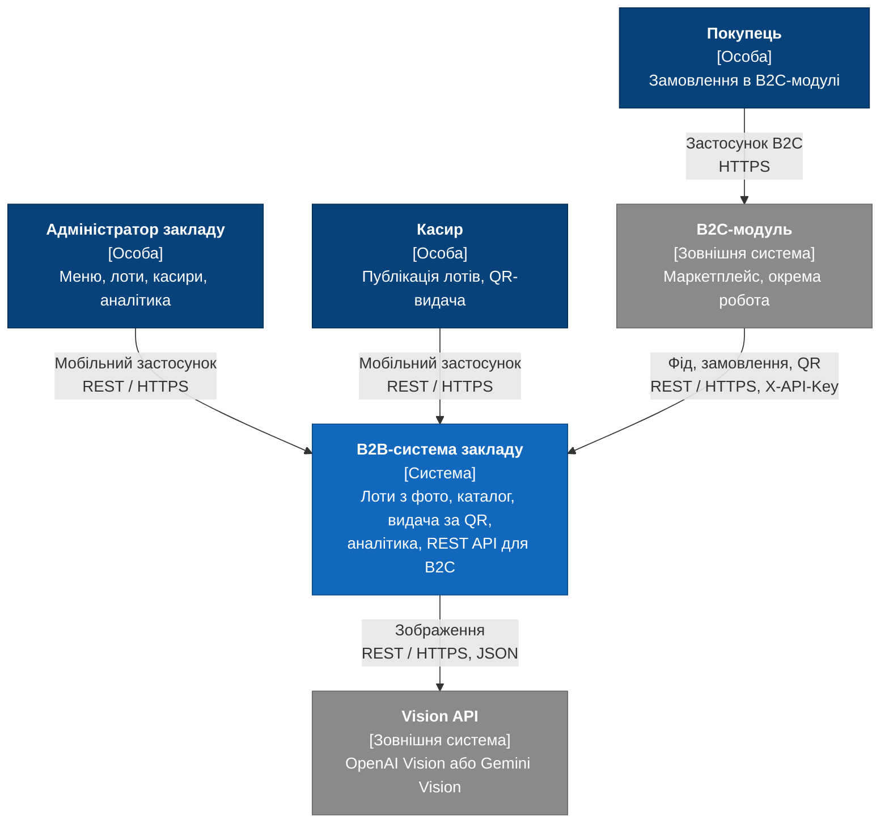
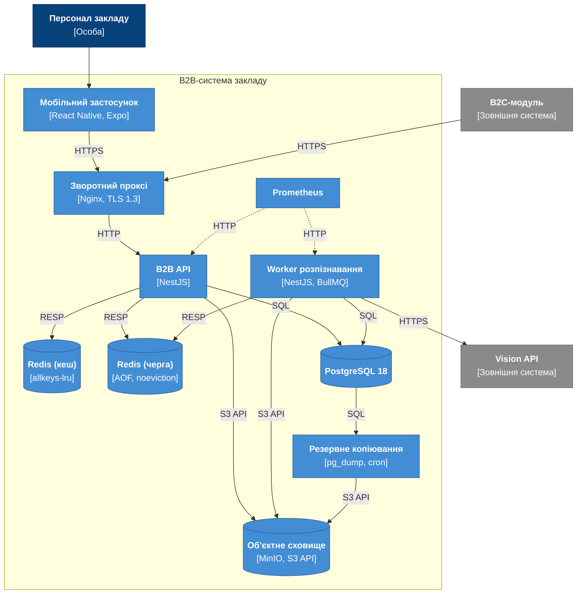
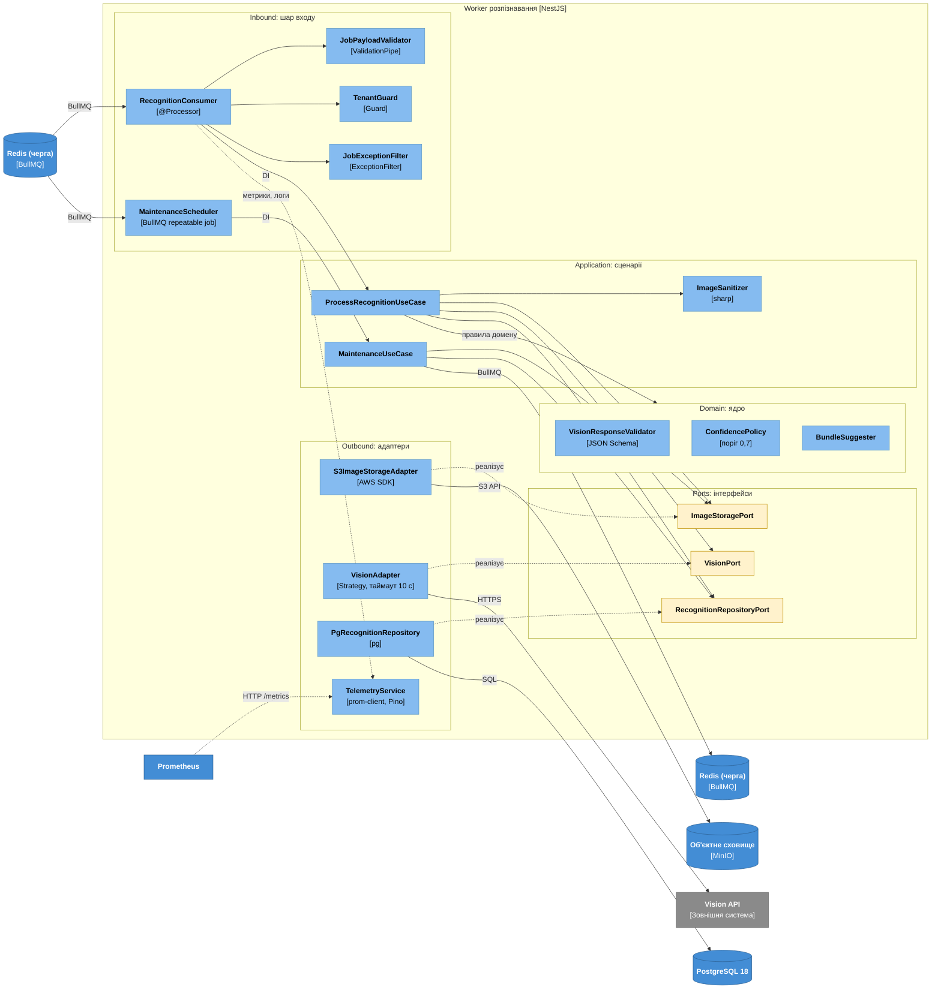
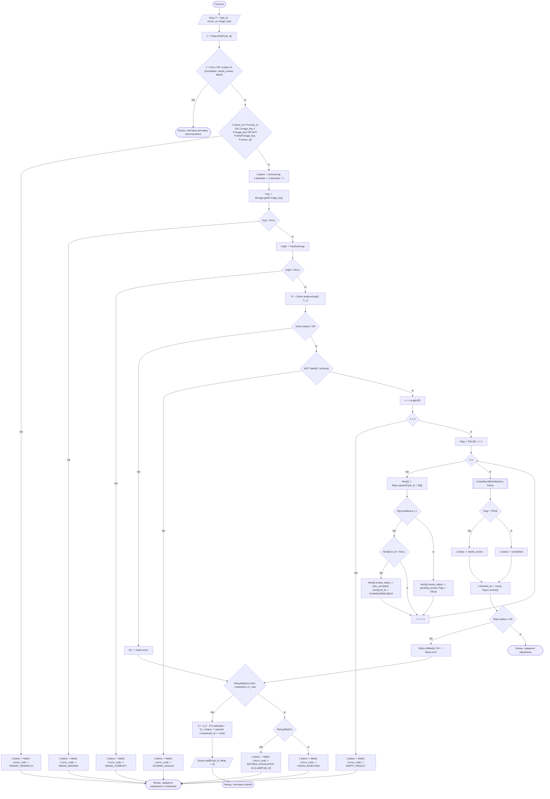
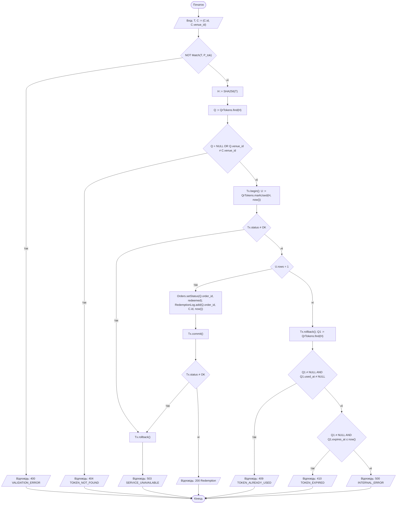
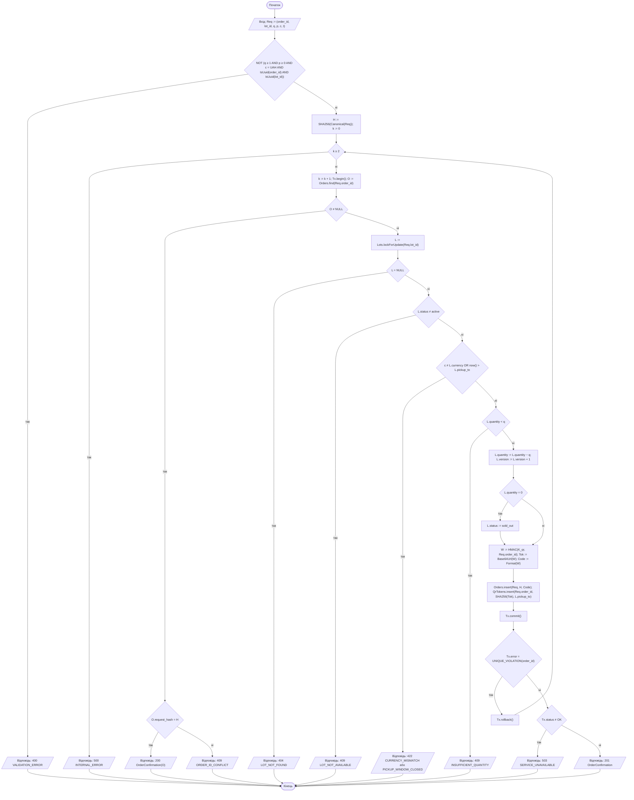
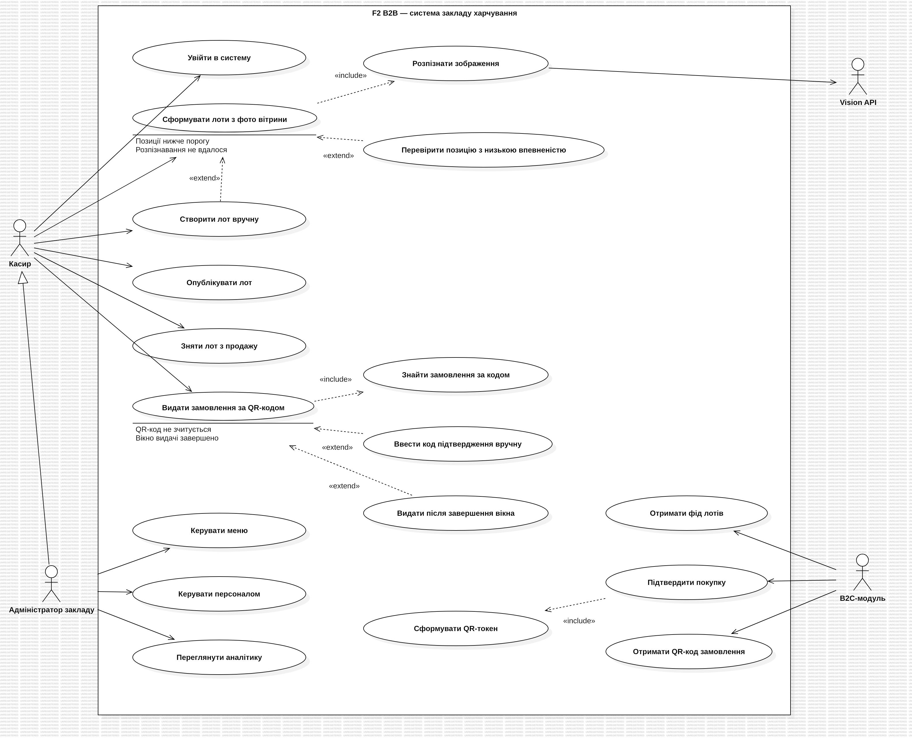
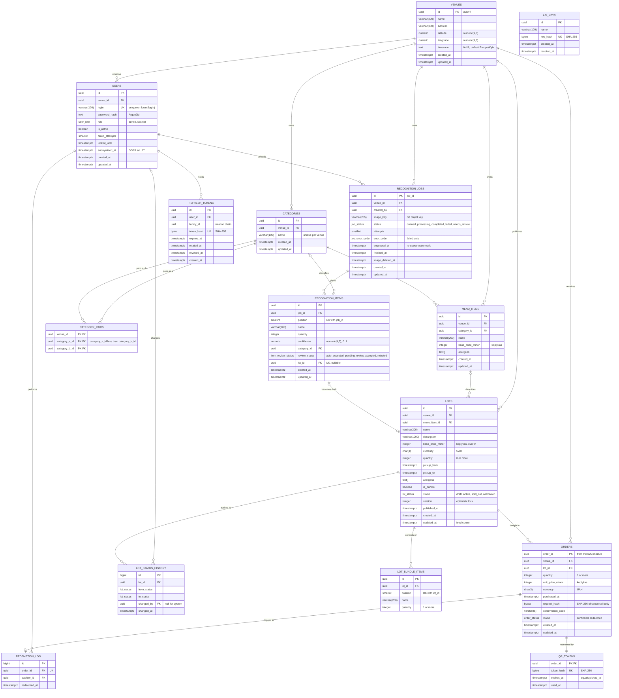

# РОЗДІЛ 2. ОБҐРУНТУВАННЯ АРХІТЕКТУРНИХ РІШЕНЬ ТА ПРОЄКТУВАННЯ СИСТЕМИ

Розділ обґрунтовує архітектурний стиль і патерни проєктування, містить модель C4 (рівні Context, Container, Component), опис серверного ядра та контуру безпеки, специфікацію контрактів API з топологією маршрутів і потоками даних, моделювання прецедентів, модель даних та інтеграційний аудит. Діаграми C4, ER-діаграму та блок-схеми виконано за принципом Diagrams-as-Code у Mermaid.js, діаграму прецедентів — у CASE-засобі StarUML. Вимоги, які реалізує архітектура, наведено в [SRS](./srs.md); обґрунтування вибору черги фонових задач — в [ADR-001](./adr/0001-choice-of-technology.md).

## 2.1 Обґрунтування архітектурного стилю та патернів проєктування

Підрозділ обґрунтовує макроструктуру системи та патерни коду, які далі деталізовано діаграмами C4 ([підрозділ 2.2](#22-контекстне-та-контейнерне-моделювання-системи-c4-model)) і компонентною моделлю ([підрозділ 2.3](#23-компонентне-моделювання-та-опис-серверного-ядра)). Кожне рішення зіставлено з вимогою [SRS](./srs.md) або з записом [ADR-001](./adr/0001-choice-of-technology.md); рішення без такої прив'язки до тексту не включено.

### 2.1.1 Вихідні обмеження

Вибір стилю визначають чотири групи обмежень.

1. Розгортання на одному вузлі однією командою `docker compose up` ([SRS-NFR-INFRA-01](./srs.md#srs-nfr-infra-01)); реплікація PostgreSQL і Redis не передбачена.
2. Цільове навантаження на Стенді: 500 RPS для ендпоінтів читання з p95 ≤ 200 мс ([SRS-NFR-PERF-01](./srs.md#srs-nfr-perf-01)), 100 RPS для ендпоінтів запису з p95 ≤ 500 мс ([SRS-NFR-PERF-02](./srs.md#srs-nfr-perf-02)), 20 одночасних завантажень зображень із відповіддю `202 Accepted` за p95 ≤ 1000 мс ([SRS-NFR-PERF-03](./srs.md#srs-nfr-perf-03)).
3. Транзакційні інваріанти: залишок лота не може стати від'ємним, а одне замовлення не може бути підтверджене або видане двічі ([SRS-FUN-22](./srs.md#srs-fun-22), [SRS-FUN-23](./srs.md#srs-fun-23), [SRS-FUN-27](./srs.md#srs-fun-27)).
4. Залежність від платного зовнішнього сервісу Vision API з таймаутом 10 с ([SRS-NFR-PERF-04](./srs.md#srs-nfr-perf-04)), недоступність якого не повинна блокувати ручну роботу з лотами ([SRS-NFR-REL-04](./srs.md#srs-nfr-rel-04)).

### 2.1.2 Макростиль: модульний моноліт з виділеним обробником черги

Серверну частину побудовано як модульний моноліт: один застосунок NestJS з однією кодовою базою та однією схемою PostgreSQL `b2b`, який запускається у двох процесах з різними точками входу. Процес B2B API обслуговує синхронні HTTP-запити, а процес Worker розпізнавання обробляє завдання черги BullMQ і завантажує модуль `recognition` разом із сервісами модулів `lots` і `catalog` без їхніх контролерів: чернетки лотів Worker створює через сервіс модуля-власника `lots`, а позиції меню й пари категорій для пропозиції набору читає через сервіс `catalog`. Обидва процеси збираються з одного образу Docker однієї версії, тому розбіжність версій коду між ними виключено на рівні розгортання.

Застосунок поділено на дев'ять модулів NestJS, кожен з яких відповідає окремій частині предметної області: `auth` (вхід і токени), `staff` (облікові записи персоналу), `catalog` (категорії, пари категорій, позиції меню), `recognition` (завдання й позиції розпізнавання), `lots` (лоти та їхні статуси), `orders` (підтвердження покупок і QR-коди для B2C-модуля), `redemption` (перегляд і погашення QR-коду), `analytics` (агрегати продажів) та `health`. Межі модулів забезпечують три механізми. По-перше, модуль експортує лише свій сервіс; контролери та репозиторії інших модулів недоступні для імпорту, що перевіряє правило лінтера `no-restricted-imports` у конвеєрі CI. По-друге, кожна таблиця має одного модуля-власника, який єдиний виконує в неї запис; інші модулі читають дані лише через сервіс власника. По-третє, міжмодульні виклики синхронні та внутрішньопроцесні, тому не потребують мережевого протоколу та розподілених транзакцій.

Альтернативою розглянуто мікросервісну архітектуру з окремою базою даних на сервіс. Її відхилено з інженерної причини: підтвердження замовлення змінює одночасно залишок лота (модуль `lots`) і створює замовлення з QR-токеном (модуль `orders`). У моноліті обидві зміни виконуються в одній транзакції PostgreSQL із блокуванням рядка лота `SELECT … FOR UPDATE`, що гарантує неможливість продажу останньої порції двічі. У мікросервісній архітектурі ця операція перетворюється на сагу з компенсаційними діями та проміжним станом eventual consistency, у якому залишок у B2C-фіді тимчасово розходиться з фактичним. Для системи, основна функція якої — продаж обмеженого залишку, такий проміжний стан є прямим ризиком продажу відсутнього товару.

Решту контейнерів рівня 2 обґрунтовано окремими вимогами: зворотний проксі Nginx є єдиною точкою входу, на якій завершується TLS 1.3 ([SRS-NFR-SEC-02](./srs.md#srs-nfr-sec-02)); об'єктне сховище MinIO з інтерфейсом S3 виключає зберігання зображень у PostgreSQL ([SRS-NFR-INFRA-02](./srs.md#srs-nfr-infra-02)); окреме завдання `pg_dump` виконує щодобове резервне копіювання ([SRS-NFR-REL-03](./srs.md#srs-nfr-rel-03)); Prometheus збирає метрики тривалості запитів, глибини черги та тривалості розпізнавання ([SRS-NFR-OBS-02](./srs.md#srs-nfr-obs-02)).

Модель роботи з Vision API визначає другий елемент стилю: асинхронну обробку команд через чергу завдань ([ADR-001](./adr/0001-choice-of-technology.md)). Це не подієво-керована архітектура: система не публікує доменних подій для довільних підписників, а ставить у чергу адресну команду «розпізнати зображення» з одним обробником. Синхронний шлях запиту (Nginx → B2B API → PostgreSQL або Redis) не містить жодного виклику зовнішньої системи, тому таймаут або збій Vision API не поширюється на інші запити й не вичерпує пул з'єднань API. Каскадний збій обмежено процесом Worker: при недоступності провайдера завдання переходять у повтори, а створення лотів вручну через `POST /v1/venue/lots` залишається доступним ([SRS-NFR-REL-04](./srs.md#srs-nfr-rel-04)).

Досягнення бюджету затримки p95 ≤ 200 мс для фіду лотів і аналітики забезпечують не внутрішньопроцесні виклики, а відсутність зовнішніх викликів у синхронному шляху, keyset-пагінація за покривними індексами `(updated_at, id)` ([підрозділ 2.7](#27-проєктування-та-документування-моделей-даних)) та кешування агрегатів аналітики в Redis на 300 с. Виконання бюджету підтверджується сценаріями k6 на Стенді, як визначено методами верифікації [SRS](./srs.md); до вимірювання це проєктна оцінка.

Масштабування на одному вузлі стосується лише Worker: кількість паралельних обробників BullMQ задається параметром `concurrency` без зміни коду, і вимога [SRS-NFR-SCAL-01](./srs.md#srs-nfr-scal-01) (не менше 3,5 пропускної здатності одного обробника при чотирьох обробниках) перевіряється з імітацією Vision API. Фактичну пропускну здатність обмежує ліміт запитів провайдера Vision, а не кількість обробників, тому збільшення `concurrency` понад ліміт провайдера лише збільшує частку відповідей `429`, які повторюються з експоненційною затримкою. Горизонтальне масштабування B2B API на кілька вузлів архітектура не виключає: стан сесій і лічильники обмеження частоти зберігаються в PostgreSQL і Redis, а не в пам'яті процесу. Для цільового навантаження воно не потрібне.

Результат асинхронного завдання клієнт отримує опитуванням `GET /v1/venue/recognition-jobs/{jobId}` з інтервалом 1,5 с до фінального статусу (`completed`, `needs_review` або `failed`). WebSocket або push-канал не застосовано. За нормальної роботи провайдера тривалість обробки обмежено 15 с ([SRS-NFR-PERF-04](./srs.md#srs-nfr-perf-04)), тобто близько 10 запитів опитування; у найгіршому випадку з трьома повторами (4 спроби по 10 с і затримки 2, 4, 8 с, разом близько 54 с) — близько 36 запитів. Обидва значення вкладаються в ліміт 100 запитів за хвилину на користувача ([SRS-NFR-SEC-03](./srs.md#srs-nfr-sec-03)) і не потребують окремого протоколу та контейнера.

### 2.1.3 Стиль усередині процесів

Усередині процесів застосовано два стилі, вибір між якими залежить від характеру залежностей. Модулі B2B API, які переважно виконують транзакційні операції над PostgreSQL, побудовано за багатошаровою схемою «контролер → сервіс → репозиторій»: контролер виконує автентифікацію, авторизацію та валідацію DTO, сервіс містить правила предметної області та межі транзакцій, репозиторій виконує параметризовані SQL-запити. Модуль розпізнавання в процесі Worker побудовано за гексагональною схемою з портами й адаптерами (п'ять шарів на рисунку 2.3), оскільки його сценарій залежить від трьох зовнішніх систем із недетермінованою поведінкою: Vision API, об'єктного сховища та черги. Ізоляція цих залежностей портами дозволяє перевіряти правила розпізнавання модульними тестами без мережі й замінювати провайдера без змін у сценарії.

### 2.1.4 Патерни мікрорівня

Перелік патернів, проблему зв'язності, яку кожен із них вирішує, та спосіб перевірки наведено в таблиці 2.1.

Таблиця 2.1 — Патерни коду та проблеми, які вони вирішують

| Патерн | Де застосовано | Проблема, яку вирішує | Перевірка |
| --- | --- | --- | --- |
| Dependency Injection | Усі модулі; контейнер NestJS | Сервіси не створюють залежностей самостійно, тому в тестах репозиторії та адаптери замінюються імітаціями без зміни коду сервісу | Модульні тести Jest з тестовими провайдерами |
| Repository | Модулі API; `PgRecognitionRepository` у Worker | Ізолює SQL від правил предметної області та робить ідентифікатор закладу обов'язковим аргументом кожного методу; використання цього аргументу в умові `WHERE` перевіряють інтеграційні тести, а складені зовнішні ключі `(venue_id, id)` не дозволяють зв'язати дані різних закладів на рівні СУБД | Інтеграційні тести на тестовій БД; тест на звернення до ресурсу іншого закладу |
| Ports and Adapters | Модуль розпізнавання (Worker) | Сценарій `ProcessRecognitionUseCase` залежить лише від інтерфейсів `VisionPort`, `ImageStoragePort`, `RecognitionRepositoryPort`, а не від SDK провайдерів | Тести сценарію з імітаціями портів |
| Strategy | `VisionAdapter` | Інкапсулює відмінності OpenAI Vision і Gemini Vision (формат запиту, промпт, нормалізація відповіді в єдину JSON-схему); провайдер обирається змінною середовища під час запуску, а не перемиканням під час роботи | Тест нормалізації відповіді кожного провайдера; калібрування порогу 0,7 на еталонній вибірці ([SRS-NFR-QUAL-01](./srs.md#srs-nfr-qual-01)) |
| Idempotent Consumer | Обробка завдання розпізнавання | Повторна доставка завдання (семантика «щонайменше одна обробка» BullMQ) не створює дублікатів чернеток: запис виконується за унікальним ключем `(job_id, position)`, а завдання у фінальному статусі не обробляється повторно | Тест повторної доставки ([SRS-NFR-REL-02](./srs.md#srs-nfr-rel-02)) |
| Pessimistic Locking | Підтвердження замовлення B2C-модулем | `SELECT … FOR UPDATE` для рядка лота серіалізує конкурентні покупки останньої порції в межах однієї транзакції | Конкурентний тест: N паралельних замовлень на залишок 1 дають рівно одне успішне |
| Optimistic Locking | Редагування лота персоналом | Поле `version` виявляє одночасні зміни лота двома працівниками без тривалого блокування рядка; конфлікт повертається як `409 VERSION_CONFLICT`. Підтвердження покупки також збільшує `version`, тому редагування за застарілою формою не перезапише залишок, уже зменшений продажем | Тест конфлікту версій |
| Conditional Atomic Update | Погашення QR-коду | Умовний `UPDATE … WHERE used_at IS NULL` разом з `UNIQUE (order_id)` у журналі видач виключає повторну видачу при одночасному скануванні | Конкурентний тест погашення |
| Cache-Aside | Аналітика | Агрегати продажів читаються з Redis (TTL 300 с), а при відсутності ключа обчислюються SQL-запитом; збій Redis-кешу знижує швидкодію, але не доступність | Тест роботи аналітики з вимкненим кешем |

Два патерни свідомо не застосовано. CQRS з окремою моделлю читання відхилено: аналітика будується SQL-агрегацією над таблицею `orders` закладу та кешується, а окрема модель читання з проєкціями потребувала б механізму синхронізації без вимоги в SRS. Transactional Outbox для узгодження запису статусу завдання в PostgreSQL і постановки в Redis відхилено на користь простішої компенсації з [ADR-001](./adr/0001-choice-of-technology.md): PostgreSQL є джерелом істини стану завдання, а періодичне завдання обслуговування повертає в чергу завдання зі статусом `queued`, старші за 5 хв ([SRS-NFR-REL-06](./srs.md#srs-nfr-rel-06)).

Область видимості Singleton є поведінкою NestJS за замовчуванням, а не окремим проєктним рішенням. Її наслідок враховано як обмеження: провайдери не зберігають у полях стану, пов'язаного із запитом або закладом. Ідентифікатор закладу передається аргументом із claims JWT (у B2B API) або з повідомлення черги після звірки із записом завдання в PostgreSQL (у Worker, [підрозділ 2.3](#23-компонентне-моделювання-та-опис-серверного-ядра)), тому спільний екземпляр сервісу не переносить даних одного закладу в запит іншого. Область видимості `REQUEST` не використовується, оскільки вона створює екземпляри провайдерів на кожен запит і збільшує затримку.

### 2.1.5 Ризики обраного стилю та їх компенсація

Таблиця 2.2 — Архітектурні ризики та компенсації

| Ризик | Наслідок | Компенсація | Вимоги |
| --- | --- | --- | --- |
| Єдиний вузол є єдиною точкою відмови | Під час відмови вузла застосунок персоналу показує «Немає зв'язку з сервером», а ендпоінти B2C-модуля недоступні | Перезапуск контейнерів політикою `restart: unless-stopped`; при пошкодженні даних за справного диска — відновлення з щодобової копії (RPO ≤ 24 год, RTO ≤ 1 год); B2C-модуль повторює `POST /v1/orders` з тим самим `order_id`, і ідемпотентність виключає подвійне списання залишку після відновлення | [SRS-NFR-REL-03](./srs.md#srs-nfr-rel-03), [SRS-FUN-23](./srs.md#srs-fun-23) |
| Резервна копія розташована на тому самому вузлі | Втрата диска знищує базу даних і копію | Ризик прийнято для навчального Стенда; для промислового розгортання потрібна копія поза вузлом (див. [підрозділ 2.8](#28-інтеграційний-аудит-та-висновок-про-готовність-архітектури-до-реалізації)) | [SRS-NFR-REL-03](./srs.md#srs-nfr-rel-03) |
| Неатомарний запис у PostgreSQL і Redis | Завдання зі статусом `queued` без запису в черзі | Повернення в чергу лише тих завдань `queued`, яких немає в черзі понад 5 хв; завдання, що законно чекають у черзі, повторно не ставляться | [SRS-NFR-REL-06](./srs.md#srs-nfr-rel-06) |
| Вичерпання пам'яті Redis черги (`noeviction`) | `POST /v1/venue/recognition-jobs` не може поставити завдання | Відповідь `503 SERVICE_UNAVAILABLE`; кеш винесено в окремий екземпляр Redis, тому тиск кешу не впливає на чергу | [SRS-NFR-REL-01](./srs.md#srs-nfr-rel-01) |
| Витрати на платний Vision API | Повтори та повторна доставка завислого завдання збільшують кількість платних викликів | Не більше 1 + 3 викликів на одне зображення; помилки валідації відповіді та пошкоджене зображення не повторюються; повторна доставка завислого завдання дає щонайбільше один додатковий виклик. Добова квота розпізнавань на заклад у SRS не визначена (залишкове зауваження в [підрозділі 2.8](#28-інтеграційний-аудит-та-висновок-про-готовність-архітектури-до-реалізації)) | [SRS-NFR-REL-01](./srs.md#srs-nfr-rel-01), [SRS-NFR-SEC-03](./srs.md#srs-nfr-sec-03) |
| Втрата лічильників обмеження частоти | Лічильники зберігаються в Redis кешу з політикою `allkeys-lru` і під тиском пам'яті можуть бути витіснені, тобто обмеження тимчасово не діє | Ризик прийнято: другий рівень обмеження частоти виконує Nginx (`limit_req`) у власній пам'яті; ключі лічильників мають TTL 60 с і займають мало пам'яті | [SRS-NFR-SEC-03](./srs.md#srs-nfr-sec-03) |
| Зміна схеми БД при двох процесах | Невідповідність схеми та коду | Обидва процеси оновлюються з одного образу; міграції виконуються до запуску нової версії й лише розширюють схему, а видалення стовпців виконується наступною міграцією | [SRS-NFR-INFRA-01](./srs.md#srs-nfr-infra-01) |

### 2.1.6 Журнал архітектурних рішень (ADR)

Значущі архітектурні рішення зафіксовано у форматі Architecture Decision Record за шаблоном Майкла Нігарда. Кожен запис складається з розділів Title, Status, Context, Alternatives, Decision і Consequences та зберігається в каталозі `docs/adr/` разом із кодом. Такий підхід зберігає обґрунтування рішення на момент його ухвалення й дозволяє відстежити, які вимоги до нього призвели. Перелік записів подано в таблиці 2.3.

Таблиця 2.3 — Журнал архітектурних рішень

| ID | Рішення | Статус |
| --- | --- | --- |
| [ADR-001](./adr/0001-choice-of-technology.md) | Вибір черги фонових задач для асинхронного розпізнавання зображень (BullMQ на Redis) | Approved |

Рішення ADR-001 стосується способу асинхронної обробки зображень. Синхронний виклик Vision API з HTTP-обробника суперечить вимозі [SRS-NFR-PERF-03](./srs.md#srs-nfr-perf-03) (відповідь 202 Accepted з p95 не більше 1000 мс) і за піку наприкінці зміни вичерпує пул з'єднань API. Розглянуто чотири альтернативи: RabbitMQ, Amazon SQS, Apache Kafka та BullMQ на Redis. RabbitMQ потребує окремого брокера, плагіна або ланцюжка черг із TTL для відкладених повторів і власної таблиці статусів завдань. Amazon SQS пов'язує систему з хмарним провайдером, що суперечить розгортанню на одному вузлі. Apache Kafka реалізує модель журналу подій без підтвердження й повтору окремого повідомлення, а експлуатація кластера непропорційна навантаженню.

Обрано BullMQ на окремому екземплярі Redis із персистентністю AOF і політикою `noeviction`. Рішення відповідає вимозі [SRS-NFR-REL-01](./srs.md#srs-nfr-rel-01) без власного коду, надає стан завдання як частину API ([SRS-FUN-04](./srs.md#srs-fun-04)), не додає нового протоколу до стеку й допускає підключення до чотирьох обробників ([SRS-NFR-SCAL-01](./srs.md#srs-nfr-scal-01)). До негативних наслідків віднесено вікно втрати записів черги до 1 с за `appendfsync everysec`, семантику доставки «щонайменше одна обробка», неатомарність запису статусу в PostgreSQL і постановки в Redis, а також єдиний екземпляр Redis без реплікації. Їх компенсовано збереженням стану завдань у PostgreSQL як джерела істини, ідемпотентною обробкою за `job_id` і періодичним поверненням застряглих завдань у чергу. Повний текст записано у файлі [ADR-001](./adr/0001-choice-of-technology.md).

### Підсумок підрозділу 2.1

Обрано модульний моноліт NestJS із дев'ятьма модулями та виділеним процесом Worker для асинхронної обробки команд розпізнавання. Головний аргумент вибору — можливість виконати підтвердження замовлення однією транзакцією PostgreSQL із блокуванням рядка лота, що виключає продаж останньої порції двічі без саги. Синхронний шлях запиту не містить викликів зовнішніх систем, тому збій Vision API обмежено процесом Worker. Для коду визначено дев'ять патернів із конкретною проблемою зв'язності та способом перевірки кожного; CQRS і Transactional Outbox відхилено з обґрунтуванням. Ризики стилю, зокрема єдиний вузол і розміщення резервної копії, зафіксовано разом із компенсаціями.

## 2.2 Контекстне та контейнерне моделювання системи (C4 Model)

Контекстне та контейнерне моделювання виконано за методологією C4, яка передбачає послідовну деталізацію системи: від її зовнішнього оточення до окремо розгортаних контейнерів. Діаграми описано мовою Mermaid і зберігаються в репозиторії разом із текстовою документацією (Diagrams-as-Code), тому зміни архітектури версіонуються так само, як зміни коду. Елементи позначено за нотацією C4: темно-синім кольором — особи, синім — система та контейнери, сірим — зовнішні системи, світло-синім — компоненти, жовтим — порти (інтерфейси); пунктирна лінія позначає зв'язок, що не є прямим викликом (збір метрик, реалізація інтерфейсу). Вимоги, які реалізує архітектура, наведено в [SRS](./srs.md); кожен елемент діаграм зіставлено з ідентифікаторами цих вимог.

### 2.2.1 Рівень 1. System Context

На першому рівні B2B-система розглядається як єдиний об'єкт без внутрішньої структури. Визначено три групи користувачів. Адміністратор закладу керує меню, лотами та обліковими записами касирів і переглядає фінансову аналітику. Касир публікує лоти, скануює QR-код і підтверджує видачу замовлення. Покупець оформлює замовлення в B2C-модулі та взаємодіє з B2B-системою лише опосередковано, через пред'явлення QR-коду. Зовнішніми системами є B2C-модуль, який розробляється як окрема робота, та Vision API (OpenAI Vision або Google Gemini Vision), що виконує розпізнавання товарів на зображеннях. Склад учасників і їхніх ролей подано в таблиці 2.4.

B2C-модуль взаємодіє з B2B-системою за моделлю pull: самостійно забирає фід лотів і викликає ендпоінти створення замовлення та запиту QR-коду за REST-контрактом OpenAPI 3.1 з автентифікацією заголовком `X-API-Key`. Протоколи всіх зв'язків першого рівня наведено в таблиці 2.5, діаграму — на рисунку 2.1.

Рисунок 2.1 — Діаграма System Context (рівень 1 моделі C4)

Таблиця 2.4 — Учасники діаграми рівня 1

| Учасник | Тип | Опис |
| --- | --- | --- |
| Адміністратор закладу | Person | Керує меню, лотами та обліковими записами касирів, переглядає аналітику ([SRS-FUN-12](./srs.md#srs-fun-12), [SRS-FUN-13](./srs.md#srs-fun-13), [SRS-FUN-14](./srs.md#srs-fun-14), [SRS-FUN-15](./srs.md#srs-fun-15), [SRS-FUN-16](./srs.md#srs-fun-16), [SRS-FUN-17](./srs.md#srs-fun-17), [SRS-FUN-18](./srs.md#srs-fun-18), [SRS-FUN-19](./srs.md#srs-fun-19), [SRS-FUN-20](./srs.md#srs-fun-20), [SRS-FUN-21](./srs.md#srs-fun-21), [SRS-FUN-29](./srs.md#srs-fun-29), [SRS-FUN-30](./srs.md#srs-fun-30)) |
| Касир | Person | Публікує лоти, скануює QR-код і підтверджує видачу ([SRS-FUN-15](./srs.md#srs-fun-15), [SRS-FUN-25](./srs.md#srs-fun-25), [SRS-FUN-26](./srs.md#srs-fun-26), [SRS-FUN-27](./srs.md#srs-fun-27), [SRS-FUN-28](./srs.md#srs-fun-28)) |
| Покупець | Person | Оформлює замовлення в B2C-модулі; взаємодіє з B2B-системою лише опосередковано, через B2C-модуль |
| B2B-система закладу | System | Предмет проєктування: формування лотів із фото, каталог, видача за QR, аналітика, REST API для B2C-модуля |
| B2C-модуль | System_Ext | Незалежна система маркетплейсу (ціноутворення, бронювання, оплата) |
| Vision API | System_Ext | Зовнішній сервіс розпізнавання зображень (OpenAI Vision або Google Gemini Vision) |

Таблиця 2.5 — Зв'язки діаграми рівня 1

| Зв'язок | Протокол | Вимоги |
| --- | --- | --- |
| Адміністратор, Касир → B2B-система | Мобільний застосунок, REST / HTTPS | [SRS-FUN-17](./srs.md#srs-fun-17), [SRS-FUN-18](./srs.md#srs-fun-18), [SRS-FUN-19](./srs.md#srs-fun-19), [SRS-FUN-20](./srs.md#srs-fun-20), [SRS-FUN-21](./srs.md#srs-fun-21) |
| B2C-модуль → B2B-система | REST / HTTPS, JSON, заголовок `X-API-Key` (контракт [`b2c-contract.yaml`](../contracts/b2c-contract.yaml)) | [SRS-FUN-22](./srs.md#srs-fun-22), [SRS-FUN-23](./srs.md#srs-fun-23), [SRS-FUN-24](./srs.md#srs-fun-24), [SRS-FUN-32](./srs.md#srs-fun-32), [SRS-FUN-33](./srs.md#srs-fun-33), [SRS-FUN-34](./srs.md#srs-fun-34), [SRS-FUN-35](./srs.md#srs-fun-35) |
| B2B-система → Vision API | REST / HTTPS, JSON | [SRS-FUN-06](./srs.md#srs-fun-06) |
| Покупець → B2C-модуль | Мобільний застосунок B2C, HTTPS | Поза межами системи |

### 2.2.2 Рівень 2. Container Diagram

На другому рівні систему розкладено на контейнери, кожен із яких розгортається як окремий процес або образ Docker. Клієнтську частину становить мобільний застосунок на React Native (Expo). Єдиною точкою входу для застосунку й B2C-модуля є зворотний проксі Nginx, на якому завершується TLS 1.3. Серверна частина складається з двох застосунків NestJS: B2B API, що обробляє синхронні запити, та Worker розпізнавання, що виконує фонові завдання з черги BullMQ. Дані зберігаються в PostgreSQL 18, зображення — в об'єктному сховищі MinIO з інтерфейсом S3. Метрики збирає Prometheus, щодобове резервне копіювання бази даних виконує окреме завдання `pg_dump`. Призначення контейнерів і їхній зв'язок з вимогами подано в таблиці 2.6, протоколи взаємодії — у таблиці 2.7, діаграму — на рисунку 2.2.

Рисунок 2.2 — Діаграма Container (рівень 2 моделі C4)

Таблиця 2.6 — Контейнери системи

| Контейнер | Технологія | Призначення | Вимоги |
| --- | --- | --- | --- |
| Мобільний застосунок | React Native (Expo), TypeScript | Клієнт персоналу: фото, чернетки лотів, каталог, QR-сканер, аналітика | [SRS-NFR-TEST-02](./srs.md#srs-nfr-test-02) |
| Зворотний проксі | Nginx | Завершення TLS 1.3, єдина точка входу для застосунку й B2C-модуля | [SRS-NFR-SEC-02](./srs.md#srs-nfr-sec-02) |
| B2B API | NestJS, TypeScript | Автентифікація, каталог, замовлення, аналітика, фід лотів, приймання зображень, постановка завдань у чергу | [SRS-FUN-01](./srs.md#srs-fun-01), [SRS-FUN-02](./srs.md#srs-fun-02), [SRS-FUN-03](./srs.md#srs-fun-03), [SRS-FUN-04](./srs.md#srs-fun-04), [SRS-FUN-09](./srs.md#srs-fun-09), [SRS-FUN-12](./srs.md#srs-fun-12), [SRS-FUN-13](./srs.md#srs-fun-13), [SRS-FUN-14](./srs.md#srs-fun-14), [SRS-FUN-15](./srs.md#srs-fun-15), [SRS-FUN-16](./srs.md#srs-fun-16), [SRS-FUN-17](./srs.md#srs-fun-17), [SRS-FUN-18](./srs.md#srs-fun-18), [SRS-FUN-19](./srs.md#srs-fun-19), [SRS-FUN-20](./srs.md#srs-fun-20), [SRS-FUN-21](./srs.md#srs-fun-21), [SRS-FUN-22](./srs.md#srs-fun-22), [SRS-FUN-23](./srs.md#srs-fun-23), [SRS-FUN-24](./srs.md#srs-fun-24), [SRS-FUN-25](./srs.md#srs-fun-25), [SRS-FUN-26](./srs.md#srs-fun-26), [SRS-FUN-27](./srs.md#srs-fun-27), [SRS-FUN-28](./srs.md#srs-fun-28), [SRS-FUN-29](./srs.md#srs-fun-29), [SRS-FUN-30](./srs.md#srs-fun-30), [SRS-FUN-31](./srs.md#srs-fun-31), [SRS-FUN-32](./srs.md#srs-fun-32), [SRS-FUN-33](./srs.md#srs-fun-33), [SRS-FUN-34](./srs.md#srs-fun-34), [SRS-FUN-35](./srs.md#srs-fun-35), [SRS-FUN-36](./srs.md#srs-fun-36), [SRS-NFR-SEC-01](./srs.md#srs-nfr-sec-01), [SRS-NFR-SEC-03](./srs.md#srs-nfr-sec-03), [SRS-NFR-SEC-05](./srs.md#srs-nfr-sec-05), [SRS-NFR-PERF-01](./srs.md#srs-nfr-perf-01), [SRS-NFR-PERF-02](./srs.md#srs-nfr-perf-02), [SRS-NFR-PERF-03](./srs.md#srs-nfr-perf-03), [SRS-NFR-OBS-01](./srs.md#srs-nfr-obs-01) |
| Worker розпізнавання | NestJS, BullMQ | Обробка завдань розпізнавання, формування чернеток лотів і бандлів, обслуговування (очищення зображень, повернення застряглих завдань) | [SRS-FUN-05](./srs.md#srs-fun-05), [SRS-FUN-06](./srs.md#srs-fun-06), [SRS-FUN-07](./srs.md#srs-fun-07), [SRS-FUN-08](./srs.md#srs-fun-08), [SRS-FUN-10](./srs.md#srs-fun-10), [SRS-FUN-11](./srs.md#srs-fun-11), [SRS-NFR-PERF-04](./srs.md#srs-nfr-perf-04), [SRS-NFR-QUAL-01](./srs.md#srs-nfr-qual-01), [SRS-NFR-SCAL-01](./srs.md#srs-nfr-scal-01), [SRS-NFR-REL-01](./srs.md#srs-nfr-rel-01), [SRS-NFR-REL-02](./srs.md#srs-nfr-rel-02), [SRS-NFR-REL-04](./srs.md#srs-nfr-rel-04), [SRS-NFR-REL-06](./srs.md#srs-nfr-rel-06), [SRS-NFR-COMP-01](./srs.md#srs-nfr-comp-01) |
| PostgreSQL | PostgreSQL 18 | Лоти, меню, замовлення, користувачі, журнал видач, статус завдань | [SRS-FUN-28](./srs.md#srs-fun-28), [SRS-NFR-COMP-02](./srs.md#srs-nfr-comp-02), [SRS-NFR-REL-03](./srs.md#srs-nfr-rel-03) |
| Redis (черга) | Redis 8, AOF, `noeviction` | Черга BullMQ і dead-letter | [SRS-FUN-03](./srs.md#srs-fun-03), [SRS-NFR-REL-01](./srs.md#srs-nfr-rel-01); [ADR-001](./adr/0001-choice-of-technology.md) |
| Redis (кеш) | Redis 8, `allkeys-lru` | Кеш аналітики, лічильники rate limiting | [SRS-FUN-31](./srs.md#srs-fun-31), [SRS-NFR-SEC-03](./srs.md#srs-nfr-sec-03) |
| Об'єктне сховище | MinIO (S3 API) | Зображення, резервні копії | [SRS-NFR-INFRA-02](./srs.md#srs-nfr-infra-02), [SRS-NFR-COMP-01](./srs.md#srs-nfr-comp-01) |
| Prometheus | Prometheus | Збір метрик API і Worker | [SRS-NFR-OBS-02](./srs.md#srs-nfr-obs-02) |
| Резервне копіювання | pg_dump, cron | Щодобова резервна копія PostgreSQL | [SRS-NFR-REL-03](./srs.md#srs-nfr-rel-03) |

Таблиця 2.7 — Зв'язки між контейнерами

| Від → до | Протокол | Призначення |
| --- | --- | --- |
| Мобільний застосунок → Зворотний проксі | REST / HTTPS (TLS 1.3), JSON | Запити API |
| B2C-модуль → Зворотний проксі | REST / HTTPS (TLS 1.3), `X-API-Key` | Фід лотів, підтвердження покупок, QR-код |
| Зворотний проксі → B2B API | HTTP/1.1 | Проксіювання у внутрішній мережі |
| B2B API → Redis (кеш) | RESP / TCP | Кеш аналітики, лічильники запитів |
| B2B API → Redis (черга) | RESP / TCP | Постановка завдань розпізнавання |
| B2B API → PostgreSQL | SQL / TCP | Каталог, замовлення, користувачі |
| B2B API → Об'єктне сховище | S3 API / HTTP | Збереження завантаженого зображення |
| Worker → Redis (черга) | RESP / TCP | Отримання завдань, оновлення стану |
| Worker → PostgreSQL | SQL / TCP | Чернетки лотів, статус завдання |
| Worker → Об'єктне сховище | S3 API / HTTP | Читання та видалення зображень |
| Worker → Vision API | REST / HTTPS, JSON | Розпізнавання |
| Prometheus → B2B API, Worker | HTTP (`/metrics`) | Збір метрик |
| Резервне копіювання → PostgreSQL | SQL / TCP (`pg_dump`) | Дамп БД |
| Резервне копіювання → Об'єктне сховище | S3 API / HTTP | Архів дампу |

Для рівня 2 ухвалено такі архітектурні рішення.

Черга й кеш розміщено на двох окремих екземплярах Redis. Черга BullMQ потребує політики `noeviction` і персистентності AOF, а кеш аналітики — політики `allkeys-lru`. За спільної політики витіснення тиск пам'яті від кешу міг би призвести до втрати ключів черги, що суперечить вимозі відмовостійкості [SRS-NFR-REL-01](./srs.md#srs-nfr-rel-01). Вибір BullMQ як брокера черги обґрунтовано в [ADR-001](./adr/0001-choice-of-technology.md).

Автентифікацію персоналу виконує модуль у складі B2B API на основі JWT ([SRS-FUN-17](./srs.md#srs-fun-17), [SRS-NFR-SEC-01](./srs.md#srs-nfr-sec-01)). Окремий Identity Provider не застосовується, оскільки він додав би контейнер і операційну складність без відповідної вимоги в [SRS](./srs.md).

Реплікація PostgreSQL і Redis не передбачена, оскільки розгортання виконується на одному вузлі (розділ «System Context» у [SRS](./srs.md)).

### Підсумок підрозділу 2.2

Побудовано діаграми рівнів 1 і 2 моделі C4: виокремлено 3 групи користувачів, 2 зовнішні системи та 10 контейнерів, а для кожного зв'язку вказано протокол. Усі контейнери зіставлено з вимогами [SRS](./srs.md), що забезпечує трасування від вимоги до елемента архітектури.

## 2.3 Компонентне моделювання та опис серверного ядра

### 2.3.1 Діаграма компонентів контейнера Worker розпізнавання

Для компонентної декомпозиції обрано контейнер Worker розпізнавання. Саме він виконує найскладнішу обробку в системі: взаємодіє із зовнішнім Vision API, перевіряє недетермінований результат розпізнавання, забезпечує ідемпотентність обробки, повтори та узгодження станів між PostgreSQL і Redis. Помилка в цьому контейнері безпосередньо впливає на головну функцію системи, формування лотів із фотографій, тому його внутрішню структуру деталізовано до рівня компонентів.

Структуру побудовано за принципами чистої архітектури з п'ятьма шарами: Inbound (вхід), Application (сценарії), Domain (ядро), Ports (інтерфейси) та Outbound (адаптери й наскрізні сервіси). Залежності спрямовані до ядра: Inbound викликає Application, Application залежить лише від Domain і Ports, а адаптери шару Outbound реалізують порти за принципом Dependency Inversion та підключаються через Dependency Injection фреймворку NestJS. Завдяки цьому сценарії `ProcessRecognitionUseCase` і `MaintenanceUseCase` не імпортують класи адаптерів, а ядро можна перевіряти модульними тестами без мережі. Склад компонентів, їхню роль і зв'язок з вимогами подано в таблиці 2.8, діаграму — на рисунку 2.3. Черга Redis зображена двічі (на вході та на виході `MaintenanceUseCase`) лише для уникнення перетину ліній; це один і той самий контейнер. Виклики `ProcessRecognitionUseCase` до компонентів домену показано одним зв'язком із шаром Domain.

Рисунок 2.3 — Діаграма Component для контейнера Worker розпізнавання (рівень 3 моделі C4)

Таблиця 2.8 — Компоненти контейнера Worker розпізнавання

| Шар | Компонент | Роль | Вимоги |
| --- | --- | --- | --- |
| Inbound | `RecognitionConsumer` | Приймає завдання з черги BullMQ; точка входу шару | [SRS-FUN-03](./srs.md#srs-fun-03) |
| Inbound | `JobPayloadValidator` | Валідація структури завдання (DTO, `class-validator`, `ValidationPipe`) | [SRS-FUN-01](./srs.md#srs-fun-01) |
| Inbound | `TenantGuard` | Перевіряє, що ключ зображення належить закладу, зазначеному в завданні | [SRS-FUN-21](./srs.md#srs-fun-21) |
| Inbound | `MaintenanceScheduler` | Періодичне завдання BullMQ: запускає обслуговування | [SRS-NFR-COMP-01](./srs.md#srs-nfr-comp-01), [SRS-NFR-REL-06](./srs.md#srs-nfr-rel-06) |
| Inbound | `JobExceptionFilter` | Глобальний обробник винятків: розрізняє помилки, що повторюються (мережа, 5xx, 429), і ті, що не повторюються (невалідна схема, пошкоджене зображення) | [SRS-NFR-REL-01](./srs.md#srs-nfr-rel-01) |
| Application | `ProcessRecognitionUseCase` | Оркеструє обробку одного завдання; залежить лише від портів і доменних компонентів | [SRS-FUN-03](./srs.md#srs-fun-03), [SRS-FUN-04](./srs.md#srs-fun-04), [SRS-FUN-05](./srs.md#srs-fun-05), [SRS-FUN-06](./srs.md#srs-fun-06), [SRS-FUN-07](./srs.md#srs-fun-07), [SRS-FUN-08](./srs.md#srs-fun-08), [SRS-NFR-REL-02](./srs.md#srs-nfr-rel-02) |
| Application | `MaintenanceUseCase` | Видаляє зображення за строком; повертає в чергу завдання зі статусом `queued` старші за 5 хв | [SRS-NFR-COMP-01](./srs.md#srs-nfr-comp-01), [SRS-NFR-REL-06](./srs.md#srs-nfr-rel-06) |
| Application | `ImageSanitizer` | Видаляє EXIF-метадані перед передаванням провайдеру | [SRS-FUN-05](./srs.md#srs-fun-05) |
| Domain | `VisionResponseValidator` | Перевіряє відповідь Vision API за JSON-схемою | [SRS-FUN-06](./srs.md#srs-fun-06) |
| Domain | `ConfidencePolicy` | Поріг достовірності 0,7; рішення про `needs_review` | [SRS-FUN-07](./srs.md#srs-fun-07), [SRS-FUN-08](./srs.md#srs-fun-08) |
| Domain | `BundleSuggester` | Формує смарт-бандли за довідником сумісних категорій | [SRS-FUN-10](./srs.md#srs-fun-10), [SRS-FUN-11](./srs.md#srs-fun-11) |
| Port | `VisionPort`, `ImageStoragePort`, `RecognitionRepositoryPort` | Інтерфейси залежностей ядра | Dependency Inversion |
| Outbound | `VisionAdapter` | Стратегія OpenAI або Gemini; таймаут виклику 10 с | [SRS-NFR-PERF-04](./srs.md#srs-nfr-perf-04) |
| Outbound | `S3ImageStorageAdapter` | Читання й видалення зображень | [SRS-NFR-INFRA-02](./srs.md#srs-nfr-infra-02), [SRS-NFR-COMP-01](./srs.md#srs-nfr-comp-01) |
| Outbound | `PgRecognitionRepository` | Транзакційний запис чернеток і статусу; унікальний ключ `job_id` забезпечує ідемпотентність | [SRS-NFR-REL-02](./srs.md#srs-nfr-rel-02) |
| Cross-cutting | `TelemetryService` | Метрики Prometheus і структуровані логи з кореляційним ідентифікатором | [SRS-NFR-OBS-01](./srs.md#srs-nfr-obs-01), [SRS-NFR-OBS-02](./srs.md#srs-nfr-obs-02) |

Основний сценарій обробки такий. `RecognitionConsumer` приймає завдання з черги BullMQ, `JobPayloadValidator` перевіряє його структуру, а `TenantGuard` підтверджує, що ключ зображення належить закладу, зазначеному в завданні. Далі `ProcessRecognitionUseCase` читає зображення через `ImageStoragePort`, видаляє EXIF-метадані компонентом `ImageSanitizer`, передає зображення в `VisionPort`, перевіряє відповідь за JSON-схемою (`VisionResponseValidator`), застосовує поріг достовірності 0,7 (`ConfidencePolicy`), формує смарт-бандли (`BundleSuggester`) і зберігає результат через `RecognitionRepositoryPort`. Помилки класифікує `JobExceptionFilter`: збої мережі, відповіді 5xx і 429 повторюються, а невалідна схема та пошкоджене зображення завершують завдання без повторів.

Обслуговування виконує `MaintenanceScheduler`: періодичне завдання BullMQ запускає `MaintenanceUseCase`, який видаляє зображення за строком зберігання та повертає в чергу завдання зі статусом `queued`, старші за 5 хв. Це усуває розбіжність між PostgreSQL і Redis, що виникає при збої між записом статусу та постановкою завдання в чергу ([SRS-NFR-REL-06](./srs.md#srs-nfr-rel-06)).

Застосовано такі патерни. Вибір провайдера розпізнавання (OpenAI або Gemini) реалізовано шаблоном Strategy у `VisionAdapter`, що не змінює ядро. Репозиторій доступний лише через `RecognitionRepositoryPort`, а `RecognitionConsumer` не звертається до сховищ напряму. Ідемпотентність забезпечує унікальний ключ `job_id` у `PgRecognitionRepository` ([SRS-NFR-REL-02](./srs.md#srs-nfr-rel-02)).

Межу довіри визначено так. Перевірку JWT і RBAC виконує контейнер B2B API ([SRS-FUN-17](./srs.md#srs-fun-17), [SRS-FUN-20](./srs.md#srs-fun-20)) до постановки завдання в чергу, а Worker не приймає запитів клієнтів. На рівні Worker захист забезпечують `TenantGuard`, валідація вхідних даних, автентифікація Redis (ACL) і мережева ізоляція контейнерів. Повторні спроби з експоненційною затримкою та dead-letter налаштовано на рівні черги BullMQ ([SRS-NFR-REL-01](./srs.md#srs-nfr-rel-01), [ADR-001](./adr/0001-choice-of-technology.md)).

### 2.3.2 Опис серверного ядра: шлях даних через рівні

Серверне ядро розглядається у трьох рівнях потоку даних: Inbound (прийом і перевірка запиту), Core (сценарії та правила предметної області) та Outbound (доступ до сховищ і зовнішніх систем). Для Worker ці рівні відповідають п'яти шарам рисунка 2.3: рівню Inbound — шар Inbound, рівню Core — шари Application і Domain, рівню Outbound — шари Ports та Outbound. Порти належать ядру як інтерфейси, а їхні реалізації — рівню Outbound. Відповідність рівнів і компонентів обох процесів наведено в таблиці 2.9.

Таблиця 2.9 — Рівні серверного ядра B2B API та Worker

| Рівень | B2B API | Worker розпізнавання | Інваріант рівня |
| --- | --- | --- | --- |
| Inbound | Контролери модулів; глобальні `JwtAuthGuard`, `RolesGuard`, `ApiKeyGuard`, `ThrottlerGuard`; глобальний `ValidationPipe`; `AllExceptionsFilter`; проміжний обробник `CorrelationIdMiddleware` | `RecognitionConsumer`, `JobPayloadValidator`, `TenantGuard`, `JobExceptionFilter`, `MaintenanceScheduler` | До рівня Core потрапляють лише автентифіковані запити з валідованим DTO та ідентифікатором закладу, отриманим із JWT або API-ключа, а не з тіла чи шляху запиту |
| Core | Сервіси модулів (`LotsService`, `OrdersService`, `RedemptionService` тощо) | `ProcessRecognitionUseCase`, `MaintenanceUseCase`, `ImageSanitizer`, `VisionResponseValidator`, `ConfidencePolicy`, `BundleSuggester` | Правила предметної області та межі транзакцій; рівень не імпортує драйверів СУБД і SDK зовнішніх систем |
| Outbound | Репозиторії модулів (драйвер `pg`, параметризовані запити), `S3ImageStorageAdapter`, `RecognitionQueueProducer` (BullMQ) | `PgRecognitionRepository`, `S3ImageStorageAdapter`, `VisionAdapter`, `TelemetryService` | Кожен метод доступу до даних закладу приймає `venue_id` обов'язковим аргументом і додає його до умови `WHERE` |

Шлях синхронного запиту B2B API розглянуто на прикладі підтвердження видачі `POST /v1/venue/redemptions`. На рівні Inbound `CorrelationIdMiddleware` присвоює запиту кореляційний ідентифікатор, `JwtAuthGuard` перевіряє підпис RS256 і строк дії access-токена, `ThrottlerGuard` перевіряє ліміт запитів за ідентифікатором уже автентифікованого користувача (для анонімних маршрутів — за IP-адресою), а `RolesGuard` — роль `admin` або `cashier`. Глобальний `ValidationPipe` перетворює тіло на DTO `RedemptionRequest` і відхиляє запит із зайвими полями. Контролер передає в сервіс DTO разом з `venue_id` та `user_id` з claims токена. На рівні Core `RedemptionService` відкриває транзакцію, викликає репозиторій для атомарного погашення токена та запису в журнал видач і фіксує транзакцію. На рівні Outbound репозиторій виконує умовний `UPDATE qr_tokens … WHERE token_hash = $1 AND used_at IS NULL AND expires_at > now()` з обмеженням за закладом через зв'язок із замовленням. Виняток будь-якого рівня перетворює `AllExceptionsFilter` на відповідь у форматі `Error` без стеку викликів і тексту помилки СУБД.

Шлях асинхронного завдання проходить ті самі рівні, але точкою входу є черга, а не HTTP. Механізми Guard, Pipe і ExceptionFilter фреймворку NestJS застосовуються лише до HTTP-обробників і не викликаються автоматично для обробника `@Processor` BullMQ. Тому компоненти `JobPayloadValidator`, `TenantGuard` і `JobExceptionFilter` на рисунку 2.3 є звичайними класами, які `RecognitionConsumer` викликає явно в методі обробки завдання в такому порядку: валідація повідомлення черги за схемою (таблиця 2.20) → перевірка закладу → виклик сценарію → класифікація винятку. Позначки `[ValidationPipe]`, `[Guard]` і `[ExceptionFilter]` на діаграмі вказують роль компонента, а не механізм фреймворку.

`TenantGuard` не перевіряє ідентичність користувача, оскільки повідомлення черги не містить JWT. Він перевіряє узгодженість трьох джерел: `venue_id` з повідомлення, `venue_id` у записі `recognition_jobs` з первинним ключем `job_id` та префікс ключа зображення `venues/{venue_id}/jobs/{job_id}.jpg`. Запис у `recognition_jobs` створює лише B2B API після автентифікації касира, тому повідомлення з підробленим `venue_id` або ключем зображення іншого закладу не проходить перевірку й завершується статусом `failed` з кодом `TENANT_MISMATCH` без виклику Vision API. Записати повідомлення в чергу в обхід B2B API може лише клієнт, автентифікований у Redis черги за обліковим записом ACL, доступ до якого мають тільки процеси API та Worker ([підрозділ 2.4](#24-контур-безпеки-програмного-рішення-application-security)).

Ізоляція доменної логіки від інфраструктури перевіряється правилом лінтера: файли шарів Application і Domain не можуть імпортувати пакети `pg`, `bullmq`, `@aws-sdk/*`, `openai` та `@google/genai`. Рисунок 2.3 містить три свідомі відхилення від правила залежностей, які прийнято як компроміси. `ImageSanitizer` використовує бібліотеку `sharp` у шарі Application, оскільки видалення EXIF-метаданих є обов'язковим кроком сценарію перед передаванням зображення третій стороні, а не доступом до зовнішньої системи. `MaintenanceUseCase` звертається до черги BullMQ напряму, бо повернення завдань у чергу — інфраструктурна операція обслуговування, яка не містить правил предметної області. `RecognitionConsumer` викликає `TelemetryService` напряму, оскільки метрики й логи є наскрізною функцією шару Inbound. Правило лінтера про заборону імпортів поширюється на шар Domain без винятків.

### 2.3.3 Моделювання логіки критичних вузлів системи

Для детального опису обрано три алгоритми, у яких зосереджено координаційну та конкурентну логіку системи: обробка завдання розпізнавання в контейнері Worker, атомарне погашення QR-коду та ідемпотентне підтвердження замовлення. Саме в цих вузлах помилка призводить до втрати лота, дубльованого списання залишку або повторної видачі, а коректність залежить від порядку операцій, обмежень циклів і поведінки при збоях зовнішніх сервісів. Алгоритми використовують сутності й атрибути, зафіксовані в [підрозділі 2.7](#27-проєктування-та-документування-моделей-даних), та коди відповідей [підрозділу 2.5](#25-специфікація-міжсервісних-контрактів-api-та-топологія-маршрутів).

Опис виконано за правилами нормоконтролю: присвоювання позначається лише оператором `:=`, знак `=` використовується тільки як порівняння, складні умови будуються операторами AND, OR і NOT великими літерами, елементи масивів позначаються індексами `Item[i]`. Блок-схеми побудовано мовою Mermaid (`graph TD`) за геометричними блоками ДСТУ: термінатор — початок і кінець, паралелограм — введення та виведення даних, прямокутник — процес, ромб — рішення, прямокутник із подвійними бічними сторонами — попередньо визначений процес.

Таблиця 2.10 — Позначення, що використовуються в описі алгоритмів

| Позначення | Значення |
| --- | --- |
| `x := e` | присвоювання змінній `x` значення виразу `e` |
| `=`, `≠`, `≤`, `≥`, `∈` | порівняння та належність множині |
| AND, OR, NOT | логічні зв'язки |
| `X[i]` | елемент масиву `X` з індексом `i`; нумерація з 1 |
| `n := Length(R)` | кількість елементів масиву `R` |
| `τ := 0,7` | поріг достовірності розпізнавання ([SRS-FUN-07](./srs.md#srs-fun-07)) |
| `K_max := 3`, `d_0 := 2 с` | максимальна кількість повторів і початкова затримка ([SRS-NFR-REL-01](./srs.md#srs-nfr-rel-01)) |
| `T_v := 10 с` | таймаут виклику Vision API ([SRS-NFR-PERF-04](./srs.md#srs-nfr-perf-04)) |
| `N_max := 50` | максимальна кількість позицій у відповіді Vision API |
| `P_tok` | шаблон токена QR-коду `^[A-Za-z0-9_-]{43}$` |
| `K_qr` | серверний секретний ключ HMAC для токенів QR-кодів |

#### 2.3.3.1 Алгоритм обробки завдання розпізнавання

Алгоритм виконує компонент `ProcessRecognitionUseCase` контейнера Worker ([підрозділ 2.3](#23-компонентне-моделювання-та-опис-серверного-ядра)). Вхід: повідомлення черги `P := (job_id, venue_id, image_key)`. Вихід: стан завдання `J.status ∈ {completed, needs_review, failed}` або повернення завдання в чергу для повторної спроби. Алгоритм ідемпотентний: повторна доставка завдання у фінальному стані не змінює даних ([SRS-NFR-REL-02](./srs.md#srs-nfr-rel-02)).

1. `J := Repo.find(P.job_id)`. Якщо `J = NULL` OR `J.status ∈ {completed, needs_review, failed}`, обробку завершено без змін.
2. Якщо `J.venue_id ≠ P.venue_id` OR `J.image_key ≠ P.image_key` OR NOT `Prefix(P.image_key, P.venue_id)`, то `J.status := failed`, `J.error_code := TENANT_MISMATCH`; повтор не виконується.
3. `J.status := processing`; `J.attempts := J.attempts + 1`; `Img := Storage.get(P.image_key)`. Якщо `Img = NULL`, то `J.error_code := IMAGE_MISSING`.
4. `ImgS := Sanitize(Img)` (видалення EXIF-метаданих, [SRS-FUN-05](./srs.md#srs-fun-05)). Якщо `ImgS = NULL`, то `J.error_code := IMAGE_CORRUPT`.
5. `R := Vision.analyze(ImgS, T_v)`. Якщо `Vision.status ≠ OK`, то `Err := Vision.error` і виконується крок 6.
6. Якщо `Retryable(Err)` AND `J.attempts ≤ K_max`, то `d := d_0 · 2^(J.attempts − 1)`, `J.status := queued`, `J.enqueued_at := now()`, `Queue.add(P.job_id, delay := d)`; завершення. Інакше, якщо `Retryable(Err)`, то `J.error_code := RETRIES_EXHAUSTED` і `DLQ.add(P.job_id)`; в іншому разі `J.error_code := VISION_REJECTED`. `Retryable(Err)` є істиною для таймауту, мережевої помилки, відповідей 5xx і 429.
7. Якщо NOT `Valid(R, Schema)`, то `J.error_code := SCHEMA_INVALID`. Умова `Valid` вимагає `Length(R) ≤ N_max` і для кожного `R[i]`: `R[i].name` — непорожній рядок, `R[i].quantity` — ціле ≥ 1, `R[i].confidence` ∈ [0, 1] ([SRS-FUN-06](./srs.md#srs-fun-06)).
8. `n := Length(R)`. Якщо `n = 0`, то `J.error_code := EMPTY_RESULT`; лот створюється вручну ([SRS-NFR-REL-04](./srs.md#srs-nfr-rel-04)).
9. `Flag := FALSE`; для `i := 1, …, n`: `Item[i] := Repo.upsert(P.job_id, i, R[i])`. Якщо `R[i].confidence ≥ τ`, то за умови `Item[i].lot_id = NULL` виконується `Item[i].review_status := auto_accepted` і `Item[i].lot_id := CreateDraft(Item[i]).id`; інакше `Item[i].review_status := pending_review` і `Flag := TRUE` ([SRS-FUN-07](./srs.md#srs-fun-07), [SRS-FUN-08](./srs.md#srs-fun-08)).
10. `CreateBundleDrafts(Item, Pairs)`: з позицій зі статусом `auto_accepted` формуються бандли з двох або трьох позицій, кожна пара категорій яких належить `Pairs`; кількість бандлів `Q(B) := MIN(Item[c].quantity)` за всіма складовими `c ∈ B`; кожна позиція входить не більше ніж в один бандл ([SRS-FUN-10](./srs.md#srs-fun-10), [SRS-FUN-11](./srs.md#srs-fun-11)).
11. Якщо `Flag = TRUE`, то `J.status := needs_review`, інакше `J.status := completed`; `J.finished_at := now()`; `Repo.commit()`. Кроки 9–11 виконуються в одній транзакції. Якщо `Repo.status ≠ OK`, то `Repo.rollback()`, `Err := Repo.error` і виконується крок 6. Зображення видаляє `MaintenanceUseCase` після переходу завдання у фінальний стан, але не пізніше ніж через 30 діб ([SRS-NFR-COMP-01](./srs.md#srs-nfr-comp-01)).

Кроки 3, 4, 7 і 8 завершують завдання зі статусом `failed` без повтору: повторне виконання дало б той самий результат. Цикл за `i` обмежений значенням `n ≤ N_max`, а кількість повторів — значенням `K_max`, тому алгоритм завершується за скінченну кількість кроків. Блок-схему подано на рисунку 2.4.

Рисунок 2.4 — Блок-схема алгоритму обробки завдання розпізнавання

Таблиця 2.11 — Виняткові ситуації алгоритму обробки завдання розпізнавання

| Ситуація | Поведінка | Результат |
| --- | --- | --- |
| Повторна доставка завдання у фінальному стані; запис `J` відсутній | Крок 1: завершення без змін | Дублікатів чернеток немає |
| Ключ зображення або заклад не збігаються із записом завдання | Крок 2 | `failed`, `TENANT_MISMATCH`, без повтору |
| Зображення відсутнє у сховищі або пошкоджене | Кроки 3 і 4 | `failed`, `IMAGE_MISSING` або `IMAGE_CORRUPT`, без повтору |
| Таймаут 10 с, мережева помилка, 5xx або 429 від Vision API | Крок 6: повтор із затримкою 2, 4, 8 с | `queued`; після 3 повторів `failed`, `RETRIES_EXHAUSTED`, dead-letter |
| Vision API відхилив запит (4xx, крім 429) | Крок 6 | `failed`, `VISION_REJECTED`, без повтору |
| Відповідь не відповідає схемі або містить понад 50 позицій | Крок 7 | `failed`, `SCHEMA_INVALID`, без повтору |
| Порожній масив розпізнаних позицій | Крок 8 | `failed`, `EMPTY_RESULT`; ручне створення лота доступне |
| Позиція з `confidence` < 0,7 | Крок 9 | `pending_review`, завдання `needs_review`; чернетка не створюється |
| Збій запису в PostgreSQL | Крок 11: відкат транзакції, політика кроку 6 | Часткових записів немає; повтор безпечний завдяки `UNIQUE (job_id, position)` |
| Втрата запису черги між записом статусу й постановкою в Redis | Періодичне завдання `MaintenanceUseCase` | Завдання зі статусом `queued` старше 5 хв повертається в чергу ([SRS-NFR-REL-06](./srs.md#srs-nfr-rel-06)) |

#### 2.3.3.2 Алгоритм атомарного погашення QR-коду

Алгоритм реалізує операцію `POST /v1/venue/redemptions` ([підрозділ 2.5](#25-специфікація-міжсервісних-контрактів-api-та-топологія-маршрутів)). Вхід: токен `T` зі сканованого QR-коду та касир `C := (C.id, C.venue_id)`, отриманий з JWT. Вихід: відповідь `200`, `400`, `404`, `409`, `410` або `503`. Вимога до алгоритму: з двох одночасних сканувань одного токена успішним є лише одне ([SRS-FUN-27](./srs.md#srs-fun-27)).

1. Якщо NOT `Match(T, P_tok)`, то відповідь `400 VALIDATION_ERROR` без звернення до бази даних.
2. `H := SHA256(T)`; `Q := QrTokens.find(H)`, де `Q` містить `Q.order_id`, `Q.expires_at`, `Q.used_at` і `Q.venue_id` (заклад із `orders`).
3. Якщо `Q = NULL` OR `Q.venue_id ≠ C.venue_id`, то відповідь `404 TOKEN_NOT_FOUND`. Відповідь для токена іншого закладу збігається з відповіддю для неіснуючого токена ([SRS-FUN-26](./srs.md#srs-fun-26)).
4. `Tx.begin()`; `U := QrTokens.markUsed(H, now())`, що виконує `UPDATE qr_tokens SET used_at = now() WHERE token_hash = H AND used_at IS NULL AND expires_at > now()`. Перевірка умов і запис виконуються одним оператором: паралельна транзакція очікує на блокування рядка, після його зняття повторно обчислює умову й не змінює жодного рядка.
5. Якщо `U.rows = 1`, то `Orders.setStatus(Q.order_id, redeemed)`, `RedemptionLog.add(Q.order_id, C.id, now())`, `Tx.commit()` і відповідь `200 Redemption` ([SRS-FUN-25](./srs.md#srs-fun-25), [SRS-FUN-28](./srs.md#srs-fun-28)).
6. Якщо `U.rows ≠ 1`, то `Tx.rollback()` і `Q1 := QrTokens.find(H)`. Якщо `Q1 ≠ NULL` AND `Q1.used_at ≠ NULL`, то відповідь `409 TOKEN_ALREADY_USED`; інакше, якщо `Q1 ≠ NULL` AND `Q1.expires_at ≤ now()`, то відповідь `410 TOKEN_EXPIRED`; в іншому разі порушено інваріант даних і повертається `500 INTERNAL_ERROR`.
7. Якщо `Tx.status ≠ OK` на кроці 4 або 5 (помилка або перевищення `statement_timeout := 3 с`), то `Tx.rollback()` і відповідь `503 SERVICE_UNAVAILABLE`.

Алгоритм не містить циклів, тому завершується за не більше ніж два звернення до бази даних для пошуку й одну транзакцію. Порядок перевірок у кроці 6 (спочатку повторне використання, потім строк дії) збігається з описом операції в `openapi.yaml`. Записи `qr_tokens` не видаляються, тому значення `Q1 = NULL` свідчить про порушення цілісності. Блок-схему подано на рисунку 2.5.

Рисунок 2.5 — Блок-схема алгоритму атомарного погашення QR-коду

Таблиця 2.12 — Виняткові ситуації алгоритму погашення QR-коду

| Ситуація | Поведінка | Результат |
| --- | --- | --- |
| Токен не відповідає шаблону `P_tok` | Крок 1 | `400`; звернень до бази даних немає |
| Токен не існує або належить іншому закладу | Крок 3 | `404 TOKEN_NOT_FOUND`; факт існування токена не розкривається |
| Два одночасних сканування одного токена | Крок 4: `UPDATE` першої транзакції блокує другу | Перше сканування `200`, друге `409 TOKEN_ALREADY_USED` |
| Повторне сканування погашеного токена | Крок 6 | `409 TOKEN_ALREADY_USED` |
| Строк дії токена минув (`expires_at` дорівнює `lots.pickup_to`) | Крок 6 | `410 TOKEN_EXPIRED` |
| Недоступність PostgreSQL або перевищення `statement_timeout` | Крок 7: відкат транзакції | `503`; повтор безпечний: якщо транзакцію зафіксовано, повтор дає `409` |
| Запис `Q1` не знайдено або жодна умова відмови не виконується | Крок 6 | `500 INTERNAL_ERROR`; інваріант даних порушено |

#### 2.3.3.3 Алгоритм ідемпотентного підтвердження замовлення

Алгоритм реалізує операцію `POST /v1/orders`, яку викликає B2C-модуль. Вхід: `Req := (order_id, lot_id, q, p, c, t)`, де `q` — кількість, `p` — ціна за одиницю в копійках, `c` — валюта, `t` — момент покупки. Вихід: відповідь `201`, `200`, `400`, `404`, `409`, `422`, `500` або `503`. Алгоритм гарантує, що залишок лота зменшується не більше одного разу для одного `order_id` і ніколи не стає від'ємним ([SRS-FUN-22](./srs.md#srs-fun-22), [SRS-FUN-23](./srs.md#srs-fun-23)).

1. Якщо NOT (`q ≥ 1` AND `p ≥ 0` AND `c = UAH` AND `IsUuid(order_id)` AND `IsUuid(lot_id)`), то відповідь `400 VALIDATION_ERROR`.
2. `H := SHA256(Canonical(Req))`; `k := 0`. Канонічний вигляд упорядковує поля за назвою.
3. Якщо `k ≥ 2`, то відповідь `500 INTERNAL_ERROR`. Інакше `k := k + 1`, `Tx.begin()`, `O := Orders.find(Req.order_id)`.
4. Якщо `O ≠ NULL`: за умови `O.request_hash = H` відповідь `200 OrderConfirmation(O)` без зміни залишку, інакше `409 ORDER_ID_CONFLICT`.
5. `L := Lots.lockForUpdate(Req.lot_id)` (`SELECT … FOR UPDATE`). Якщо `L = NULL`, то `404 LOT_NOT_FOUND`; якщо `L.status ≠ active`, то `409 LOT_NOT_AVAILABLE`.
6. Якщо `c ≠ L.currency` OR `now() > L.pickup_to`, то `422 CURRENCY_MISMATCH` або `422 PICKUP_WINDOW_CLOSED` відповідно. Якщо `L.quantity < q`, то `409 INSUFFICIENT_QUANTITY`.
7. `L.quantity := L.quantity − q`; `L.version := L.version + 1`. Якщо `L.quantity = 0`, то `L.status := sold_out` ([SRS-FUN-16](./srs.md#srs-fun-16)).
8. `W := HMAC(K_qr, Req.order_id)`; `Tok := Base64Url(W)`; `Code := Format(W)`. `Orders.insert(Req, H, Code)`; `QrTokens.insert(Req.order_id, SHA256(Tok), L.pickup_to)`; `Tx.commit()`. Значення `Tok` не зберігається: повторний виклик `GET /v1/orders/{orderId}/qr` обчислює його з `order_id` ([SRS-FUN-24](./srs.md#srs-fun-24)).
9. Якщо `Tx.error = UNIQUE_VIOLATION(order_id)`, то `Tx.rollback()` і перехід до кроку 3; повторне виконання знайде запис `O` і поверне `200` або `409`. Якщо `Tx.status ≠ OK`, то `503 SERVICE_UNAVAILABLE`; інакше відповідь `201 OrderConfirmation`.

Кількість проходів обмежена значенням `k ≤ 2`: друга ітерація можлива лише після програшу в гонці за унікальний ключ `order_id`, а третьої не буде, оскільки запис уже існує. Конкурентні замовлення на один лот виконуються послідовно завдяки блокуванню рядка `L`, тому перевірка `L.quantity < q` у кроці 6 завжди бачить актуальний залишок, а обмеження `CHECK (quantity >= 0)` у PostgreSQL є другим рівнем захисту. Блок-схему подано на рисунку 2.6.

Рисунок 2.6 — Блок-схема алгоритму ідемпотентного підтвердження замовлення

Таблиця 2.13 — Виняткові ситуації алгоритму підтвердження замовлення

| Ситуація | Поведінка | Результат |
| --- | --- | --- |
| Некоректні поля запиту | Крок 1 | `400`; звернень до бази даних немає |
| Повторний виклик із тим самим `order_id` і тими самими даними (втрачена відповідь, повтор B2C-модуля) | Крок 4 | `200`; залишок не змінюється |
| Той самий `order_id` з іншими даними | Крок 4 | `409 ORDER_ID_CONFLICT` |
| Два одночасних виклики з однаковим `order_id` | Кроки 8 і 9: програш за `UNIQUE (order_id)`, відкат і повторний прохід | Один результат `201`, інший `200`; залишок зменшено один раз |
| Одночасні замовлення різних покупців на один лот | Крок 5: блокування рядка лота | Послідовне виконання; залишок не стає від'ємним |
| Лот не існує, не активний, інша валюта, інтервал видачі завершено, недостатній залишок | Кроки 5 і 6 | `404`, `409`, `422`, `409` відповідно; стан даних не змінюється |
| Недоступність PostgreSQL | Кроки 8 і 9: відкат транзакції | `503`; повтор із тим самим `order_id` безпечний |

#### 2.3.3.4 Трасування алгоритмів до вимог і структур даних

Таблиця 2.14 — Трасування алгоритмів

| Алгоритм | Вимоги | Таблиці й поля | Операції API |
| --- | --- | --- | --- |
| Обробка завдання розпізнавання | [SRS-FUN-05](./srs.md#srs-fun-05), 06, 07, 08, 10, 11; [SRS-NFR-REL-01](./srs.md#srs-nfr-rel-01), 02, 04, 06; [SRS-NFR-PERF-04](./srs.md#srs-nfr-perf-04) | `recognition_jobs`, `recognition_items`, `lots`, `lot_bundle_items`, `category_pairs` | `createRecognitionJob`, `getRecognitionJob`, `reviewRecognitionItem` |
| Атомарне погашення QR-коду | [SRS-FUN-25](./srs.md#srs-fun-25), 26, 27, 28 | `qr_tokens`, `orders`, `redemption_log` | `redeemQrToken` |
| Ідемпотентне підтвердження замовлення | [SRS-FUN-16](./srs.md#srs-fun-16), 22, 23, 24 | `orders`, `lots`, `qr_tokens` | `confirmOrder`, `getOrderQr` |

### Підсумок підрозділу 2.3

Для критичного сервісу побудовано діаграму рівня 3, що містить 18 компонентів у п'яти шарах. Залежності ядра від зовнішніх систем замінено інтерфейсами, що дозволяє змінювати провайдера розпізнавання, сховище та СУБД без змін у сценаріях обробки. Описано шлях даних через рівні Inbound, Core і Outbound для обох процесів, зокрема явний виклик компонентів перевірки в обробнику черги та звірку закладу з записом завдання. Формалізовано три критичні алгоритми, кожен із яких має блок-схему за правилами нормоконтролю, покрокову специфікацію з оператором присвоювання `:=`, логічними зв'язками AND, OR, NOT та індексами елементів масивів. Для кожного алгоритму визначено обмеження циклів (`n ≤ 50`, `K_max = 3`, `k ≤ 2`) і таблицю виняткових ситуацій, що охоплює збої Vision API, бази даних і конкурентні виклики.

## 2.4 Контур безпеки програмного рішення (Application Security)

Підрозділ специфікує засоби захисту серверного ядра, описаного в [підрозділі 2.3](#23-компонентне-моделювання-та-опис-серверного-ядра). Для кожного засобу вказано алгоритм або параметр, компонент, що його виконує, і вимогу [SRS](./srs.md), яку він реалізує. Засоби, які на поточному етапі закладено в проєкт, але ще не реалізовано в коді, позначено як заплановані на етап реалізації.

### 2.4.1 Модель загроз і межі довіри

Визначено чотири межі довіри: мобільний застосунок ↔ зворотний проксі (публічна мережа), B2C-модуль ↔ зворотний проксі (публічна мережа), процеси API і Worker ↔ сховища (внутрішня мережа Docker одного вузла), Worker ↔ Vision API (публічна мережа, третя сторона). Розглянуто п'ять джерел загроз: анонімний зовнішній клієнт; працівник одного закладу, який намагається отримати дані іншого закладу; звільнений або деактивований касир; зловмисник, який заволодів API-ключем B2C-модуля; вміст фотографії, переданий у Vision API (prompt injection через текст на вітрині). Загрози класифіковано за переліком OWASP API Security Top 10 (2023), оскільки поверхнею атаки системи є REST API; відповідність ризиків і засобів наведено в таблиці 2.16.

### 2.4.2 Автентифікація та керування сесіями

Паролі персоналу зберігаються як хеш Argon2id з параметрами m = 19 МіБ, t = 2, p = 1 ([SRS-NFR-SEC-02](./srs.md#srs-nfr-sec-02)) і випадковою сіллю 16 байт, які формує бібліотека `argon2` (node-argon2). Під час успішного входу параметри збереженого хешу порівнюються з поточними; якщо вони слабші, пароль перехешовується. Довжина пароля обмежена 12…128 символами на рівні DTO, а кількість одночасних обчислень Argon2id у процесі API — чотирма (семафор), тому пікове споживання пам'яті на хешування не перевищує 76 МіБ навіть при розподіленому потоці входів.

Access-токен JWT підписується алгоритмом RS256 приватним ключем 2048 біт і діє 15 хв ([SRS-NFR-SEC-01](./srs.md#srs-nfr-sec-01)). `JwtAuthGuard` приймає лише `alg: RS256` (allowlist алгоритмів у `@nestjs/jwt`), тому токени з `alg: none` або `HS256` з публічним ключем як секретом відхиляються; також перевіряється claim `exp`. Refresh-токен — випадкове значення 256 біт, що зберігається в таблиці `refresh_tokens` як SHA-256, діє 7 діб і замінюється при кожному використанні. Повторне використання вже заміненого токена відкликає весь ланцюг `family_id` і реєструється як подія безпеки. Щоб обрив мобільної мережі під час ротації не відкликав сесію легітимного касира, повторне пред'явлення того самого токена протягом 30 с після ротації не вважається атакою. Деактивація облікового запису касира адміністратором (`PATCH /v1/venue/staff/{staffId}`) відкликає всі refresh-токени працівника в тій самій транзакції; уже виданий access-токен залишається дійсним не довше 15 хв, і цей інтервал прийнято як допустиме вікно ризику.

Захист входу від перебору має три рівні. Після п'яти невдалих спроб для облікового запису вхід блокується на 15 хв (`users.locked_until`, відповідь `423 ACCOUNT_LOCKED`). Для неіснуючого логіна лічильник ведеться в Redis за хешем логіна, тому відповіді для існуючого й неіснуючого облікового запису однакові, а час відповіді вирівнюється перевіркою пароля проти фіктивного хешу Argon2id. Анонімні маршрути `/v1/auth/*` додатково обмежено 30 запитами за хвилину на IP-адресу: значення враховує, що пристрої одного закладу виходять в інтернет через спільну адресу NAT, і водночас стримує перебір багатьох логінів з однієї адреси. Навмисне блокування облікових записів касирів перебором із багатьох адрес (DoS на зміну) повністю не усувається; ризик зменшує те, що логін касира не відображається в застосунку B2C і невідомий зовні.

У мобільному застосунку токени зберігаються в `expo-secure-store` (Keychain в iOS, Keystore в Android), а не в `AsyncStorage`. Вихід з облікового запису видаляє токени з пристрою та відкликає refresh-токен на сервері, що важливо для спільного пристрою каси під час зміни касира. Мобільний клієнт надсилає зображення лише у форматі JPEG: камера й галерея Expo повертають JPEG, а знімки HEIC перекодовуються на пристрої до завантаження. До збірки застосунку не потрапляють секрети: змінні `EXPO_PUBLIC_*` містять лише базову адресу API.

### 2.4.3 Авторизація та ізоляція закладів

Авторизація виконується за принципом заборони за замовчуванням. Глобальний `RolesGuard` відхиляє запит до маршруту, на якому немає декоратора `@Roles('admin')`, `@Roles('admin', 'cashier')` або `@Public()`; модульний тест обходить усі зареєстровані маршрути через `DiscoveryService` і завершується помилкою, якщо маршрут не має політики доступу. Роль `cashier` не має доступу до змін меню, категорій, облікових записів та аналітики ([SRS-FUN-20](./srs.md#srs-fun-20)).

Захист від BOLA/IDOR має три рівні. По-перше, `venue_id` береться лише з claims JWT і ніколи з тіла, шляху чи параметрів запиту, тому звернення до ресурсу іншого закладу неможливо сформулювати ([SRS-FUN-21](./srs.md#srs-fun-21)). По-друге, кожен метод репозиторію приймає `venue_id` обов'язковим аргументом, а ідентифікатори ресурсів є UUID версій 4 і 7 з не менше ніж 74 випадковими бітами, що не допускає перебору. По-третє, складені зовнішні ключі `(venue_id, id)` на рівні СУБД не дозволяють зв'язати сутності різних закладів ([підрозділ 2.7](#27-проєктування-та-документування-моделей-даних)). Запит із чужим ідентифікатором отримує `404 NOT_FOUND`, а не `403`, що не розкриває існування ресурсу; кожна така відповідь на маршрутах з ідентифікатором реєструється подією `resource.not_found` з ідентифікатором користувача, тому перебір чужих ідентифікаторів видно в журналі безпеки. Row-Level Security PostgreSQL не застосовано: при пулі з'єднань контекст закладу довелося б встановлювати змінною сеансу на кожну транзакцію, а помилка її скидання між запитами створила б той самий ризик, від якого RLS захищає. Ізоляцію перевіряють інтеграційні тести, що для кожного маршруту з ідентифікатором у шляху виконують запит від імені іншого закладу й очікують `404`.

API-ключ B2C-модуля (`X-API-Key`) має обмежену область дії: `ApiKeyGuard` допускає його лише до маршрутів `/v1/lots/*` і `/v1/orders/*`, а маршрути `/v1/venue/*` вимагають JWT. На сервері зберігається SHA-256 ключа, пошук виконується за хешем, тому порівняння не залежить від часу обробки відкритого значення. Одночасно можуть діяти два ключі, що дозволяє ротацію без зупинки інтеграції, а відкликання ключа набирає чинності з наступного запиту ([SRS-FUN-34](./srs.md#srs-fun-34), [SRS-FUN-35](./srs.md#srs-fun-35)). Ключ не прив'язано до закладу, оскільки B2C-модуль є маркетплейсом, що працює з лотами всіх закладів; наслідки його компрометації обмежено областю дії (лише фід, залишок, підтвердження покупки й QR-код), ідемпотентністю за `order_id` та дозволом на маршрути B2C у Nginx лише з IP-адрес сервера B2C-модуля.

### 2.4.4 Валідація вхідних даних і захист від ін'єкцій

Глобальний `ValidationPipe` налаштовано з параметрами `whitelist: true`, `forbidNonWhitelisted: true` і `transform: true`: поля, відсутні в DTO, спричиняють `400 VALIDATION_ERROR`, тому масове присвоєння полів `status`, `venue_id`, `role` чи `version` неможливе. Для створення й зміни ресурсу використовуються окремі DTO, вкладені об'єкти перевіряються декораторами `@ValidateNested` і `@Type`. Відповіді формуються явними функціями відображення з сутності на схему відповіді, тому поля `password_hash` і `token_hash` не потрапляють у відповідь навіть при зміні сутності. Обмеження DTO збігаються з обмеженнями схем [`openapi.yaml`](./api/openapi.yaml): `maxLength` для рядків, `minimum` і `maximum` для чисел, `pattern` для логінів і токена QR-коду.

Усі SQL-запити виконуються через драйвер `pg` з параметрами (`$1`, `$2`); конкатенацію рядків у викликах `query()` забороняє правило лінтера. Правило лінтера забороняє як конкатенацію, так і шаблонні рядки з підстановкою в аргументі `query()`; схема `b2b` задається параметром `search_path` ролі СУБД, а не в тексті запиту. Динамічні ідентифікатори (порядок сортування, назви стовпців) не формуються з даних запиту: параметр `status` у `GET /v1/venue/lots` перевіряється за переліком значень ENUM, а сортування фіксоване. Пошуку за шаблоном `LIKE` в API немає: пошук у списках меню й лотів виконується на клієнті серед уже завантажених даних закладу.

Відповідь Vision API розглядається як недовірені дані. `VisionResponseValidator` перевіряє її за JSON-схемою: не більше 50 позицій, назва до 200 символів, кількість — ціле від 1 до 100 000, впевненість від 0 до 1. Ціна з відповіді моделі не береться: ціна лота визначається ціною позиції меню або вводиться працівником, тому текст на вітрині на кшталт «ціна 0» не впливає на ціну. Назва й кількість, запропоновані моделлю, не потрапляють до B2C-модуля без людини: лот із розпізнавання створюється як чернетка й публікується лише дією працівника. Назви зберігаються як звичайний текст і передаються B2C-модулю без HTML-розмітки; екранування під час відображення є відповідальністю клієнта, що зазначено в описі поля контракту.

Завантаження зображення перевіряється на трьох рівнях. Nginx обмежує тіло запиту директивою `client_max_body_size 11m` (10 МБ файлу і заголовки multipart). B2B API приймає лише одне поле `image` з обмеженням 10 485 760 байт і визначає тип за сигнатурою файлу (JPEG `FF D8 FF`, PNG `89 50 4E 47`), а не за заголовком `Content-Type` чи розширенням імені. Перед передаванням провайдеру `ImageSanitizer` декодує зображення бібліотекою `sharp` з обмеженням `limitInputPixels` = 40 000 000, що відсікає decompression bomb, і перекодовує його в JPEG без метаданих EXIF і GPS. Ключ об'єкта формує сервер за шаблоном `venues/{venue_id}/jobs/{job_id}.jpg`; ім'я файлу клієнта не використовується. Бакет приватний: публічних посилань і presigned URL на зображення вітрини немає, а Worker передає зображення у Vision API вмістом запиту (base64). Оригінал із метаданими зберігається в MinIO лише від завантаження до фінального статусу завдання й видаляється одразу після нього; фрагмент фото для блоку «Перевірте» застосунок вирізає з власного знімка на пристрої за координатами `box`, тому сервер фрагментів не зберігає й не віддає.

### 2.4.5 Захист середовища виконання

Таблиця 2.15 — Засоби захисту середовища

| Загроза | Засіб | Параметр | Вимоги |
| --- | --- | --- | --- |
| Перехоплення трафіку в публічній мережі | TLS 1.3 на Nginx, HSTS | `ssl_protocols TLSv1.3`; `Strict-Transport-Security: max-age=31536000`; порт 80 лише переадресовує на HTTPS і обслуговує перевірку ACME; сертифікат Let's Encrypt оновлює certbot | [SRS-NFR-SEC-02](./srs.md#srs-nfr-sec-02) |
| Доступ до сховищ ззовні | Внутрішня мережа Docker | Порти публікує лише Nginx (80 і 443); PostgreSQL, обидва Redis, MinIO і Prometheus портів на хості не публікують; `/metrics` і консоль MinIO через Nginx не проксіюються | [SRS-NFR-SEC-04](./srs.md#srs-nfr-sec-04) |
| Надмірні привілеї в сховищах | Найменші привілеї | Ролі PostgreSQL `b2b_migrator` (власник схеми, лише для міграцій), `b2b_api` і `b2b_worker` без права `ALTER TABLE`, тому вимкнути trigger журналу видач вони не можуть; `b2b_worker` має DML над таблицями розпізнавання, вставку чернеток лотів і `SELECT` над меню, категоріями та парами категорій; користувачі Redis ACL `api` і `worker` без команд `FLUSHALL`, `CONFIG`, `KEYS`; окремі ключі доступу MinIO для API (запис) і Worker (читання й видалення) з політикою на префікс `venues/` | [SRS-NFR-SEC-02](./srs.md#srs-nfr-sec-02) |
| Перевантаження та перебір | Обмеження частоти на двох рівнях | Nginx `limit_req` за IP-адресою як перший рівень; `@nestjs/throttler` з лічильниками в Redis кешу: 100 запитів за хвилину на користувача або API-ключ і 30 за хвилину на IP-адресу для анонімних маршрутів з `429` і `Retry-After`; погашення за кодом — 10 спроб за хвилину на касира; API довіряє `X-Forwarded-For` лише від Nginx (`trust proxy` = 1) | [SRS-NFR-SEC-03](./srs.md#srs-nfr-sec-03) |
| Повільні запити (slowloris) і великі тіла JSON | Таймаути й ліміти | Nginx `client_body_timeout 10s`, `proxy_read_timeout 30s`; ліміт тіла JSON у NestJS — 100 КБ | [SRS-NFR-SEC-03](./srs.md#srs-nfr-sec-03) |
| Витік інформації в заголовках і помилках | HTTP-гігієна | `helmet` (заголовки безпеки), вимкнений `X-Powered-By`; `AllExceptionsFilter` повертає `Error` без стеку й тексту SQL, а для `500` поле `details` не заповнюється; CORS вимкнено (нативному застосунку й B2C-модулю він не потрібен), для веб-перегляду в режимі розробки дозволено лише `localhost` | [SRS-NFR-SEC-04](./srs.md#srs-nfr-sec-04) |
| Витік секретів | Секрети поза репозиторієм | Змінні середовища з `.env` (у `.gitignore` і `.dockerignore`); приватний ключ JWT, ключ `K_qr`, ключ Vision API і паролі сховищ монтуються як файли через `secrets` Docker Compose і не видні в `docker inspect`; сканування історії Git засобом gitleaks у CI; секрети GitHub Actions не передаються в запуски з форків | [SRS-NFR-SEC-05](./srs.md#srs-nfr-sec-05) |
| Вразливі залежності й образи | Аналіз ланцюга постачання | `npm ci` з файлом блокування, `npm audit --audit-level=high`, Dependabot, сканування образів Trivy, OWASP ZAP baseline проти Стенда; поріг блокування злиття — High і Critical. SAST (CodeQL) і SBOM заплановано на етап реалізації | [SRS-NFR-SEC-04](./srs.md#srs-nfr-sec-04) |
| Передавання персональних даних третій стороні | Мінімізація даних | Провайдеру передається лише перекодоване зображення без EXIF і GPS; зображення видаляється після завершення завдання й не пізніше 30 діб; провайдер обирається з тарифом API, за умовами якого дані запитів не використовуються для навчання моделей | [SRS-NFR-COMP-01](./srs.md#srs-nfr-comp-01) |

Трафік усередині мережі Docker між Nginx, процесами API і Worker та сховищами не шифрується. Це рішення обґрунтовано тим, що всі контейнери розташовано на одному вузлі в ізольованій мережі без опублікованих портів, а доступ до сховищ додатково вимагає автентифікації (пароль ролі PostgreSQL, Redis ACL, ключ MinIO). При розгортанні на кількох вузлах внутрішні з'єднання потребують TLS.

### 2.4.6 Журналювання подій безпеки (Audit Logging)

Журналювання розділено на бізнес-аудит і події безпеки. Бізнес-аудит зберігається в PostgreSQL: таблиця `lot_status_history` фіксує кожну зміну статусу лота з ідентифікатором працівника (`changed_by`), а журнал видач `redemption_log` фіксує працівника й час кожної видачі та захищений від змін trigger `redemption_log_immutable`, що забороняє `UPDATE` і `DELETE`. Події безпеки записуються структурованими JSON-логами Pino з полем `event` і кореляційним ідентифікатором у потік stdout, який драйвер журналів Docker зберігає з ротацією (10 файлів по 10 МБ): `resource.not_found`, `auth.login_failed`, `auth.account_locked`, `auth.refresh_reuse_detected`, `authz.forbidden` (відповідь `403`), `apikey.invalid`, `redemption.token_not_found`, `rate_limit.exceeded`. Зміни ціни лота й деактивація персоналу фіксуються подіями `lot.updated` і `staff.updated` з ідентифікатором працівника. Журнали зберігаються на тому самому вузлі, тому їхня цілісність при компрометації вузла не гарантується (залишкове зауваження в [підрозділі 2.8](#28-інтеграційний-аудит-та-висновок-про-готовність-архітектури-до-реалізації)). Pino маскує значення заголовків `Authorization` і `X-API-Key` та полів `password`, `refresh_token`, `token` (параметр `redact`), тому журнал не стає джерелом витоку облікових даних. Заголовок `X-Correlation-Id` від клієнта приймається лише за шаблоном `^[A-Za-z0-9-]{1,64}$`, інакше сервер генерує новий ідентифікатор, що виключає ін'єкцію символів переведення рядка в журнал.

### 2.4.7 Відповідність OWASP API Security Top 10 (2023)

Таблиця 2.16 — Ризики OWASP API Security Top 10 і засоби захисту

| Ризик | Засіб | Компонент |
| --- | --- | --- |
| API1 Broken Object Level Authorization | `venue_id` лише з JWT; обов'язковий `venue_id` у методах репозиторію; складені зовнішні ключі; `404` для чужих ресурсів | Репозиторії модулів, `TenantGuard` (Worker) |
| API2 Broken Authentication | JWT RS256 з allowlist алгоритмів, access 15 хв; ротація refresh-токенів з виявленням повторного використання; Argon2id; блокування після 5 спроб; ліміт за IP | `auth`, `JwtAuthGuard` |
| API3 Broken Object Property Level Authorization | `whitelist` і `forbidNonWhitelisted` у `ValidationPipe`; окремі DTO; явне відображення відповідей | Глобальний `ValidationPipe`, сервіси модулів |
| API4 Unrestricted Resource Consumption | Ліміт частоти на двох рівнях; ліміт тіла 10 МБ і 100 КБ; `limitInputPixels`; не більше 4 викликів Vision API на зображення | Nginx, `ThrottlerGuard`, `ImageSanitizer` |
| API5 Broken Function Level Authorization | `RolesGuard` із забороною за замовчуванням; тест наявності політики для кожного маршруту | `RolesGuard` |
| API6 Unrestricted Access to Sensitive Business Flows | Ідемпотентність `POST /v1/orders` за `order_id`; блокування рядка лота; ліміт ручного введення коду видачі 10 за хвилину | `orders`, `redemption` |
| API7 Server Side Request Forgery | Сервер не виконує запитів за адресами з даних клієнта; адреса Vision API задана конфігурацією | `VisionAdapter` |
| API8 Security Misconfiguration | `helmet`, вимкнений CORS, закриті порти сховищ, TLS 1.3, HSTS | Nginx, конфігурація NestJS |
| API9 Improper Inventory Management | Єдиний контракт `openapi.yaml` з версією шляху `/v1`; перевірка відповідей Schemathesis | Контракт, CI |
| API10 Unsafe Consumption of APIs | Валідація відповіді Vision API за JSON-схемою; ціна не береться з відповіді моделі; таймаут 10 с | `VisionResponseValidator`, `VisionAdapter` |

### Підсумок підрозділу 2.4

Контур безпеки визначено від моделі загроз із чотирма межами довіри до конкретних засобів: Argon2id з параметрами m = 19 МіБ, t = 2, p = 1; JWT RS256 з allowlist алгоритмів і ротацією refresh-токенів; ізоляція закладів на трьох рівнях; глобальна валідація DTO з забороною зайвих полів; перевірка зображень за сигнатурою, розміром і кількістю пікселів; обмеження частоти на рівнях Nginx і NestJS; журнал подій безпеки з маскуванням секретів. Кожен ризик OWASP API Security Top 10 (2023) зіставлено із засобом і компонентом. Залишкові ризики (вікно 15 хв дії access-токена після деактивації касира, незашифрований трафік усередині вузла) прийнято з обґрунтуванням.

## 2.5 Специфікація міжсервісних контрактів (API) та топологія маршрутів

Інтерфейси зафіксовано за підходом API-First: специфікацію OpenAPI 3.1 розроблено до реалізації, з неї можна згенерувати серверні заглушки та клієнтські SDK. На діаграмі рівня 2 ([підрозділ 2.2](#22-контекстне-та-контейнерне-моделювання-системи-c4-model)) визначено три міжсервісні взаємодії, для яких потрібен формальний контракт: «Мобільний застосунок → B2B API», «B2C-модуль → B2B API» та «B2B API → Worker розпізнавання». Перші дві реалізовано як REST API через зворотний проксі Nginx, третю — як повідомлення черги BullMQ. REST-контракти зібрано в одному файлі [`openapi.yaml`](./api/openapi.yaml), оскільки обидва споживачі звертаються до одного контейнера й використовують спільні схеми даних.

### 2.5.1 REST-контракт B2B API

Деталізовану специфікацію endpoint у форматі OpenAPI 3.1 зафіксовано у файлі [`openapi.yaml`](./api/openapi.yaml). Файл містить 37 операцій, 46 схем даних і дві схеми безпеки. Мобільний застосунок працює з ресурсами закладу за префіксом `/v1/venue/*` і автентифікується JWT; B2C-модуль використовує `/v1/lots/*` та `/v1/orders/*` з API-ключем. Endpoint B2C-модуля збігаються з узгодженим контрактом [`b2c-contract.yaml`](../contracts/b2c-contract.yaml); розширено перелік кодів помилок, додано відповіді `429` та `503`, а також уточнено вміст QR-коду: він містить токен довжиною 256 біт ([SRS-FUN-24](./srs.md#srs-fun-24)), а короткий `confirmation_code` призначений лише для візуальної звірки касиром. Повний перелік операцій наведено в таблиці 2.17.

Таблиця 2.17 — Операції B2B API

| № | Операція | operationId | Автентифікація | Успіх | Помилки | Вимоги |
| --- | --- | --- | --- | --- | --- | --- |
| 1 | `POST /v1/auth/login` | `login` | Не потрібна | 200 | 400, 401, 423, 429, 500 | [SRS-FUN-17](./srs.md#srs-fun-17), [SRS-FUN-18](./srs.md#srs-fun-18) |
| 2 | `POST /v1/auth/refresh` | `refreshTokens` | Не потрібна | 200 | 400, 401, 429, 500 | [SRS-FUN-17](./srs.md#srs-fun-17), [SRS-NFR-SEC-01](./srs.md#srs-nfr-sec-01) |
| 3 | `GET /v1/venue/staff` | `listStaff` | JWT, роль `admin` | 200 | 401, 403, 429, 500 | [SRS-FUN-19](./srs.md#srs-fun-19) |
| 4 | `POST /v1/venue/staff` | `createCashier` | JWT, роль `admin` | 201 | 400, 401, 403, 409, 429, 500 | [SRS-FUN-19](./srs.md#srs-fun-19) |
| 5 | `PATCH /v1/venue/staff/{staffId}` | `updateStaffActivity` | JWT, роль `admin` | 200 | 400, 401, 403, 404, 429, 500 | [SRS-FUN-19](./srs.md#srs-fun-19) |
| 6 | `POST /v1/venue/staff/{staffId}/anonymize` | `anonymizeStaff` | JWT, роль `admin` | 204 | 400, 401, 403, 404, 429, 500 | [SRS-NFR-COMP-02](./srs.md#srs-nfr-comp-02) |
| 7 | `GET /v1/venue/categories` | `listCategories` | JWT, `admin` або `cashier` | 200 | 401, 429, 500 | [SRS-FUN-13](./srs.md#srs-fun-13) |
| 8 | `POST /v1/venue/categories` | `createCategory` | JWT, роль `admin` | 201 | 400, 401, 403, 409, 429, 500 | [SRS-FUN-13](./srs.md#srs-fun-13) |
| 9 | `PATCH /v1/venue/categories/{categoryId}` | `updateCategory` | JWT, роль `admin` | 200 | 400, 401, 403, 404, 409, 429, 500 | [SRS-FUN-13](./srs.md#srs-fun-13) |
| 10 | `DELETE /v1/venue/categories/{categoryId}` | `deleteCategory` | JWT, роль `admin` | 204 | 401, 403, 404, 409, 429, 500 | [SRS-FUN-13](./srs.md#srs-fun-13) |
| 11 | `GET /v1/venue/category-pairs` | `listCategoryPairs` | JWT, `admin` або `cashier` | 200 | 401, 429, 500 | [SRS-FUN-10](./srs.md#srs-fun-10) |
| 12 | `PUT /v1/venue/category-pairs` | `replaceCategoryPairs` | JWT, роль `admin` | 200 | 400, 401, 403, 404, 429, 500 | [SRS-FUN-10](./srs.md#srs-fun-10) |
| 13 | `GET /v1/venue/menu-items` | `listMenuItems` | JWT, `admin` або `cashier` | 200 | 400, 401, 429, 500 | [SRS-FUN-12](./srs.md#srs-fun-12) |
| 14 | `POST /v1/venue/menu-items` | `createMenuItem` | JWT, роль `admin` | 201 | 400, 401, 403, 404, 429, 500 | [SRS-FUN-12](./srs.md#srs-fun-12) |
| 15 | `GET /v1/venue/menu-items/{menuItemId}` | `getMenuItem` | JWT, `admin` або `cashier` | 200 | 400, 401, 404, 429, 500 | [SRS-FUN-12](./srs.md#srs-fun-12) |
| 16 | `PATCH /v1/venue/menu-items/{menuItemId}` | `updateMenuItem` | JWT, роль `admin` | 200 | 400, 401, 403, 404, 429, 500 | [SRS-FUN-12](./srs.md#srs-fun-12) |
| 17 | `DELETE /v1/venue/menu-items/{menuItemId}` | `deleteMenuItem` | JWT, роль `admin` | 204 | 400, 401, 403, 404, 429, 500 | [SRS-FUN-12](./srs.md#srs-fun-12) |
| 18 | `POST /v1/venue/recognition-jobs` | `createRecognitionJob` | JWT, `admin` або `cashier` | 202 | 400, 401, 413, 429, 503, 500 | [SRS-FUN-01](./srs.md#srs-fun-01), [SRS-FUN-02](./srs.md#srs-fun-02), [SRS-FUN-03](./srs.md#srs-fun-03) |
| 19 | `GET /v1/venue/recognition-jobs/{jobId}` | `getRecognitionJob` | JWT, `admin` або `cashier` | 200 | 400, 401, 404, 429, 500 | [SRS-FUN-04](./srs.md#srs-fun-04) |
| 20 | `POST /v1/venue/recognition-jobs/{jobId}/items/{itemId}/review` | `reviewRecognitionItem` | JWT, `admin` або `cashier` | 200 | 400, 401, 404, 409, 429, 500 | [SRS-FUN-08](./srs.md#srs-fun-08), [SRS-FUN-09](./srs.md#srs-fun-09) |
| 21 | `GET /v1/venue/lots` | `listVenueLots` | JWT, `admin` або `cashier` | 200 | 400, 401, 429, 500 | [SRS-FUN-14](./srs.md#srs-fun-14) |
| 22 | `POST /v1/venue/lots` | `createVenueLot` | JWT, `admin` або `cashier` | 201 | 400, 401, 404, 429, 500 | [SRS-FUN-14](./srs.md#srs-fun-14) |
| 23 | `GET /v1/venue/lots/{lotId}` | `getVenueLot` | JWT, `admin` або `cashier` | 200 | 400, 401, 404, 429, 500 | [SRS-FUN-14](./srs.md#srs-fun-14) |
| 24 | `PATCH /v1/venue/lots/{lotId}` | `updateVenueLot` | JWT, `admin` або `cashier` | 200 | 400, 401, 404, 409, 429, 500 | [SRS-FUN-09](./srs.md#srs-fun-09), [SRS-FUN-14](./srs.md#srs-fun-14) |
| 25 | `POST /v1/venue/lots/{lotId}/publish` | `publishVenueLot` | JWT, `admin` або `cashier` | 200 | 400, 401, 404, 409, 429, 500 | [SRS-FUN-15](./srs.md#srs-fun-15) |
| 26 | `POST /v1/venue/lots/{lotId}/withdraw` | `withdrawVenueLot` | JWT, `admin` або `cashier` | 200 | 400, 401, 404, 409, 429, 500 | [SRS-FUN-16](./srs.md#srs-fun-16) |
| 27 | `POST /v1/venue/redemptions` | `redeemQrToken` | JWT, `admin` або `cashier` | 200 | 400, 401, 404, 409, 410, 429, 503, 500 | [SRS-FUN-25](./srs.md#srs-fun-25), [SRS-FUN-26](./srs.md#srs-fun-26), [SRS-FUN-27](./srs.md#srs-fun-27), [SRS-FUN-28](./srs.md#srs-fun-28) |
| 28 | `POST /v1/venue/redemptions/lookup` | `lookupRedemption` | JWT, `admin` або `cashier` | 200 | 400, 401, 404, 429, 503, 500 | [SRS-FUN-25](./srs.md#srs-fun-25), [SRS-FUN-26](./srs.md#srs-fun-26) |
| 29 | `GET /v1/venue/me` | `getMe` | JWT, `admin` або `cashier` | 200 | 401, 429, 500 | [SRS-FUN-17](./srs.md#srs-fun-17) |
| 30 | `GET /v1/venue/me/today` | `getMyToday` | JWT, `admin` або `cashier` | 200 | 401, 429, 500 | [SRS-FUN-20](./srs.md#srs-fun-20) |
| 31 | `GET /v1/venue/analytics/summary` | `getAnalyticsSummary` | JWT, роль `admin` | 200 | 400, 401, 403, 429, 500 | [SRS-FUN-29](./srs.md#srs-fun-29), [SRS-FUN-31](./srs.md#srs-fun-31) |
| 32 | `GET /v1/venue/analytics/sales-trend` | `getSalesTrend` | JWT, роль `admin` | 200 | 400, 401, 403, 429, 500 | [SRS-FUN-30](./srs.md#srs-fun-30) |
| 33 | `GET /v1/health` | `getHealth` | Не потрібна | 200 | 503, 429 | [SRS-FUN-36](./srs.md#srs-fun-36) |
| 34 | `GET /v1/lots/feed` | `getLotsFeed` | X-API-Key | 200 | 400, 401, 429, 500 | [SRS-FUN-32](./srs.md#srs-fun-32) |
| 35 | `GET /v1/lots/{lotId}` | `getLot` | X-API-Key | 200 | 400, 401, 404, 429, 500 | [SRS-FUN-33](./srs.md#srs-fun-33) |
| 36 | `POST /v1/orders` | `confirmOrder` | X-API-Key | 201, 200 | 400, 401, 404, 409, 422, 429, 503, 500 | [SRS-FUN-22](./srs.md#srs-fun-22), [SRS-FUN-23](./srs.md#srs-fun-23) |
| 37 | `GET /v1/orders/{orderId}/qr` | `getOrderQr` | X-API-Key | 200 | 400, 401, 404, 429, 500 | [SRS-FUN-24](./srs.md#srs-fun-24) |

Для всіх ресурсів закладу `venue_id` береться з claims JWT, а не з параметрів запиту, тому звернення до ресурсу іншого закладу неможливо сформулювати; запит із чужим ідентифікатором дає `404` ([SRS-FUN-21](./srs.md#srs-fun-21)). Створення та зміну ресурсів захищено обмеженнями схем: рядки мають `minLength` і `maxLength`, числа — `minimum` і `maximum`, логіни та токен QR-коду — `pattern`, а об'єкти запитів — `additionalProperties: false`. Зміна лота потребує поля `version` для оптимістичного блокування, повторний `POST /v1/orders` — незмінного `order_id` для ідемпотентності.

### 2.5.2 Автентифікація та авторизація

Таблиця 2.18 — Схеми безпеки

| Схема | Тип | Споживач | Параметри |
| --- | --- | --- | --- |
| `BearerAuth` | HTTP Bearer, JWT | Мобільний застосунок | Алгоритм RS256; access-токен ≤ 15 хв; claims `sub`, `venue_id`, `role`, `exp`, `iat`; токени з `alg: none` відхиляються ([SRS-NFR-SEC-01](./srs.md#srs-nfr-sec-01)) |
| `ApiKeyAuth` | API-ключ у заголовку `X-API-Key` | B2C-модуль | Окремий ключ для споживача; на сервері зберігається SHA-256 ключа; відкликання без зупинки системи ([SRS-FUN-34](./srs.md#srs-fun-34), [SRS-FUN-35](./srs.md#srs-fun-35)) |

Refresh-токен діє не більше 7 діб і замінюється при кожному використанні (ротація); повторне використання замінного токена відкликає весь ланцюг `family_id`. Роль `cashier` не має доступу до змін меню й категорій, облікових записів та аналітики: такі виклики відхиляються з кодом `403` ([SRS-FUN-20](./srs.md#srs-fun-20)). Паролі зберігаються як Argon2id, а ліміт запитів — 100 за хвилину на ключ — застосовується до всіх операцій з відповіддю `429` та заголовком `Retry-After` ([SRS-NFR-SEC-03](./srs.md#srs-nfr-sec-03)).

### 2.5.3 Обробка помилок

Усі помилки мають єдиний формат `Error` із полями `code`, `message` та необов'язковим `details`; значення `code` обрано з замкненого переліку (таблиця 2.19). Кожна відповідь містить заголовок `X-Correlation-Id`, який потрапляє в структуровані логи ([SRS-NFR-OBS-01](./srs.md#srs-nfr-obs-01)).

Таблиця 2.19 — Реєстр кодів помилок

| Код | HTTP | Умова |
| --- | --- | --- |
| `VALIDATION_ERROR` | 400 | Порушення формату або обмежень полів запиту; у `details.fields` вказано поле та причину |
| `INVALID_IMAGE` | 400 | Файл відсутній, не є JPEG або PNG за сигнатурою, або пошкоджений |
| `UNAUTHORIZED` | 401 | Токен або API-ключ відсутній, недійсний чи прострочений |
| `INVALID_CREDENTIALS` | 401 | Невірний логін або пароль, деактивований обліковий запис |
| `INVALID_REFRESH_TOKEN` | 401 | Refresh-токен недійсний, прострочений, відкликаний або вже використаний |
| `FORBIDDEN` | 403 | Роль не має доступу до операції |
| `NOT_FOUND` | 404 | Ресурс не існує або належить іншому закладу |
| `LOT_NOT_FOUND` | 404 | Лот не існує |
| `ORDER_NOT_FOUND` | 404 | Замовлення не підтверджувалося через `POST /v1/orders` |
| `TOKEN_NOT_FOUND` | 404 | Токен QR-коду не існує або належить іншому закладу |
| `LOGIN_TAKEN` | 409 | Логін уже використовується |
| `CATEGORY_NAME_TAKEN` | 409 | Назва категорії вже використовується в закладі |
| `CATEGORY_NOT_EMPTY` | 409 | Категорія містить позиції меню |
| `ITEM_ALREADY_REVIEWED` | 409 | Позиція не очікує рішення працівника |
| `VERSION_CONFLICT` | 409 | Версія лота в запиті не збігається з поточною |
| `INVALID_STATE_TRANSITION` | 409 | Перехід неможливий із поточного статусу лота |
| `INSUFFICIENT_QUANTITY` | 409 | Кількість у замовленні перевищує залишок лота |
| `LOT_NOT_AVAILABLE` | 409 | Лот має статус, відмінний від `active` |
| `ORDER_ID_CONFLICT` | 409 | Той самий `order_id` надійшов з іншими даними |
| `TOKEN_ALREADY_USED` | 409 | Токен QR-коду вже погашено |
| `TOKEN_EXPIRED` | 410 | Строк дії токена QR-коду минув |
| `IMAGE_TOO_LARGE` | 413 | Розмір зображення перевищує 10 МБ |
| `CURRENCY_MISMATCH` | 422 | Валюта замовлення не збігається з валютою лота |
| `PICKUP_WINDOW_CLOSED` | 422 | Інтервал видачі лота завершився |
| `ACCOUNT_LOCKED` | 423 | Вхід заблоковано на 15 хв після 5 невдалих спроб |
| `RATE_LIMITED` | 429 | Перевищено ліміт 100 запитів за хвилину; заголовок `Retry-After` |
| `INTERNAL_ERROR` | 500 | Непередбачена помилка сервера |
| `SERVICE_UNAVAILABLE` | 503 | Недоступна залежність: PostgreSQL, Redis або об'єктне сховище |

### 2.5.4 Контракт повідомлення черги

Взаємодія «B2B API → Worker розпізнавання» виконується через чергу BullMQ ([ADR-001](./adr/0001-choice-of-technology.md)). Повідомлення містить лише ідентифікатори й ключ об'єкта, тому розмір даних у Redis мінімальний; стан завдання зберігається в PostgreSQL. Структуру повідомлення перевіряє компонент `JobPayloadValidator`.

Таблиця 2.20 — Повідомлення черги `recognition`

| Поле | Тип | Обмеження | Призначення |
| --- | --- | --- | --- |
| `job_id` | string (UUID) | обов'язкове; збігається з `recognition_jobs.id` | Ключ ідемпотентності обробки ([SRS-NFR-REL-02](./srs.md#srs-nfr-rel-02)) |
| `venue_id` | string (UUID) | обов'язкове; збігається з `recognition_jobs.venue_id` | Заклад, для якого виконується розпізнавання; перевіряється `TenantGuard` |
| `image_key` | string | обов'язкове; шаблон `venues/{venue_id}/jobs/{job_id}.jpg` | Ключ зображення в об'єктному сховищі |
| `correlation_id` | string | обов'язкове; до 64 символів | Кореляційний ідентифікатор для логів |

Повторні спроби налаштовано на рівні черги: до 3 повторів із затримками 2, 4 і 8 с, після чого завдання потрапляє в чергу dead-letter `bull:recognition-dlq:*` ([SRS-NFR-REL-01](./srs.md#srs-nfr-rel-01)).

### 2.5.5 Валідація контракту

Файл `openapi.yaml` перевірено засобом Redocly CLI із набором правил `recommended`: 0 помилок і 0 застережень. Для кожної операції задано `operationId`, теги, схеми запитів і відповідей та перелік негативних сценаріїв; для кожної схеми, що відображається на таблицю бази даних, типи й обмеження збігаються з [підрозділом 2.7](#27-проєктування-та-документування-моделей-даних) (результати перехресної перевірки наведено в [підрозділі 2.8](#28-інтеграційний-аудит-та-висновок-про-готовність-архітектури-до-реалізації)). Відповідність відповідей контракту в процесі реалізації перевірятиме Schemathesis ([SRS-NFR-TEST-03](./srs.md#srs-nfr-test-03)).

### 2.5.6 Топологія API-маршрутів

Карта маршрутів (таблиця 2.21) відображає всі 37 операцій [`openapi.yaml`](./api/openapi.yaml) і доповнює таблицю 2.17 колонками, важливими для мережевої взаємодії: механізм автентифікації, роль, споживач, вхідні параметри та контейнер-обробник. Позначення: `J` — `BearerAuth` (JWT), `K` — `ApiKeyAuth` (`X-API-Key`), `—` — без автентифікації; `A` — роль `admin`, `C` — роль `cashier`; `МЗ` — мобільний застосунок персоналу, `B2C` — B2C-модуль. Усі маршрути обробляє контейнер B2B API за зворотним проксі Nginx; для маршруту API-REQ-18 обробку продовжує Worker розпізнавання через чергу BullMQ. Обов'язкові поля тіла запиту позначено без знака питання, необов'язкові — знаком `?`; діапазон `a…b` задає межі довжини рядка або значення числа; грошові суми передаються цілими числами в копійках (`*_minor`). Маршрути API-REQ-34…37 належать до контракту з B2C-модулем, який має статус «до узгодження» (`x-agreement-status: pending`): сигнатури можуть змінитися після погодження з розробницею B2C-модуля.

Таблиця 2.21 — Карта інтерфейсних маршрутів системи

| ID | Метод | URI | Вхідні параметри / Payload | Автент., роль | Споживач | Призначення; обробник |
| --- | --- | --- | --- | --- | --- | --- |
| API-REQ-01 | POST | `/v1/auth/login` | body: `login` 3…100 (`^[A-Za-z0-9._-]+$`), `password` 12…128 | — | МЗ | Вхід, видача пари токенів; модуль `auth` |
| API-REQ-02 | POST | `/v1/auth/refresh` | body: `refresh_token` ≤ 2048 | — | МЗ | Ротація refresh-токена; `auth` |
| API-REQ-03 | GET | `/v1/venue/staff` | query: `is_active?` (boolean) | J, A | МЗ | Список персоналу; `staff` |
| API-REQ-04 | POST | `/v1/venue/staff` | body: `display_name` ≤ 100, `login` 3…100, `password` 12…128 | J, A | МЗ | Створення касира; `staff` |
| API-REQ-05 | PATCH | `/v1/venue/staff/{staffId}` | path: `staffId` (UUID); body: `is_active?`, `display_name?`, мінімум одне поле | J, A | МЗ | Зміна імені, активація або деактивація; `staff` |
| API-REQ-06 | POST | `/v1/venue/staff/{staffId}/anonymize` | path: `staffId` (UUID) | J, A | МЗ | Знеособлення облікового запису; `staff` |
| API-REQ-07 | GET | `/v1/venue/categories` | — | J, A/C | МЗ | Категорії закладу; `catalog` |
| API-REQ-08 | POST | `/v1/venue/categories` | body: `name` ≤ 100 | J, A | МЗ | Створення категорії; `catalog` |
| API-REQ-09 | PATCH | `/v1/venue/categories/{categoryId}` | path: `categoryId` (UUID); body: `name` ≤ 100 | J, A | МЗ | Перейменування категорії; `catalog` |
| API-REQ-10 | DELETE | `/v1/venue/categories/{categoryId}` | path: `categoryId` (UUID) | J, A | МЗ | Видалення порожньої категорії; `catalog` |
| API-REQ-11 | GET | `/v1/venue/category-pairs` | — | J, A/C | МЗ | Довідник сумісних категорій; `catalog` |
| API-REQ-12 | PUT | `/v1/venue/category-pairs` | body: `pairs[]` ≤ 500 | J, A | МЗ | Повна заміна довідника; `catalog` |
| API-REQ-13 | GET | `/v1/venue/menu-items` | query: `category_id?` (UUID) | J, A/C | МЗ | Позиції меню; `catalog` |
| API-REQ-14 | POST | `/v1/venue/menu-items` | body: `name` ≤ 200, `category_id` (UUID), `base_price_minor` 1…10 000 000, `allergens?[]` ≤ 20 | J, A | МЗ | Створення позиції меню; `catalog` |
| API-REQ-15 | GET | `/v1/venue/menu-items/{menuItemId}` | path: `menuItemId` (UUID) | J, A/C | МЗ | Позиція меню; `catalog` |
| API-REQ-16 | PATCH | `/v1/venue/menu-items/{menuItemId}` | path: `menuItemId`; body: ті самі поля, що в API-REQ-14, усі необов'язкові | J, A | МЗ | Зміна позиції меню; `catalog` |
| API-REQ-17 | DELETE | `/v1/venue/menu-items/{menuItemId}` | path: `menuItemId` (UUID) | J, A | МЗ | Видалення позиції меню; `catalog` |
| API-REQ-18 | POST | `/v1/venue/recognition-jobs` | multipart: `image` (JPEG або PNG за сигнатурою, ≤ 10 485 760 байт) | J, A/C | МЗ | Приймання фото вітрини, відповідь `202`; `recognition` → черга → Worker |
| API-REQ-19 | GET | `/v1/venue/recognition-jobs/{jobId}` | path: `jobId` (UUID) | J, A/C | МЗ | Стан завдання й розпізнані позиції; `recognition` |
| API-REQ-20 | POST | `/v1/venue/recognition-jobs/{jobId}/items/{itemId}/review` | path: `jobId`, `itemId` (UUID); body: `decision` (`accept` або `reject`), `name?` ≤ 200, `quantity?` 1…100 000 | J, A/C | МЗ | Рішення щодо позиції з низькою впевненістю; `recognition` |
| API-REQ-21 | GET | `/v1/venue/lots` | query: `status?`, `cursor?`, `limit?` ≤ 100 (типово 50) | J, A/C | МЗ | Лоти закладу з пагінацією; `lots` |
| API-REQ-22 | POST | `/v1/venue/lots` | body: `name` ≤ 200, `base_price_minor`, `quantity` 1…100 000, `pickup_from`, `pickup_to` (date-time), `menu_item_id?`, `description?` ≤ 1000, `allergens?[]` ≤ 20, `bundle_items?[]` 2…3 | J, A/C | МЗ | Створення чернетки лота вручну; `lots` |
| API-REQ-23 | GET | `/v1/venue/lots/{lotId}` | path: `lotId` (UUID) | J, A/C | МЗ | Лот закладу; `lots` |
| API-REQ-24 | PATCH | `/v1/venue/lots/{lotId}` | path: `lotId`; body: `version` ≥ 1 (обов'язкове), `name?`, `description?`, `base_price_minor?`, `quantity?` 0…100 000, `pickup_from?`, `pickup_to?`, `allergens?[]`; `menu_item_id` і склад набору не змінюються | J, A/C | МЗ | Зміна лота з оптимістичним блокуванням; `lots` |
| API-REQ-25 | POST | `/v1/venue/lots/{lotId}/publish` | path: `lotId` (UUID) | J, A/C | МЗ | Перехід `draft` → `active`; `lots` |
| API-REQ-26 | POST | `/v1/venue/lots/{lotId}/withdraw` | path: `lotId` (UUID) | J, A/C | МЗ | Перехід `active` → `withdrawn`; `lots` |
| API-REQ-27 | POST | `/v1/venue/redemptions` | body: `token` (43 символи Base64url) або `confirmation_code` (`XXX-XXX`), `allow_late?` | J, A/C | МЗ | Погашення QR-коду, видача замовлення; `redemption` |
| API-REQ-28 | POST | `/v1/venue/redemptions/lookup` | body: `token` (43 символи Base64url) або `confirmation_code` (`XXX-XXX`) | J, A/C | МЗ | Перегляд замовлення перед видачею без змін стану; `redemption` |
| API-REQ-29 | GET | `/v1/venue/me` | — | J, A/C | МЗ | Профіль працівника та закладу; `staff` |
| API-REQ-30 | GET | `/v1/venue/me/today` | — | J, A/C | МЗ | Власний підсумок працівника за день; `staff` |
| API-REQ-31 | GET | `/v1/venue/analytics/summary` | query: `period` (`day`, `week`, `month`) | J, A | МЗ | Показники відновленого доходу; `analytics` |
| API-REQ-32 | GET | `/v1/venue/analytics/sales-trend` | query: `from`, `to` (date, не більше 90 діб) | J, A | МЗ | Динаміка продажів; `analytics` |
| API-REQ-33 | GET | `/v1/health` | — | — | Docker, моніторинг | Стан PostgreSQL і Redis; `health` |
| API-REQ-34 | GET | `/v1/lots/feed` | query: `updated_since?` (date-time), `cursor?`, `limit?` ≤ 200 (типово 100) | K | B2C | Фід нових і змінених лотів; `lots` |
| API-REQ-35 | GET | `/v1/lots/{lotId}` | path: `lotId` (UUID) | K | B2C | Актуальний залишок лота; `lots` |
| API-REQ-36 | POST | `/v1/orders` | body: `order_id` (UUID), `lot_id` (UUID), `quantity` ≥ 1, `unit_price_minor` ≥ 0, `currency` (`UAH`), `purchased_at` (date-time) | K | B2C | Ідемпотентне підтвердження покупки; `orders` |
| API-REQ-37 | GET | `/v1/orders/{orderId}/qr` | path: `orderId` (UUID) | K | B2C | QR-код замовлення (PNG у base64) і код підтвердження; `orders` |

Іменування ресурсів відповідає REST за одним винятком, прийнятим свідомо. Переходи стану лота (`publish`, `withdraw`), знеособлення (`anonymize`), рішення щодо позиції розпізнавання (`review`) та перегляд замовлення (`lookup`) оформлено як підресурси-дії методом `POST`, а не як зміну поля `status` через `PATCH`. Кожен перехід має власні передумови, коди помилок і побічні ефекти (запис у `lot_status_history`, відкликання токенів, створення чернетки лота), тому окрема операція робить ці правила явними в контракті, а `PATCH` змінює лише описові поля лота. Перегляд замовлення `lookup` реалізовано методом `POST`, оскільки токен QR-коду є секретом погашення: у тілі запиту він не потрапляє в журнали доступу Nginx і проміжних проксі, на відміну від параметра URL. Ідемпотентне підтвердження покупки залишено методом `POST /v1/orders` з ідентифікатором `order_id` у тілі відповідно до узгодженого контракту з B2C-модулем: повторний виклик з тим самим `order_id` і тими самими даними повертає `200` з попереднім результатом, а з іншими даними — `409 ORDER_ID_CONFLICT`.

Статичний сегмент `/v1/lots/feed` і шаблон `/v1/lots/{lotId}` не конфліктують: контролер реєструє маршрут `feed` раніше за параметричний, а параметр `lotId` перевіряється `ParseUUIDPipe`, тому рядок `feed` не може бути сприйнятий як ідентифікатор лота. Маршрути `/v1/lots/{lotId}` (схема `Lot`, B2C-модуль) і `/v1/venue/lots/{lotId}` (схема `VenueLot`, персонал) описують той самий лот у двох проєкціях: B2C-проєкція не містить службових полів (`version`, `menu_item_id`, `published_at`), але містить дані закладу (`venue`) і категорію і не повертає лотів у статусі `draft`, для яких відповідь — `404 LOT_NOT_FOUND`.

Інфраструктурні обмеження маршрутів зведено в таблиці 2.22.

Таблиця 2.22 — Мережеві обмеження маршрутів

| Обмеження | Значення | Де застосовується |
| --- | --- | --- |
| Розмір тіла multipart | Nginx `client_max_body_size 11m`, відповідь `413` у форматі `Error` через `error_page`; у застосунку файл ≤ 10 485 760 байт, одне поле `image` | API-REQ-18; перевищення — `413 IMAGE_TOO_LARGE` |
| Розмір тіла JSON | 100 КБ | Усі маршрути з тілом JSON |
| Пагінація | Keyset-пагінація за курсором `(updated_at, id)`; `limit` ≤ 100 для персоналу і ≤ 200 для B2C-модуля | API-REQ-21, API-REQ-34 |
| Обмеження обсягу без пагінації | Списки персоналу, категорій і меню обмежені розміром одного закладу; довідник пар — ≤ 500 елементів; відповідь Vision API — ≤ 50 позицій | API-REQ-03, 07, 11, 13; API-REQ-19 |
| Ліміт частоти | 100 запитів за хвилину на користувача або API-ключ ([SRS-NFR-SEC-03](./srs.md#srs-nfr-sec-03)); 30 за хвилину на IP-адресу для анонімних маршрутів (рішення цього підрозділу, до контракту ще не внесено); 10 спроб коду видачі за хвилину на касира | Усі маршрути; `/v1/auth/*`; API-REQ-27, 28 |
| Виняток із ліміту | `GET /v1/health` з внутрішньої мережі Docker не обмежується, щоб перевірка стану не отримувала `429` | API-REQ-33 |
| CORS | Вимкнено: застосунок нативний, B2C-модуль викликає API між серверами; заголовки `Access-Control-*` не надсилаються | Усі маршрути |
| Кешування відповідей із секретами | `Cache-Control: no-store` (реалізується сервером; до контракту ще не внесено) | API-REQ-01, 02, 27, 28, 37 |
| Таймаути | Nginx `proxy_read_timeout 30s`, `client_body_timeout 10s`; виклик Vision API — 10 с (лише у Worker) | Периметр; Worker |

### 2.5.7 Наскрізні потоки даних

Нижче описано шлях трьох критичних інформаційних пакетів через контейнери, визначені в [підрозділі 2.2](#22-контекстне-та-контейнерне-моделювання-системи-c4-model).

**Потік 1. Фото вітрини → чернетки лотів (Snap & Sell).**

1. Мобільний застосунок надсилає `POST /v1/venue/recognition-jobs` по HTTPS (TLS 1.3) з тілом `multipart/form-data` (поле `image`) і заголовком `Authorization: Bearer <access-токен>`.
2. Nginx завершує TLS, відхиляє тіло понад 11 МБ відповіддю `413`, застосовує `limit_req` за IP-адресою, додає `X-Forwarded-For` і проксіює запит у B2B API по HTTP у внутрішній мережі.
3. B2B API перевіряє JWT (RS256, `exp`) і роль, приймає файл потоком з обмеженням 10 485 760 байт і визначає тип за сигнатурою; невідповідність дає `400 INVALID_IMAGE`.
4. Модуль `recognition` виконує три кроки в такому порядку: записує файл у MinIO за ключем `venues/{venue_id}/jobs/{job_id}.jpg`; окремою транзакцією PostgreSQL створює запис `recognition_jobs` зі статусом `queued` і `venue_id` з claims; після коміту ставить у Redis черги повідомлення `(job_id, venue_id, image_key, correlation_id)`. Транзакція не охоплює MinIO і Redis, тому збої обробляються окремо: недоступність MinIO дає `503 SERVICE_UNAVAILABLE` без запису в БД; помилка вставки залишає файл без запису, який видаляє правило життєвого циклу бакета; помилка постановки в чергу після коміту дає `503`, а запис `queued` без повідомлення повертає в чергу завдання обслуговування через 5 хв. Повідомлення з'являється в черзі лише після коміту, тому Worker завжди знаходить запис завдання.
5. API відповідає `202 Accepted` з `job_id`, не очікуючи Vision API.
6. Worker отримує повідомлення, перевіряє його схему й заклад, читає зображення з MinIO, декодує його з обмеженням 40 000 000 пікселів, видаляє EXIF перекодуванням і надсилає його у Vision API по HTTPS з таймаутом 10 с. Помилки мережі, `5xx` і `429` повторюються до 3 разів із затримками 2, 4 і 8 с, після чого завдання отримує статус `failed` з кодом `RETRIES_EXHAUSTED`.
7. Worker перевіряє відповідь за JSON-схемою, застосовує поріг впевненості 0,7 і в одній транзакції записує позиції `recognition_items` за ключем `(job_id, position)`. Для позицій із впевненістю не нижче 0,7 створюються чернетки лотів, а позиції нижче порогу чекають рішення працівника; завдання отримує статус `completed` або `needs_review`. Зображення видаляється з MinIO.
8. Застосунок опитує `GET /v1/venue/recognition-jobs/{jobId}` кожні 1,5 с, доки статус не стане фінальним або касир не залишить екран; за 15 с обробки це не більше 10 запитів, що вкладається в ліміт частоти; при `needs_review` показує блок «Перевірте» з викликом API-REQ-20, при `failed` — повідомлення з можливістю повторити фото або створити лот вручну.

**Потік 2. Покупка в B2C-модулі → підтвердження замовлення → QR-код.**

1. B2C-модуль кожні 30 с викликає `GET /v1/lots/feed` із заголовком `X-API-Key`: перший запит без `updated_since`, далі за `cursor` до `next_cursor = null`; отримане `server_time` передається як `updated_since` наступного циклу. Сервер повертає `server_time` зі зсувом 5 с у минуле, тому лот, транзакція якого почалася до опитування, а зафіксувалася після нього, потрапить у наступний цикл; повтори лотів B2C-модуль відкидає за `id` і `updated_at`.
2. Після оплати B2C-модуль викликає `POST /v1/orders` з `order_id`, згенерованим на своєму боці, з тим самим ключем.
3. B2B API перевіряє хеш ключа й ліміт частоти; модуль `orders` у транзакції блокує рядок лота (`SELECT … FOR UPDATE`), перевіряє статус `active`, вікно видачі, валюту й залишок, зменшує залишок, створює замовлення, обчислює токен QR-коду як HMAC-SHA256 від `order_id` із серверним ключем `K_qr` і зберігає лише SHA-256 токена. Відповідь — `201`; повтор із тим самим `order_id` після втрати відповіді — `200` з тим самим результатом.
4. Нестача залишку дає `409 INSUFFICIENT_QUANTITY`, лот не в статусі `active` — `409 LOT_NOT_AVAILABLE`, неіснуючий лот — `404 LOT_NOT_FOUND`, завершене вікно видачі — `422 PICKUP_WINDOW_CLOSED`, інша валюта — `422 CURRENCY_MISMATCH`; у цих випадках повернення коштів покупцю виконує B2C-модуль. Той самий `order_id` з іншими даними — `409 ORDER_ID_CONFLICT`. Відповіді `503` і `429` B2C-модуль повторює з тим самим `order_id` з експоненційною затримкою.
5. B2C-модуль запитує `GET /v1/orders/{orderId}/qr` і отримує PNG у base64 та код підтвердження з заголовком `Cache-Control: no-store`. Знання `order_id` без ключа `K_qr` не дозволяє обчислити токен.

**Потік 3. Видача замовлення за QR-кодом.**

1. Касир сканує QR-код; застосунок надсилає `POST /v1/venue/redemptions/lookup` з токеном у тілі, а не в URL.
2. B2B API перевіряє JWT і роль, обчислює SHA-256 токена і знаходить замовлення лише серед замовлень закладу з claims; токен іншого закладу дає `404 TOKEN_NOT_FOUND`. Відповідь містить склад замовлення, `pickup_to` і стан `awaiting_pickup` або `picked_up` (з часом видачі); стан «після завершення вікна» застосунок визначає сам, порівнюючи `pickup_to` з поточним часом.
3. Після підтвердження касиром застосунок надсилає `POST /v1/venue/redemptions` з тим самим токеном і, якщо вікно видачі завершилося і касир вирішив усе одно видати, `allow_late: true`.
4. Модуль `redemption` у транзакції виконує умовний `UPDATE qr_tokens … WHERE used_at IS NULL` і вставку в `redemption_log` з `cashier_id`; при одночасному скануванні друга транзакція отримує `409 TOKEN_ALREADY_USED`, а після завершення вікна без `allow_late` — `410 TOKEN_EXPIRED`. Відповідь — `200`.
5. Якщо QR-код не сканується, касир вводить код підтвердження вручну; він проходить ті самі кроки 1–4 з полем `confirmation_code` замість `token`, а спроби обмежено 10 за хвилину на касира.
6. Без мережі видача неможлива: одноразовість токена перевіряє лише сервер, тому застосунок показує «Немає зв'язку з сервером» і не дозволяє підтвердити видачу офлайн.

### Підсумок підрозділу 2.5

Специфікацію інтерфейсів оформлено файлом `openapi.yaml` із 37 операціями для двох споживачів, двома схемами безпеки (JWT RS256 та `X-API-Key`), 28 кодами помилок і контрактом повідомлення черги. Кожну операцію зіставлено з вимогами SRS, а негативні сценарії задокументовано для всіх операцій. Карта маршрутів доповнює контракт автентифікацією, роллю, споживачем і мережевими обмеженнями кожної операції, а описи трьох наскрізних потоків даних фіксують порядок кроків і обробку збоїв на межах контейнерів.

## 2.6 Моделювання користувацького досвіду та транзакційних сценаріїв (Use Cases)

Поведінковий контур системи описано діаграмою прецедентів UML 2.5, побудованою в CASE-засобі StarUML (файл моделі [`docs/uml/use-cases.mdj`](./uml/use-cases.mdj)), та специфікаціями трьох прецедентів, у яких зосереджено транзакційну логіку: формування лотів із фото вітрини, видача замовлення за QR-кодом і підтвердження покупки B2C-модулем. Специфікації спираються на контракт [підрозділу 2.5](#25-специфікація-міжсервісних-контрактів-api-та-топологія-маршрутів), модель даних [підрозділу 2.7](#27-проєктування-та-документування-моделей-даних) та алгоритми [підрозділу 2.3](#23-компонентне-моделювання-та-опис-серверного-ядра).

### 2.6.1 Діаграма прецедентів

Межа системи (Subject) підписана офіційною назвою системи з теми роботи — «Інформаційна система автоматизації B2B-продажів та розпізнавання інвентарю закладів харчування засобами комп'ютерного зору». Усередині межі розміщено 18 прецедентів: «Увійти в систему», «Сформувати лоти з фото вітрини», «Розпізнати зображення», «Перевірити позицію з низькою впевненістю», «Створити лот вручну», «Опублікувати лот», «Зняти лот з продажу», «Видати замовлення за QR-кодом», «Знайти замовлення за кодом», «Ввести код підтвердження вручну», «Видати після завершення вікна», «Керувати меню», «Керувати персоналом», «Переглянути аналітику», «Отримати фід лотів», «Підтвердити покупку», «Сформувати QR-токен», «Отримати QR-код замовлення». Прецедент «Опублікувати лот» є окремим, бо касир публікує й лоти, створені вручну; у UC-01 публікація чернеток із фото є кроком основного сценарію. Первинні актори розташовані ліворуч: Касир і Адміністратор закладу. Адміністратор пов'язаний із Касиром узагальненням і успадковує всі прецеденти касира, а прецеденти керування меню, персоналом та аналітикою доступні лише йому, що відповідає рольовій моделі [SRS-FUN-20](./srs.md#srs-fun-20). Вторинні актори розташовані праворуч: Vision API, який бере участь у розпізнаванні зображення, та B2C-модуль. B2C-модуль є зовнішньою системою, але сам ініціює свої прецеденти (опитування фіду, підтвердження покупки, отримання QR-коду), тому його асоціації спрямовано від актора до прецедента. Покупець не є актором системи: він взаємодіє лише з B2C-модулем, а B2B-системі пред'являє QR-код через касира.

Вхід у систему не моделюється відношенням `<<include>>`: автентифікована сесія є передумовою кожного прецедента персоналу, а не кроком, що повторюється при кожному виконанні. Відношення `<<include>>` використано для поведінки, обов'язкової для кількох прецедентів або винесеної як окремий крок: «Розпізнати зображення» включається у формування лотів, «Знайти замовлення за кодом» — у видачу замовлення. Відношення `<<extend>>` використано для поведінки, що виконується лише за умови в названій точці розширення; перелік відношень із точками розширення наведено в таблиці 2.23.

Рисунок 2.7 — Діаграма прецедентів (Use Case Diagram) B2B-системи закладу

Таблиця 2.23 — Відношення `<<include>>` і `<<extend>>` діаграми прецедентів

| Базовий прецедент | Відношення | Прецедент | Точка розширення та умова |
| --- | --- | --- | --- |
| Сформувати лоти з фото вітрини | `<<include>>` | Розпізнати зображення | — (виконується завжди) |
| Сформувати лоти з фото вітрини | `<<extend>>` | Перевірити позицію з низькою впевненістю | «Позиції нижче порогу»: впевненість позиції < 0,7 |
| Сформувати лоти з фото вітрини | `<<extend>>` | Створити лот вручну | «Розпізнавання не вдалося»: завдання у статусі `failed` |
| Видати замовлення за QR-кодом | `<<include>>` | Знайти замовлення за кодом | — (виконується завжди) |
| Видати замовлення за QR-кодом | `<<extend>>` | Ввести код підтвердження вручну | «QR-код не зчитується» |
| Видати замовлення за QR-кодом | `<<extend>>` | Видати після завершення вікна | «Вікно видачі завершено»: `expires_at` < поточний час |
| Підтвердити покупку | `<<include>>` | Сформувати QR-токен | — (виконується завжди) |

### 2.6.2 UC-01. Формування лотів із фото вітрини (Snap & Sell)

| Поле | Значення |
| --- | --- |
| ID та назва | UC-01. Сформувати лоти з фото вітрини |
| Первинний актор | Касир (також Адміністратор через узагальнення) |
| Вторинні актори | Vision API |
| Короткий опис | Касир фотографує вітрину наприкінці зміни; система розпізнає страви та їхню кількість і формує чернетки лотів, які касир перевіряє й публікує для B2C-модуля. Бізнес-ціль — виставити залишки на продаж менш ніж за хвилину замість ручного введення кожної позиції ([SRS-FUN-01](./srs.md#srs-fun-01)…[SRS-FUN-11](./srs.md#srs-fun-11), [SRS-FUN-15](./srs.md#srs-fun-15)) |
| Тригер | Касир натискає кнопку камери «Сфотографувати вітрину» |
| Бізнес-правила | Поріг впевненості 0,7; не більше 50 позицій на зображення; файл JPEG або PNG до 10 МБ; ціна лота від 1 копійки до ціни позиції меню; кількість — ціле від 1; публікація лише чернеток свого закладу з заповненими ціною, кількістю й вікном видачі, що ще не завершилося |
| Пріоритет і частота | Високий; 1–3 рази за зміну на заклад, переважно за 1–2 год до закриття |

**Передумови (продуктові).**

1. Касир автентифікований: access-токен JWT дійсний (не старший за 15 хв або оновлений через refresh-токен), claim `role` ∈ {`cashier`, `admin`}, обліковий запис активний (`users.is_active = true`).
2. Claim `venue_id` відповідає існуючому закладу; у меню закладу є щонайменше одна позиція (без меню розпізнану страву немає з чим зіставити, і ціну чернетки немає з чим порівняти).
3. Застосунок має дозвіл на камеру або доступ до галереї; відкрито екран камери Snap & Sell.

**Передумови (інфраструктурні).**

1. Міграції схеми `b2b` застосовано; таблиці `recognition_jobs`, `recognition_items`, `lots` доступні ролі `b2b_api`.
2. `GET /v1/health` повертає `200 ok`: PostgreSQL і обидва екземпляри Redis відповідають.
3. Бакет MinIO існує, ключ доступу API має право запису за префіксом `venues/`.
4. Redis черги має вільну пам'ять (`noeviction` не відхиляє запис); процес Worker запущений і підключений до черги.
5. Ключ Vision API задано змінною середовища, квоту провайдера не вичерпано.

Таблиця 2.24 — UC-01. Основний сценарій (Happy Path)

| Крок | Дія актора | Реакція та відповідь системи |
| --- | --- | --- |
| 1 | Касир фотографує вітрину й підтверджує знімок | Застосунок стискає зображення та надсилає `POST /v1/venue/recognition-jobs` (`multipart/form-data`, поле `image`) із заголовком `Authorization: Bearer` |
| 2 | — | Nginx перевіряє розмір тіла (≤ 11 МБ) і ліміт за IP; B2B API перевіряє підпис RS256, `exp`, роль; `ThrottlerGuard` перевіряє ліміт 100 запитів за хвилину; файл перевіряється за сигнатурою JPEG або PNG і розміром ≤ 10 485 760 байт |
| 3 | — | Файл записується в MinIO за ключем `venues/{venue_id}/jobs/{job_id}.jpg`; окремою транзакцією виконується `INSERT INTO recognition_jobs (id, venue_id, created_by, image_key, status) VALUES (…, 'queued')` і `COMMIT`; після коміту повідомлення `(job_id, venue_id, image_key, correlation_id)` додається в чергу BullMQ `recognition`. Відповідь `202 Accepted` з `job_id` |
| 4 | Касир бачить екран «Розпізнаємо позиції» | Застосунок кожні 1,5 с викликає `GET /v1/venue/recognition-jobs/{jobId}`; API виконує `SELECT` завдання з умовою `venue_id` з claims і повертає статус `queued` або `processing` |
| 5 | — | Worker отримує повідомлення, перевіряє схему й `TenantGuard` (збіг `venue_id` повідомлення, запису та префікса ключа), виконує `UPDATE recognition_jobs SET status = 'processing'`, читає зображення з MinIO, перекодовує його без EXIF (`sharp`, `limitInputPixels`) і надсилає у Vision API (HTTPS, таймаут 10 с) |
| 6 | — | Worker перевіряє відповідь за JSON-схемою, застосовує поріг 0,7 і в одній транзакції виконує `INSERT INTO recognition_items … ON CONFLICT (job_id, position) DO NOTHING`, створює чернетки лотів (`lots.status = 'draft'`) для позицій із впевненістю ≥ 0,7, формує пропозицію набору за довідником пар категорій і встановлює `status = 'completed'`; зображення видаляється з MinIO |
| 7 | Касир бачить екран «Знайдено на фото» з чернетками та пропозицією набору | Опитування отримує фінальний статус `completed` (усі позиції ≥ 0,7) або `needs_review` (див. AF-01A); застосунок показує позиції, ціни меню та пропозицію набору |
| 8 | Касир вказує ціну зі знижкою, час видачі й кількість для кожної чернетки | Для кожної зміни застосунок викликає `PATCH /v1/venue/lots/{lotId}` з полем `version`; API в транзакції перевіряє `base_price_minor` ≤ ціни позиції меню та `pickup_to` > `pickup_from` і виконує `UPDATE lots … WHERE id = $1 AND venue_id = $2 AND version = $3`, збільшуючи `version` |
| 9 | Касир натискає «Опублікувати всі» | Для кожної чернетки застосунок викликає `POST /v1/venue/lots/{lotId}/publish`; API в транзакції перевіряє, що ціна, кількість ≥ 1 і вікно видачі заповнені, а `pickup_to` > `now()`, виконує `UPDATE lots SET status = 'active', published_at = now() WHERE id = $1 AND venue_id = $2 AND status = 'draft'`, вставляє запис у `lot_status_history` з `changed_by` = `sub` з JWT і оновлює `updated_at`, за яким лот потрапляє у фід |
| 10 | Касир бачить сповіщення «Опубліковано лотів: N» | Застосунок оновлює список «Активні» викликом `GET /v1/venue/lots?status=active` |

**Постумови (успіх).**

1. Для кожної опублікованої позиції в `lots` існує запис зі статусом `active`, `published_at` і `version` ≥ 2; у `lot_status_history` є запис переходу `draft` → `active` з ідентифікатором касира.
2. Завдання `recognition_jobs` має статус `completed`, позиції збережено в `recognition_items`; зображення видалено з MinIO ([SRS-NFR-COMP-01](./srs.md#srs-nfr-comp-01)).
3. Наступний запит B2C-модуля до `GET /v1/lots/feed` з `updated_since`, меншим за `published_at`, повертає опубліковані лоти; максимальна затримка появи лота в B2C дорівнює інтервалу опитування фіду (рекомендовано 30 с).

**Мінімальні гарантії (невдача).** Чернетки не публікуються без явної дії касира; невдале завдання має статус `failed` з кодом помилки; дублікатів чернеток при повторній доставці завдання немає.

Таблиця 2.25 — UC-01. Альтернативні потоки

| ID | Старт із кроку | Умова-тригер | Повернення | Алгоритм обробки |
| --- | --- | --- | --- | --- |
| AF-01A | 6 | Тип 1. Частина позицій має впевненість < 0,7 (статус завдання `needs_review` є фінальним і далі не змінюється) | Крок 7 | 1) Worker зберігає такі позиції з `review_status = 'pending_review'` без чернетки лота і встановлює статус завдання `needs_review`. 2) Касир бачить блок «Перевірте» з фрагментом фото й міткою «Не впевнені · 58 %», виправляє назву або кількість і натискає «Додати до чернеток». 3) Застосунок викликає `POST …/items/{itemId}/review` з `decision: accept`; API в транзакції перевіряє `review_status = 'pending_review'`, створює чернетку лота й встановлює `review_status = 'accepted'`. 4) При «Це не те» — `decision: reject`, чернетка не створюється. Стан БД: `review_status` = `accepted` або `rejected`; позиції, що лишилися `pending_review`, «Опублікувати всі» пропускає й показує касиру їхню кількість |
| AF-01B | 1 | Тип 1. Касир обирає фото з галереї замість камери або відмовив застосунку в доступі до камери | Крок 2 | Застосунок перевіряє тип і розмір файлу до відправлення; сервер виконує ту саму перевірку за сигнатурою. Касир несе відповідальність за актуальність фото: чернетки не публікуються без перевірки на кроці 8 |
| AF-01C | 2 | Тип 2. Файл не є JPEG або PNG за сигнатурою або пошкоджений | Крок 1 | API відповідає `400 INVALID_IMAGE`; запис у `recognition_jobs` не створюється; застосунок пропонує зробити новий знімок |
| AF-01D | 2 | Тип 2. Розмір файлу понад 10 МБ | Крок 1 | Nginx або API відповідає `413 IMAGE_TOO_LARGE`; застосунок повторно стискає зображення або пропонує новий знімок |
| AF-01E | 6 | Тип 2. Vision API повернув 0 позицій або відповідь не пройшла JSON-схему | Завершення; UC «Створити лот вручну» | Worker встановлює `status = 'failed'` з кодом `EMPTY_RESULT` або `SCHEMA_INVALID` без повторів; застосунок показує «Не вдалося розпізнати страви» з діями «Сфотографувати ще раз» і «Додати вручну» |
| AF-01F | 8 | Тип 2. Ціна лота 0 або більша за ціну позиції меню, кількість 0 чи дробова, або `pickup_to` ≤ `pickup_from` | Крок 8 | API відповідає `400 VALIDATION_ERROR` з полем у `details.fields`; застосунок показує помилку під полем |
| AF-01G | 8 | Тип 2. Інший працівник змінив ту саму чернетку | Крок 8 | API відповідає `409 VERSION_CONFLICT`, бо `version` не збігається; застосунок перечитує лот `GET /v1/venue/lots/{lotId}` і показує актуальні значення |
| AF-01H | 9 | Тип 2. Лот уже опубліковано (повторне натискання) або знято | Крок 10 | API відповідає `409 INVALID_STATE_TRANSITION`; умова `status = 'draft'` у `UPDATE` не дає опублікувати лот двічі; застосунок рахує такий лот опублікованим, якщо його статус `active` |
| AF-01I | 8 | Тип 2. Access-токен прострочився під час редагування | Крок 8 | API відповідає `401`; застосунок викликає `POST /v1/auth/refresh`, отримує нову пару токенів і повторює запит; введені значення зберігаються в стані екрана. Якщо відхилено й refresh-токен (строк минув або касира деактивовано), застосунок переходить на екран входу, а чернетки залишаються на сервері у статусі `draft` |
| AF-01J | 7 | Тип 1. Касир приймає пропозицію набору | Крок 8 | Касир натискає «Додати набір до чернеток»; застосунок викликає `POST /v1/venue/lots` з `bundle_items` (2–3 позиції меню); API перевіряє належність позицій закладу й створює чернетку набору зі статусом `draft`. Відхилена пропозиція не зберігається |
| AF-01K | 9 | Тип 2. Чернетка не має ціни, кількості чи вікна видачі, або вікно вже завершилося | Крок 8 | API відповідає `400 VALIDATION_ERROR` з переліком полів; лот залишається `draft`; застосунок відкриває цю чернетку |

Таблиця 2.26 — UC-01. Потоки виключень (Exception Flows)

| ID | Назва збою | Умова тригеру | Крок | Дії для UI / користувача | Технічні дії сервера та БД |
| --- | --- | --- | --- | --- | --- |
| EF-01A | Тимчасова недоступність Vision API | Таймаут 10 с, помилка мережі, відповідь `5xx` або `429` на кроці 5 | 1 | Касир бачить «Розпізнаємо позиції»; опитування триває | BullMQ повторює завдання до 3 разів із затримками 2, 4, 8 с; статус завдання залишається `processing`; кожна спроба логується з `correlation_id` |
| | | | 2 | Після вичерпання повторів касир бачить «Сервіс розпізнавання недоступний» з діями «Спробувати ще раз» і «Додати вручну» | Worker встановлює `status = 'failed'`, `error_code = 'RETRIES_EXHAUSTED'`; повідомлення переміщується в dead-letter `recognition-dlq`; зображення видаляється; ручне створення лотів (`POST /v1/venue/lots`) доступне ([SRS-NFR-REL-04](./srs.md#srs-nfr-rel-04)) |
| EF-01B | Обрив з'єднання під час завантаження | Мережа зникла до отримання відповіді на кроці 3 | 1 | Касир бачить «Немає зв'язку» і кнопку «Надіслати ще раз»; знімок зберігається в пам'яті застосунку | Якщо тіло не отримано повністю, API не створює запису, а транзакція кроку 3 не починається |
| | | | 2 | При повторі касир отримує новий `job_id` | Якщо сервер встиг створити завдання, а відповідь втрачено, попереднє завдання завершиться самостійно, а його чернетки залишаться у вкладці «Чернетки» без публікації; дублікати видаляються касиром. Ключ ідемпотентності для завантаження не передбачено (залишкове зауваження в [підрозділі 2.8](#28-інтеграційний-аудит-та-висновок-про-готовність-архітектури-до-реалізації)) |
| EF-01C | Недоступність MinIO, PostgreSQL або Redis черги | Запис файлу, вставка завдання або постановка в чергу завершується помилкою на кроці 3 | 1 | Касир бачить «Сервіс тимчасово недоступний, спробуйте за хвилину» | Недоступність MinIO: запис у БД не створюється. Недоступність PostgreSQL: транзакція відкочується (`ROLLBACK`), файл без запису видаляє правило життєвого циклу бакета. API відповідає `503 SERVICE_UNAVAILABLE` |
| | | | 2 | — | Якщо запис `queued` зафіксовано, а повідомлення до черги не потрапило, `MaintenanceUseCase` повертає завдання в чергу через 5 хв ([SRS-NFR-REL-06](./srs.md#srs-nfr-rel-06)); касир бачить результат під час опитування |
| EF-01D | Аварійне завершення Worker або недоступність PostgreSQL під час запису результату | Процес Worker завершився між кроками 5 і 6 або транзакція кроку 6 не зафіксувалася | 1 | Касир бачить «Розпізнаємо позиції» довше звичайного | BullMQ виявляє завдання без підтвердження (stalled) і повторно доставляє його іншому обробнику |
| | | | 2 | Касир отримує результат без дублікатів | Повторна обробка ідемпотентна: `ON CONFLICT (job_id, position) DO NOTHING` і перевірка фінального статусу завдання виключають дублікати чернеток ([SRS-NFR-REL-02](./srs.md#srs-nfr-rel-02)) |
| EF-01E | Недоступність PostgreSQL під час публікації | Помилка з'єднання на кроці 9 | 1 | Касир бачить «Не вдалося опублікувати N лотів» з кнопкою «Повторити»; опубліковані лоти позначено | Кожна публікація — окрема транзакція; транзакція з помилкою відкочується, лот залишається `draft`; API відповідає `503`; повтор безпечний завдяки умові `status = 'draft'` |

### 2.6.3 UC-02. Видача замовлення за QR-кодом

| Поле | Значення |
| --- | --- |
| ID та назва | UC-02. Видати замовлення за QR-кодом |
| Первинний актор | Касир |
| Вторинні актори | — (контракт не містить виклику, яким B2C-модуль дізнається про видачу конкретного замовлення; залишкове зауваження в [підрозділі 2.8](#28-інтеграційний-аудит-та-висновок-про-готовність-архітектури-до-реалізації)) |
| Короткий опис | Покупець пред'являє QR-код, отриманий у B2C-модулі; касир сканує його, перевіряє склад замовлення й підтверджує видачу. Бізнес-ціль — видати оплачене замовлення рівно один раз і зафіксувати, хто й коли його видав ([SRS-FUN-25](./srs.md#srs-fun-25)…[SRS-FUN-28](./srs.md#srs-fun-28)) |
| Тригер | Касир відкриває вкладку «Видача» і наводить камеру на QR-код |
| Бізнес-правила | Токен одноразовий; дійсний до `expires_at` = `lots.pickup_to`; видача після завершення вікна — лише явним рішенням касира; замовлення видається повністю (часткової видачі модель не передбачає); ручне введення коду (6 символів з алфавіту A–Z, 0–9) — не більше 10 спроб за хвилину на касира |
| Пріоритет і частота | Високий; десятки разів за вечір на заклад |

**Передумови (продуктові).** Касир автентифікований, роль `cashier` або `admin`, обліковий запис активний; замовлення підтверджено через UC-03, тобто в `orders` існує запис із `venue_id` закладу касира, а в `qr_tokens` — запис з `used_at IS NULL`; застосунок має дозвіл на камеру.

**Передумови (інфраструктурні).** PostgreSQL доступний для ролі `b2b_api`; trigger `redemption_log_immutable` і унікальний індекс `redemption_log_order_id_key` створено міграцією; серверний ключ `K_qr` той самий, яким підписано токен на кроці 3 UC-03.

Таблиця 2.27 — UC-02. Основний сценарій (Happy Path)

| Крок | Дія актора | Реакція та відповідь системи |
| --- | --- | --- |
| 1 | Касир наводить камеру на QR-код покупця | Застосунок зчитує токен (43 символи Base64url) і перевіряє його формат |
| 2 | — | Застосунок надсилає `POST /v1/venue/redemptions/lookup` з токеном у тілі; API перевіряє JWT і роль, обчислює `SHA-256(token)` і виконує `SELECT` з `qr_tokens` ⋈ `orders` ⋈ `lots` за `token_hash` та `orders.venue_id` = `venue_id` з claims |
| 3 | Касир бачить картку замовлення: фото, назва, кількість, код підтвердження, вікно видачі | API повертає `200` зі станом `awaiting_pickup`; стан не змінюється |
| 4 | Касир звіряє код підтвердження з екраном покупця, передає замовлення й натискає «Видано» | Застосунок надсилає `POST /v1/venue/redemptions` з тим самим токеном |
| 5 | — | API в транзакції виконує `UPDATE qr_tokens SET used_at = now() WHERE token_hash = $1 AND used_at IS NULL AND expires_at > now()` і, якщо змінено один рядок, `UPDATE orders SET status = 'redeemed'` та `INSERT INTO redemption_log (order_id, cashier_id)` з `cashier_id` = `sub` з JWT; транзакція фіксується |
| 6 | Касир бачить екран «Видано» з часом видачі | API повертає `200` з `redeemed_at` і `late: false`; застосунок повертається до сканера |

**Постумови (успіх).** `qr_tokens.used_at` встановлено; у `redemption_log` є незмінний запис з `order_id`, `cashier_id` і `redeemed_at`; повторне погашення того самого токена неможливе; лічильник «видано» в `GET /v1/venue/me/today` касира збільшився на 1.

**Мінімальні гарантії (невдача).** Замовлення не видається двічі; невдала спроба не змінює `qr_tokens` і не створює запису в журналі видач.

Таблиця 2.28 — UC-02. Альтернативні потоки

| ID | Старт із кроку | Умова-тригер | Повернення | Алгоритм обробки |
| --- | --- | --- | --- | --- |
| AF-02A | 1 | Тип 1. QR-код не зчитується (пошкоджений екран, яскравість) | Крок 2 | Касир натискає «Ввести код», вводить код підтвердження (формат `K7Q-4M2`) у поле внизу екрана; застосунок надсилає `lookup` з `confirmation_code`; `ThrottlerGuard` рахує спробу в ліміті 10 за хвилину на касира |
| AF-02B | 3 | Тип 1. Вікно видачі завершено (`pickup_to` ≤ поточного часу) | Крок 5 | `lookup` повертає стан `awaiting_pickup` з `pickup_to` у минулому; касир бачить попередження «Час видачі минув» з діями «Усе одно видати» та «Не видавати». При «Усе одно видати» застосунок надсилає `POST /v1/venue/redemptions` з `allow_late: true`, а `UPDATE` виконується без умови `expires_at > now()`; у відповіді `late: true` |
| AF-02C | 3 | Тип 2. Токен уже погашено | Завершення | `lookup` повертає `200` зі станом `picked_up` і часом видачі `redeemed_at`; касир бачить «Вже видано о 18:42» і не передає замовлення |
| AF-02D | 2 | Тип 2. Токен або код не знайдено або він належить іншому закладу | Крок 1 | API відповідає `404 TOKEN_NOT_FOUND` однаково для обох випадків, не розкриваючи існування замовлення в іншому закладі; касир бачить «Замовлення не знайдено» |
| AF-02E | 2 | Тип 2. Перевищено ліміт ручного введення | Крок 1 | API відповідає `429 RATE_LIMITED` з `Retry-After`; застосунок блокує поле введення на вказаний час |
| AF-02F | 5 | Тип 2. `UPDATE` змінив 0 рядків | Завершення або крок 3 | API відкочує транзакцію й повторно читає `qr_tokens`: якщо `used_at` заповнено (токен погасив інший касир між кроками 3 і 5) — `409 TOKEN_ALREADY_USED`, касир бачить «Замовлення щойно видав інший касир»; якщо `expires_at` минув і `allow_late` не передано — `410 TOKEN_EXPIRED`, застосунок повертає касира до кроку 3 з попередженням AF-02B |
| AF-02G | 1 | Тип 2. Зчитаний рядок не відповідає формату токена | Крок 1 | Застосунок не надсилає запит і показує «Це не QR-код замовлення»; сервер для такого рядка відповів би `400 VALIDATION_ERROR` без звернення до БД |

Таблиця 2.29 — UC-02. Потоки виключень (Exception Flows)

| ID | Назва збою | Умова тригеру | Крок | Дії для UI / користувача | Технічні дії сервера та БД |
| --- | --- | --- | --- | --- | --- |
| EF-02A | Втрата відповіді після погашення | Транзакція кроку 5 зафіксована, але відповідь не дійшла до застосунку | 1 | Касир бачить «Немає зв'язку» і кнопку «Перевірити ще раз» | Сервер нічого не відкочує: видача зафіксована в `redemption_log` |
| | | | 2 | Після повтору касир бачить «Видано (підтверджено після відновлення зв'язку)», а не «Вже видано» | Застосунок зберігає токен незавершеної спроби видачі; повторний `lookup` повертає `picked_up`, і якщо токен збігається з незавершеною спробою, застосунок трактує видачу як власну. Відповідь `lookup` не містить ідентифікатора касира, що видав замовлення (залишкове зауваження в [підрозділі 2.8](#28-інтеграційний-аудит-та-висновок-про-готовність-архітектури-до-реалізації)) |
| EF-02B | Недоступність PostgreSQL | Помилка з'єднання на кроці 2 або 5 | 1 | Касир бачить «Сервіс тимчасово недоступний», замовлення не видається | Транзакція відкочується; API відповідає `503 SERVICE_UNAVAILABLE` з `Retry-After`; стан `qr_tokens` не змінено |
| EF-02C | Відсутність мережі на пристрої | Запит не відправлено | 1 | Касир бачить «Немає зв'язку з сервером»; офлайн-видача не дозволяється, бо без сервера неможливо перевірити одноразовість токена | Запитів до сервера немає; стан не змінено |

### 2.6.4 UC-03. Підтвердження покупки B2C-модулем

| Поле | Значення |
| --- | --- |
| ID та назва | UC-03. Підтвердити покупку |
| Первинний актор | B2C-модуль (зовнішня система, ініціатор) |
| Вторинні актори | — |
| Короткий опис | Після оплати покупцем B2C-модуль повідомляє B2B-систему про покупку; система атомарно зменшує залишок лота, створює замовлення й видає QR-код. Бізнес-ціль — не продати порцію, якої вже немає, і не списати залишок двічі при повторі запиту ([SRS-FUN-22](./srs.md#srs-fun-22)…[SRS-FUN-24](./srs.md#srs-fun-24)) |
| Тригер | Платіжна система B2C-модуля підтвердила оплату |
| Бізнес-правила | Ідемпотентність за `order_id`; лот у статусі `active`; кількість ≤ залишку; валюта збігається з валютою лота; поточний час ≤ `pickup_to`. Ціна `unit_price_minor` визначається B2C-модулем (Price Decay) і з ціною лота не звіряється |
| Пріоритет і частота | Критичний; кожна покупка в B2C-модулі |

**Передумови (продуктові).** Лот має статус `active` і залишок ≥ 1; B2C-модуль отримав лот із фіду; `order_id` згенеровано B2C-модулем і збережено на його боці до відправлення запиту.

**Передумови (інфраструктурні).** API-ключ B2C-модуля активний (SHA-256 ключа є в `api_keys` без `revoked_at`); PostgreSQL доступний, обмеження `CHECK (quantity >= 0)` на `lots` та `UNIQUE (order_id)` на `orders` створено міграцією; ключ `K_qr` завантажено в процес API.

Таблиця 2.30 — UC-03. Основний сценарій (Happy Path)

| Крок | Дія актора | Реакція та відповідь системи |
| --- | --- | --- |
| 1 | B2C-модуль надсилає `POST /v1/orders` з `order_id`, `lot_id`, `quantity`, `unit_price_minor`, `currency`, `purchased_at` і заголовком `X-API-Key` | `ApiKeyGuard` обчислює SHA-256 ключа й знаходить активний запис у `api_keys`; `ThrottlerGuard` перевіряє ліміт; `ValidationPipe` перевіряє формат полів |
| 2 | — | API відкриває транзакцію й виконує `SELECT … FROM orders WHERE order_id = $1`; запису немає |
| 3 | — | `SELECT … FROM lots WHERE id = $1 FOR UPDATE` блокує рядок лота; перевіряються `status = 'active'`, `pickup_to` > `now()`, `currency` і `quantity` ≤ залишку |
| 4 | — | `UPDATE lots SET quantity = quantity - $2, version = version + 1, updated_at = now()`; якщо залишок став 0 — `status = 'sold_out'` і запис у `lot_status_history`. Збільшення `version` не дає працівнику перезаписати зменшений залишок формою зі старою версією |
| 5 | — | Обчислюється `W := HMAC-SHA256(K_qr, order_id)`, токен `Base64url(W)` і код підтвердження; `INSERT INTO orders` і `INSERT INTO qr_tokens (order_id, token_hash, expires_at)` з `token_hash = SHA-256(token)`; `COMMIT` |
| 6 | B2C-модуль отримує підтвердження | API відповідає `201` з `order_id`, кодом підтвердження та строком видачі |
| 7 | B2C-модуль викликає `GET /v1/orders/{orderId}/qr` | API знаходить замовлення (інакше `404 ORDER_NOT_FOUND`), повторно обчислює токен з `order_id` і `K_qr`, формує PNG у base64 і відповідає `200` з `Cache-Control: no-store`; для вже виданого замовлення повертається той самий QR-код, який при скануванні дасть стан `picked_up` |

**Постумови (успіх).** Залишок лота зменшено рівно на `quantity`; у `orders` є один запис з `order_id`; у `qr_tokens` збережено лише SHA-256 токена; змінений лот потрапить у наступну відповідь фіду з новим залишком або статусом `sold_out`.

**Мінімальні гарантії (невдача).** Залишок не змінюється, якщо замовлення не створено; повтор з тим самим `order_id` не списує залишок повторно.

Таблиця 2.31 — UC-03. Альтернативні потоки

| ID | Старт із кроку | Умова-тригер | Повернення | Алгоритм обробки |
| --- | --- | --- | --- | --- |
| AF-03A | 2 | Тип 1. Повтор запиту з тим самим `order_id` і тими самими даними | Крок 6 | Запис знайдено; кроки 3–5 не виконуються; API відповідає `200` з тим самим результатом |
| AF-03B | 2 | Тип 2. Той самий `order_id` з іншими даними | Завершення | API відповідає `409 ORDER_ID_CONFLICT`; транзакція відкочується |
| AF-03C | 3 | Тип 2. Залишку недостатньо (паралельна покупка забрала останню порцію) | Завершення | API відповідає `409 INSUFFICIENT_QUANTITY`; `ROLLBACK`; B2C-модуль повертає кошти покупцю |
| AF-03D | 3 | Тип 2. Лот знято з продажу або розпродано | Завершення | `409 LOT_NOT_AVAILABLE`; `ROLLBACK` |
| AF-03E | 3 | Тип 2. Вікно видачі завершилося або валюта не збігається | Завершення | `422 PICKUP_WINDOW_CLOSED` або `422 CURRENCY_MISMATCH`; `ROLLBACK` |

Таблиця 2.32 — UC-03. Потоки виключень (Exception Flows)

| ID | Назва збою | Умова тригеру | Крок | Дії для B2C-модуля | Технічні дії сервера та БД |
| --- | --- | --- | --- | --- | --- |
| EF-03A | Втрата відповіді після коміту | Транзакція кроку 5 зафіксована, але з'єднання розірвалося | 1 | B2C-модуль не отримав відповіді й повторює запит з тим самим `order_id` | Сервер знаходить замовлення на кроці 2 і відповідає `200` (AF-03A); залишок повторно не змінюється |
| EF-03B | Недоступність PostgreSQL або таймаут блокування | Помилка з'єднання або `statement_timeout` 3 с на кроках 2–5 | 1 | B2C-модуль отримує `503` з `Retry-After` і повторює запит з тим самим `order_id` з експоненційною затримкою | Транзакція відкочується повністю: залишок, замовлення і токен не змінені |
| EF-03C | Тривала недоступність B2B-системи | Повтори B2C-модуля вичерпано | 1 | B2C-модуль не повертає кошти, доки не отримає остаточної відповіді: після відновлення він повторює запит з тим самим `order_id` | Якщо замовлення було зафіксоване до збою, повтор отримує `200` (AF-03A); якщо ні — запит обробляється як новий. Операції скасування замовлення в контракті немає, тому повернення коштів без остаточної відповіді B2B-системи залишило б списаний залишок (залишкове зауваження в [підрозділі 2.8](#28-інтеграційний-аудит-та-висновок-про-готовність-архітектури-до-реалізації)) |

### Підсумок підрозділу 2.6

Побудовано діаграму прецедентів у StarUML з межею системи, двома первинними акторами з узагальненням ролей, двома вторинними акторами, відношеннями `<<include>>` і `<<extend>>` з названими точками розширення. Для трьох транзакційних прецедентів складено специфікації з розділенням передумов на продуктові та інфраструктурні, основним сценарієм із конкретними запитами SQL і викликами API, постумовами, мінімальними гарантіями, 23 альтернативними потоками з трасуванням кроків і 11 потоками виключень з діями сервера щодо відкату транзакцій, повторів та ідемпотентності.

## 2.7 Проєктування та документування моделей даних

Шар збереження даних деталізує контейнери PostgreSQL 18, Redis (черга), Redis (кеш) та об'єктне сховище MinIO, визначені на діаграмі рівня 2 ([підрозділ 2.2](#22-контекстне-та-контейнерне-моделювання-системи-c4-model)). Реляційну схему виконано у PostgreSQL, оскільки замовлення, залишки лотів і журнал видач потребують транзакційної цілісності та атомарних умовних оновлень ([SRS-FUN-22](./srs.md#srs-fun-22), [SRS-FUN-27](./srs.md#srs-fun-27)). Схему описано мовою Mermaid (`erDiagram`) за принципом Diagrams-as-Code, тому її зміни версіонуються разом із документацією. Зображення не зберігаються в PostgreSQL ([SRS-NFR-INFRA-02](./srs.md#srs-nfr-infra-02)): таблиця `recognition_jobs` містить лише ключ об'єкта в S3-сховищі. Векторні та графові структури не застосовуються, оскільки розпізнавання виконує зовнішній Vision API. Вимоги, які реалізує схема, наведено в [SRS](./srs.md).

### 2.7.1 Логічна модель даних

Схема містить 15 таблиць, 6 типів ENUM і 2 trigger. Усі первинні ключі типу `uuid` генеруються функцією `uuidv7()` PostgreSQL 18: значення впорядковані за часом створення, що зменшує фрагментацію індексів B-Tree порівняно з випадковими значеннями UUID версії 4. Грошові значення зберігаються цілими числами в копійках (`*_minor`), що збігається з контрактом API та виключає похибки округлення. Моменти часу мають тип `timestamptz`. Зв'язки між сутностями закладу оформлено складеними зовнішніми ключами `(venue_id, id)`, тому посилання на запис іншого закладу неможливе на рівні СУБД ([SRS-FUN-21](./srs.md#srs-fun-21)). Діаграму подано на рисунку 2.8.

Рисунок 2.8 — ER-діаграма бази даних B2B-системи (нотація Crow's Foot)

Діаграма Mermaid не відображає складені зовнішні ключі, обмеження `CHECK`, часткові індекси та trigger; їх наведено в таблицях 2.33–2.47 і 2.49. Позначення `PK, FK` у таблиці `category_pairs` і `qr_tokens` відповідає ключу, що одночасно є зовнішнім.

### 2.7.2 Специфікація таблиць

Для кожної таблиці наведено назву поля, тип даних, обмеження та призначення. Поля `created_at` і `updated_at` присутні в усіх таблицях із змінюваними записами; `updated_at` оновлює trigger `lots_touch` для `lots`, а для інших таблиць — застосунок. Таблиці `lot_status_history` і `redemption_log` призначені лише для додавання записів. Фізичне видалення записів `categories` і `menu_items` виконується командою `DELETE`; за наявності залежних записів категорії операція відхиляється з кодом `409` (`ON DELETE NO ACTION`), при видаленні позиції меню поле `lots.menu_item_id` отримує значення NULL (`ON DELETE SET NULL (menu_item_id)`), оскільки лот зберігає власні копії назви та ціни. Видалення облікових записів персоналу не виконується: застосовуються деактивація (`is_active`) і знеособлення (`anonymized_at`).

Таблиця 2.33 — Таблиця `venues` (заклади харчування (орендарі системи))

| Поле | Тип | Обмеження | Призначення |
| --- | --- | --- | --- |
| id | uuid | PK, DEFAULT uuidv7() | Ідентифікатор закладу |
| name | varchar(200) | NOT NULL | Назва закладу, що передається в `venue.name` фіду |
| address | varchar(300) | NOT NULL | Адреса закладу |
| latitude | numeric(9,6) | NOT NULL, CHECK від −90 до 90 | Широта; шість знаків дають точність близько 0,1 м |
| longitude | numeric(9,6) | NOT NULL, CHECK від −180 до 180 | Довгота |
| timezone | text | NOT NULL, DEFAULT 'Europe/Kyiv' | Часовий пояс IANA для групування аналітики за днями |
| created_at | timestamptz | NOT NULL, DEFAULT now() | Момент створення запису |
| updated_at | timestamptz | NOT NULL, DEFAULT now() | Момент останньої зміни запису |

Таблиця 2.34 — Таблиця `users` (облікові записи персоналу)

| Поле | Тип | Обмеження | Призначення |
| --- | --- | --- | --- |
| id | uuid | PK, DEFAULT uuidv7() | Ідентифікатор облікового запису |
| venue_id | uuid | NOT NULL, FK → venues(id) | Заклад, до якого належить обліковий запис |
| login | varchar(100) | NOT NULL; UNIQUE за `lower(login)` | Ідентифікатор для входу ([SRS-FUN-17](./srs.md#srs-fun-17)) |
| password_hash | text | NOT NULL | Рядок Argon2id у форматі PHC (m = 19 МіБ, t = 2, p = 1; [SRS-NFR-SEC-02](./srs.md#srs-nfr-sec-02)); довжина закодованого рядка близько 100 символів |
| role | user_role | NOT NULL | Роль: `admin` або `cashier` ([SRS-FUN-20](./srs.md#srs-fun-20)) |
| is_active | boolean | NOT NULL, DEFAULT true | Ознака активного облікового запису; `false` після деактивації ([SRS-FUN-19](./srs.md#srs-fun-19)) |
| failed_attempts | smallint | NOT NULL, DEFAULT 0, CHECK ≥ 0 | Лічильник послідовних невдалих спроб входу ([SRS-FUN-18](./srs.md#srs-fun-18)) |
| locked_until | timestamptz | NULL | Кінець блокування входу: `now() + 15 хв` після п'ятої невдалої спроби |
| anonymized_at | timestamptz | NULL | Момент знеособлення; `login` і `password_hash` замінюються випадковими значеннями ([SRS-NFR-COMP-02](./srs.md#srs-nfr-comp-02)) |
| created_at | timestamptz | NOT NULL, DEFAULT now() | Момент створення запису |
| updated_at | timestamptz | NOT NULL, DEFAULT now() | Момент останньої зміни запису |

Таблиця 2.35 — Таблиця `refresh_tokens` (refresh-токени з ротацією)

| Поле | Тип | Обмеження | Призначення |
| --- | --- | --- | --- |
| id | uuid | PK, DEFAULT uuidv7() | Ідентифікатор запису |
| user_id | uuid | NOT NULL, FK → users(id), ON DELETE CASCADE | Власник токена |
| family_id | uuid | NOT NULL | Ідентифікатор ланцюга ротації; при повторному використанні токена, що вже замінений, відкликається весь ланцюг |
| token_hash | bytea | NOT NULL, UNIQUE | SHA-256 від значення токена; значення токена не зберігається |
| expires_at | timestamptz | NOT NULL | Кінець строку дії: не більше 7 діб від видачі ([SRS-NFR-SEC-01](./srs.md#srs-nfr-sec-01)) |
| rotated_at | timestamptz | NULL | Момент заміни токена новим при ротації |
| revoked_at | timestamptz | NULL | Момент відкликання |
| created_at | timestamptz | NOT NULL, DEFAULT now() | Момент видачі |

Таблиця 2.36 — Таблиця `api_keys` (API-ключі B2C-модуля)

| Поле | Тип | Обмеження | Призначення |
| --- | --- | --- | --- |
| id | uuid | PK, DEFAULT uuidv7() | Ідентифікатор ключа |
| name | varchar(100) | NOT NULL | Назва споживача ключа, наприклад `b2c-module` |
| key_hash | bytea | NOT NULL, UNIQUE | SHA-256 від значення ключа; значення ключа не зберігається ([SRS-FUN-35](./srs.md#srs-fun-35)) |
| created_at | timestamptz | NOT NULL, DEFAULT now() | Момент створення |
| revoked_at | timestamptz | NULL | Момент відкликання; ключ із заповненим полем відхиляється без зупинки системи |

Таблиця 2.37 — Таблиця `categories` (категорії закладу)

| Поле | Тип | Обмеження | Призначення |
| --- | --- | --- | --- |
| id | uuid | PK, DEFAULT uuidv7() | Ідентифікатор категорії |
| venue_id | uuid | NOT NULL, FK → venues(id) | Заклад-власник категорії |
| name | varchar(100) | NOT NULL; UNIQUE (venue_id, name) | Назва категорії в межах закладу |
| created_at | timestamptz | NOT NULL, DEFAULT now() | Момент створення запису |
| updated_at | timestamptz | NOT NULL, DEFAULT now() | Момент останньої зміни запису |

Таблиця 2.38 — Таблиця `category_pairs` (довідник сумісних категорій для бандлів)

| Поле | Тип | Обмеження | Призначення |
| --- | --- | --- | --- |
| venue_id | uuid | PK, NOT NULL | Заклад, для якого визначено пару |
| category_a_id | uuid | PK, NOT NULL, FK (venue_id, category_a_id) → categories(venue_id, id), ON DELETE CASCADE | Перша категорія пари |
| category_b_id | uuid | PK, NOT NULL, FK (venue_id, category_b_id) → categories(venue_id, id), ON DELETE CASCADE | Друга категорія пари; CHECK `category_a_id < category_b_id` виключає дублі `(A, B)` і `(B, A)` |

Таблиця 2.39 — Таблиця `menu_items` (позиції меню)

| Поле | Тип | Обмеження | Призначення |
| --- | --- | --- | --- |
| id | uuid | PK, DEFAULT uuidv7() | Ідентифікатор позиції меню |
| venue_id | uuid | NOT NULL, FK → venues(id); UNIQUE (venue_id, id) | Заклад-власник позиції |
| category_id | uuid | NOT NULL, FK (venue_id, category_id) → categories(venue_id, id) | Категорія позиції; складений FK виключає категорію іншого закладу |
| name | varchar(200) | NOT NULL | Назва позиції |
| base_price_minor | integer | NOT NULL, CHECK > 0 | Базова ціна в копійках |
| allergens | text[] | NOT NULL, DEFAULT '{}' | Алергени для маркування; порожній масив означає, що алергенів не виявлено |
| created_at | timestamptz | NOT NULL, DEFAULT now() | Момент створення запису |
| updated_at | timestamptz | NOT NULL, DEFAULT now() | Момент останньої зміни запису |

Таблиця 2.40 — Таблиця `recognition_jobs` (завдання розпізнавання)

| Поле | Тип | Обмеження | Призначення |
| --- | --- | --- | --- |
| id | uuid | PK, DEFAULT uuidv7() | Ідентифікатор завдання (`job_id`); ключ ідемпотентності обробки ([SRS-NFR-REL-02](./srs.md#srs-nfr-rel-02)) |
| venue_id | uuid | NOT NULL, FK → venues(id) | Заклад, що завантажив зображення; перевіряється `TenantGuard` |
| created_by | uuid | NOT NULL, FK → users(id) | Працівник, що завантажив зображення |
| image_key | varchar(255) | NOT NULL | Ключ об'єкта в S3-сховищі за шаблоном `venues/{venue_id}/jobs/{job_id}.jpg`; самі зображення в PostgreSQL не зберігаються ([SRS-NFR-INFRA-02](./srs.md#srs-nfr-infra-02)) |
| status | job_status | NOT NULL, DEFAULT 'queued' | Стан завдання ([SRS-FUN-03](./srs.md#srs-fun-03)) |
| attempts | smallint | NOT NULL, DEFAULT 0, CHECK від 0 до 4 | Кількість виконаних спроб: перша спроба та до трьох повторів ([SRS-NFR-REL-01](./srs.md#srs-nfr-rel-01)) |
| error_code | job_error_code | NULL; CHECK `(status = 'failed') = (error_code IS NOT NULL)` | Код причини збою; заповнюється лише для статусу `failed` |
| enqueued_at | timestamptz | NOT NULL, DEFAULT now() | Момент останньої постановки в чергу; за ним `MaintenanceUseCase` знаходить завдання, що застрягли ([SRS-NFR-REL-06](./srs.md#srs-nfr-rel-06)) |
| finished_at | timestamptz | NULL | Момент переходу в стан `completed`, `failed` або `needs_review` |
| image_deleted_at | timestamptz | NULL | Момент видалення зображення зі сховища ([SRS-NFR-COMP-01](./srs.md#srs-nfr-comp-01)) |
| created_at | timestamptz | NOT NULL, DEFAULT now() | Момент створення запису |
| updated_at | timestamptz | NOT NULL, DEFAULT now() | Момент останньої зміни запису |

Таблиця 2.41 — Таблиця `recognition_items` (розпізнані позиції)

| Поле | Тип | Обмеження | Призначення |
| --- | --- | --- | --- |
| id | uuid | PK, DEFAULT uuidv7() | Ідентифікатор розпізнаної позиції |
| job_id | uuid | NOT NULL, FK → recognition_jobs(id), ON DELETE CASCADE | Завдання, що створило позицію |
| position | smallint | NOT NULL, CHECK ≥ 1; UNIQUE (job_id, position) | Порядковий номер позиції у відповіді Vision API; унікальність виключає дублі при повторній доставці завдання ([SRS-NFR-REL-02](./srs.md#srs-nfr-rel-02)) |
| name | varchar(200) | NOT NULL | Назва, повернена Vision API |
| quantity | integer | NOT NULL, CHECK ≥ 1 | Кількість одиниць ([SRS-FUN-06](./srs.md#srs-fun-06)) |
| confidence | numeric(4,3) | NOT NULL, CHECK від 0 до 1 | Достовірність розпізнавання; поріг 0,7 ([SRS-FUN-07](./srs.md#srs-fun-07), [SRS-FUN-08](./srs.md#srs-fun-08)) |
| category_id | uuid | NULL, FK → categories(id) | Категорія, зіставлена з позицією для пошуку пар бандла |
| review_status | item_review_status | NOT NULL | `auto_accepted` — `confidence` ≥ 0,7; `pending_review` — очікує підтвердження; `accepted` і `rejected` — рішення працівника |
| lot_id | uuid | NULL, UNIQUE, FK → lots(id) | Чернетка лота, створена з позиції; унікальність забезпечує не більше однієї чернетки на позицію |
| created_at | timestamptz | NOT NULL, DEFAULT now() | Момент створення запису |
| updated_at | timestamptz | NOT NULL, DEFAULT now() | Момент останньої зміни запису |

Таблиця 2.42 — Таблиця `lots` (лоти)

| Поле | Тип | Обмеження | Призначення |
| --- | --- | --- | --- |
| id | uuid | PK, DEFAULT uuidv7() | Ідентифікатор лота |
| venue_id | uuid | NOT NULL, FK → venues(id); UNIQUE (venue_id, id) | Заклад-власник лота |
| menu_item_id | uuid | NULL, FK (venue_id, menu_item_id) → menu_items(venue_id, id), ON DELETE SET NULL (menu_item_id) | Позиція меню, з якої створено лот; NULL для бандла та лота без прив'язки |
| name | varchar(200) | NOT NULL | Назва лота |
| description | varchar(1000) | NULL | Опис лота |
| base_price_minor | integer | NOT NULL, CHECK > 0 | Базова ціна за одиницю в копійках |
| currency | char(3) | NOT NULL, DEFAULT 'UAH', CHECK = 'UAH' | Код валюти ISO 4217 |
| quantity | integer | NOT NULL, CHECK ≥ 0 | Доступний залишок; зменшується атомарним `UPDATE` у `POST /v1/orders` |
| pickup_from | timestamptz | NOT NULL | Початок інтервалу видачі |
| pickup_to | timestamptz | NOT NULL, CHECK `pickup_to > pickup_from` | Кінець інтервалу видачі |
| allergens | text[] | NOT NULL, DEFAULT '{}' | Алергени для маркування |
| is_bundle | boolean | NOT NULL, DEFAULT false | Ознака смарт-бандла; склад зберігається в `lot_bundle_items` |
| status | lot_status | NOT NULL, DEFAULT 'draft' | Стан лота ([SRS-FUN-15](./srs.md#srs-fun-15), [SRS-FUN-16](./srs.md#srs-fun-16)) |
| version | integer | NOT NULL, DEFAULT 1 | Номер версії для оптимістичного блокування: оновлення виконується за умови `version = :expected` ([SRS-FUN-09](./srs.md#srs-fun-09), [SRS-FUN-14](./srs.md#srs-fun-14)) |
| published_at | timestamptz | NULL | Момент переходу `draft` → `active` |
| created_at | timestamptz | NOT NULL, DEFAULT now() | Момент створення запису |
| updated_at | timestamptz | NOT NULL, DEFAULT now() | Момент останньої зміни; значення `clock_timestamp()` встановлює trigger `lots_touch`; використовується як ключ курсорної пагінації фіду ([SRS-FUN-32](./srs.md#srs-fun-32)) |

Таблиця 2.43 — Таблиця `lot_bundle_items` (склад смарт-бандлів)

| Поле | Тип | Обмеження | Призначення |
| --- | --- | --- | --- |
| id | uuid | PK, DEFAULT uuidv7() | Ідентифікатор складової |
| lot_id | uuid | NOT NULL, FK → lots(id), ON DELETE CASCADE | Лот-бандл |
| position | smallint | NOT NULL, CHECK ≥ 1; UNIQUE (lot_id, position) | Порядковий номер складової |
| name | varchar(200) | NOT NULL | Назва складової (`bundle_items[].name` у API) |
| quantity | integer | NOT NULL, CHECK ≥ 1 | Кількість складової в одному бандлі |

Таблиця 2.44 — Таблиця `lot_status_history` (журнал змін статусу лотів)

| Поле | Тип | Обмеження | Призначення |
| --- | --- | --- | --- |
| id | bigint | PK, GENERATED ALWAYS AS IDENTITY | Послідовний ідентифікатор запису журналу |
| lot_id | uuid | NOT NULL, FK → lots(id) | Лот, статус якого змінено |
| from_status | lot_status | NULL | Попередній статус; NULL для створення |
| to_status | lot_status | NOT NULL | Новий статус |
| changed_by | uuid | NULL, FK → users(id) | Працівник, що змінив статус; NULL для системних змін (розпродаж, обслуговування) |
| changed_at | timestamptz | NOT NULL, DEFAULT now() | Момент зміни |

Таблиця 2.45 — Таблиця `orders` (підтверджені замовлення)

| Поле | Тип | Обмеження | Призначення |
| --- | --- | --- | --- |
| order_id | uuid | PK | Номер замовлення з B2C-модуля; не генерується в B2B, що забезпечує ідемпотентність за `order_id` ([SRS-FUN-23](./srs.md#srs-fun-23)) |
| venue_id | uuid | NOT NULL, FK (venue_id, lot_id) → lots(venue_id, id) | Заклад лота; зберігається для аналітики та перевірки належності без з'єднання з `lots` |
| lot_id | uuid | NOT NULL, FK (venue_id, lot_id) → lots(venue_id, id) | Придбаний лот; складений FK виключає розбіжність закладу |
| quantity | integer | NOT NULL, CHECK ≥ 1 | Кількість одиниць або бандлів |
| unit_price_minor | integer | NOT NULL, CHECK ≥ 0 | Фінальна ціна за одиницю в копійках після динамічного ціноутворення |
| currency | char(3) | NOT NULL, CHECK = 'UAH' | Валюта замовлення |
| purchased_at | timestamptz | NOT NULL | Момент оплати або автовикупу в B2C-модулі |
| request_hash | bytea | NOT NULL | SHA-256 від канонічного тіла запиту; за збігом значень повторний виклик повертає `200`, за розбіжності — `409 ORDER_ID_CONFLICT` |
| confirmation_code | varchar(8) | NOT NULL | Короткий код для візуальної звірки касиром; обчислюється із HMAC-значення токена, без окремого сховища |
| status | order_status | NOT NULL, DEFAULT 'confirmed' | `confirmed` — очікує видачі; `redeemed` — видано |
| created_at | timestamptz | NOT NULL, DEFAULT now() | Момент створення запису |
| updated_at | timestamptz | NOT NULL, DEFAULT now() | Момент останньої зміни запису |

Таблиця 2.46 — Таблиця `qr_tokens` (токени QR-кодів)

| Поле | Тип | Обмеження | Призначення |
| --- | --- | --- | --- |
| order_id | uuid | PK, FK → orders(order_id) | Замовлення; зв'язок 1:1 |
| token_hash | bytea | NOT NULL, UNIQUE | SHA-256 від значення токена QR-коду; значення токена обчислюється як HMAC-SHA256 від `order_id` із серверним ключем і довжиною 256 біт ([SRS-FUN-24](./srs.md#srs-fun-24)), тому повторний виклик `GET /v1/orders/{orderId}/qr` повертає той самий код без зберігання значення |
| expires_at | timestamptz | NOT NULL | Кінець строку дії; дорівнює `lots.pickup_to` ([SRS-FUN-26](./srs.md#srs-fun-26)) |
| used_at | timestamptz | NULL | Момент погашення; `UPDATE ... WHERE used_at IS NULL` є атомарною операцією перевірки та погашення ([SRS-FUN-27](./srs.md#srs-fun-27)) |

Таблиця 2.47 — Таблиця `redemption_log` (журнал видач)

| Поле | Тип | Обмеження | Призначення |
| --- | --- | --- | --- |
| id | bigint | PK, GENERATED ALWAYS AS IDENTITY | Послідовний ідентифікатор запису |
| order_id | uuid | NOT NULL, UNIQUE, FK → orders(order_id) | Видане замовлення; унікальність виключає подвійну видачу |
| cashier_id | uuid | NOT NULL, FK → users(id) | Касир, що підтвердив видачу |
| redeemed_at | timestamptz | NOT NULL, DEFAULT now() | Час видачі; запис незмінний: trigger `redemption_log_immutable` забороняє `UPDATE` і `DELETE` ([SRS-FUN-28](./srs.md#srs-fun-28)) |

Таблиця 2.48 — Типи ENUM

| Тип | Значення | Використання |
| --- | --- | --- |
| user_role | `admin`, `cashier` | `users.role` |
| job_status | `queued`, `processing`, `completed`, `failed`, `needs_review` | `recognition_jobs.status` |
| job_error_code | `TENANT_MISMATCH`, `IMAGE_MISSING`, `IMAGE_CORRUPT`, `VISION_REJECTED`, `SCHEMA_INVALID`, `EMPTY_RESULT`, `RETRIES_EXHAUSTED` | `recognition_jobs.error_code` |
| item_review_status | `auto_accepted`, `pending_review`, `accepted`, `rejected` | `recognition_items.review_status` |
| lot_status | `draft`, `active`, `sold_out`, `withdrawn` | `lots.status`, `lot_status_history.from_status`, `lot_status_history.to_status` |
| order_status | `confirmed`, `redeemed` | `orders.status` |

Значення `job_status` збігаються з [SRS-FUN-03](./srs.md#srs-fun-03), значення `job_error_code` — зі схемою `RecognitionJob.error_code` у [специфікації API](./api/openapi.yaml) та алгоритмом, описаним у підрозділі 2.3.3, значення `lot_status` — зі схемою `LotStatus` контракту `b2c-contract.yaml` та [SRS-FUN-15](./srs.md#srs-fun-15), [SRS-FUN-16](./srs.md#srs-fun-16) (додатково `draft`, який не передається у фід). Тип ENUM обрано замість довідникових таблиць, оскільки набори значень закріплені вимогами та змінюються лише разом із кодом застосунку; додавання значення виконує команда `ALTER TYPE ... ADD VALUE`.

### 2.7.3 План індексування

Усі індекси мають тип B-Tree. Індекси GIN для `allergens` не створюються, оскільки B2B-система не виконує пошуку за алергенами, а лише передає масив споживачеві. Часткові індекси (`WHERE`) застосовано для вибірок, що охоплюють невелику частку рядків: чернетки виключено з індексу фіду, а в індексі повернення завдань у чергу присутні лише записи зі статусом `queued`. Для агрегатів аналітики застосовано покриваючий індекс із `INCLUDE`, що дає змогу виконати запит за схемою Index Only Scan. Запит фіду використовує порівняння кортежів `(updated_at, id) > (:t, :id)` із `ORDER BY updated_at, id LIMIT :n`, що відповідає ключу індексу `lots_feed_idx` і не потребує зміщення (`OFFSET`). Індекси, які створює PostgreSQL для первинних ключів та обмежень `UNIQUE`, також перелічено в таблиці 2.49.

Таблиця 2.49 — Індекси

| Таблиця | Індекс | Тип | Ключ | Умова або INCLUDE | Запит, який обслуговує | Вимога |
| --- | --- | --- | --- | --- | --- | --- |
| users | `users_login_uq` | UNIQUE B-Tree | `lower(login)` | — | Пошук облікового запису при вході; регістронезалежна унікальність | [SRS-FUN-17](./srs.md#srs-fun-17) |
| users | `users_venue_active_idx` | B-Tree | `venue_id` | `WHERE is_active` | Перелік активних касирів закладу | [SRS-FUN-19](./srs.md#srs-fun-19) |
| refresh_tokens | `refresh_tokens_token_hash_key` | UNIQUE B-Tree | `token_hash` | — | Пошук токена при оновленні пари токенів | [SRS-NFR-SEC-01](./srs.md#srs-nfr-sec-01) |
| refresh_tokens | `refresh_tokens_user_idx` | B-Tree | `user_id` | — | Відкликання всіх токенів користувача при деактивації | [SRS-FUN-19](./srs.md#srs-fun-19) |
| refresh_tokens | `refresh_tokens_expires_idx` | B-Tree | `expires_at` | — | Періодичне видалення прострочених токенів | [SRS-NFR-SEC-01](./srs.md#srs-nfr-sec-01) |
| api_keys | `api_keys_key_hash_key` | UNIQUE B-Tree | `key_hash` | — | Перевірка `X-API-Key` на кожному виклику B2C-модуля | [SRS-FUN-34](./srs.md#srs-fun-34) |
| categories | `categories_venue_id_name_key` | UNIQUE B-Tree | `venue_id, name` | — | Унікальність назви в закладі; пошук за назвою | [SRS-FUN-13](./srs.md#srs-fun-13) |
| categories | `categories_venue_id_id_key` | UNIQUE B-Tree | `venue_id, id` | — | Ціль складених FK з `menu_items` і `category_pairs` | [SRS-FUN-21](./srs.md#srs-fun-21) |
| category_pairs | `category_pairs_pkey` | PK B-Tree | `venue_id, category_a_id, category_b_id` | — | Пошук пар із категорією на першій позиції | [SRS-FUN-10](./srs.md#srs-fun-10) |
| category_pairs | `category_pairs_b_idx` | B-Tree | `venue_id, category_b_id` | — | Пошук пар із категорією на другій позиції | [SRS-FUN-10](./srs.md#srs-fun-10) |
| menu_items | `menu_items_category_idx` | B-Tree | `venue_id, category_id` | — | Перелік позицій категорії; перевірка перед видаленням категорії | [SRS-FUN-12](./srs.md#srs-fun-12), [SRS-FUN-13](./srs.md#srs-fun-13) |
| menu_items | `menu_items_venue_id_id_key` | UNIQUE B-Tree | `venue_id, id` | — | Ціль складеного FK з `lots` | [SRS-FUN-21](./srs.md#srs-fun-21) |
| lots | `lots_feed_idx` | B-Tree | `updated_at, id` | `WHERE status <> 'draft'` | Курсорна пагінація фіду (`updated_at, id) > (:cursor_time, :cursor_id)`; частковий індекс виключає чернетки й зменшує розмір | [SRS-FUN-32](./srs.md#srs-fun-32), [SRS-NFR-PERF-01](./srs.md#srs-nfr-perf-01) |
| lots | `lots_venue_status_idx` | B-Tree | `venue_id, status, updated_at DESC` | — | Перелік лотів закладу за статусом для мобільного застосунку | [SRS-FUN-14](./srs.md#srs-fun-14) |
| lots | `lots_venue_id_id_key` | UNIQUE B-Tree | `venue_id, id` | — | Ціль складеного FK з `orders`; перевірка належності лота закладу | [SRS-FUN-21](./srs.md#srs-fun-21) |
| recognition_jobs | `jobs_requeue_idx` | B-Tree | `enqueued_at` | `WHERE status = 'queued'` | Вибірка завдань, що перебувають у стані `queued` понад 5 хв | [SRS-NFR-REL-06](./srs.md#srs-nfr-rel-06) |
| recognition_jobs | `jobs_image_cleanup_idx` | B-Tree | `created_at` | `WHERE image_deleted_at IS NULL` | Вибірка зображень для видалення за строком 30 діб | [SRS-NFR-COMP-01](./srs.md#srs-nfr-comp-01) |
| recognition_items | `recognition_items_job_id_position_key` | UNIQUE B-Tree | `job_id, position` | — | Ідемпотентна вставка `ON CONFLICT DO NOTHING`; вибірка позицій завдання | [SRS-NFR-REL-02](./srs.md#srs-nfr-rel-02) |
| recognition_items | `recognition_items_lot_id_key` | UNIQUE B-Tree | `lot_id` | — | Не більше однієї чернетки на позицію | [SRS-FUN-07](./srs.md#srs-fun-07) |
| lot_bundle_items | `lot_bundle_items_lot_id_position_key` | UNIQUE B-Tree | `lot_id, position` | — | Складники лота у фіді в сталому порядку | [SRS-FUN-10](./srs.md#srs-fun-10) |
| lot_status_history | `lot_status_history_lot_idx` | B-Tree | `lot_id, changed_at` | — | Хронологія змін статусу лота | [SRS-FUN-15](./srs.md#srs-fun-15), [SRS-FUN-16](./srs.md#srs-fun-16) |
| orders | `orders_pkey` | PK B-Tree | `order_id` | — | Ідемпотентний пошук за номером замовлення B2C | [SRS-FUN-23](./srs.md#srs-fun-23) |
| orders | `orders_venue_purchased_idx` | B-Tree | `venue_id, purchased_at` | `INCLUDE (quantity, unit_price_minor)` | Агрегати доходу та кількості за період без звернення до таблиці (Index Only Scan) | [SRS-FUN-29](./srs.md#srs-fun-29), [SRS-FUN-30](./srs.md#srs-fun-30) |
| qr_tokens | `qr_tokens_pkey` | PK B-Tree | `order_id` | — | Видача QR-коду за номером замовлення | [SRS-FUN-24](./srs.md#srs-fun-24) |
| qr_tokens | `qr_tokens_token_hash_key` | UNIQUE B-Tree | `token_hash` | — | Пошук токена при скануванні | [SRS-FUN-25](./srs.md#srs-fun-25) |
| redemption_log | `redemption_log_order_id_key` | UNIQUE B-Tree | `order_id` | — | Не більше одного запису видачі на замовлення | [SRS-FUN-27](./srs.md#srs-fun-27), [SRS-FUN-28](./srs.md#srs-fun-28) |

### 2.7.4 Структури Redis

Два екземпляри Redis, визначені на діаграмі рівня 2, зберігають лише тимчасові дані. Стан завдань розпізнавання, замовлення та залишки зберігаються в PostgreSQL як в єдиному джерелі істини ([ADR-001](./adr/0001-choice-of-technology.md)). Кеш аналітики працює за патерном cache-aside: за відсутності ключа агрегат обчислюється запитом до `orders` і записується з часом життя 300 с.

Таблиця 2.50 — Ключі та структури Redis

| Екземпляр | Ключ або шаблон | Вміст | TTL | Вимога |
| --- | --- | --- | --- | --- |
| Redis (черга) | `bull:recognition:*` | Структури BullMQ: завдання розпізнавання, затримки повторів | За налаштуванням BullMQ; `removeOnComplete` | [SRS-FUN-03](./srs.md#srs-fun-03) |
| Redis (черга) | `bull:recognition-dlq:*` | Dead-letter: завдання після вичерпання повторних спроб | Зберігається до ручного розбору | [SRS-NFR-REL-01](./srs.md#srs-nfr-rel-01) |
| Redis (черга) | `bull:maintenance:*` | Повторюване завдання обслуговування | За налаштуванням BullMQ | [SRS-NFR-REL-06](./srs.md#srs-nfr-rel-06) |
| Redis (кеш) | `analytics:{venue_id}:summary:{period}` | JSON із відновленим доходом і кількістю врятованих товарів; `period` — `day`, `week` або `month` | 300 с | [SRS-FUN-29](./srs.md#srs-fun-29), [SRS-FUN-31](./srs.md#srs-fun-31) |
| Redis (кеш) | `analytics:{venue_id}:trend:{from}:{to}` | JSON із продажами по днях за період до 90 діб | 300 с | [SRS-FUN-30](./srs.md#srs-fun-30), [SRS-FUN-31](./srs.md#srs-fun-31) |
| Redis (кеш) | `rl:u:{user_id}`, `rl:k:{api_key_id}` | Лічильник запитів у фіксованому вікні 60 с (ліміт 100) | 60 с | [SRS-NFR-SEC-03](./srs.md#srs-nfr-sec-03) |

### 2.7.5 Трасування вимог до структур даних

Таблиця 2.51 — Трасування вимог SRS до структур даних

| Вимоги | Структури даних |
| --- | --- |
| [SRS-FUN-03](./srs.md#srs-fun-03), [SRS-FUN-04](./srs.md#srs-fun-04) | `recognition_jobs.status`, тип `job_status` |
| [SRS-FUN-06](./srs.md#srs-fun-06), [SRS-FUN-07](./srs.md#srs-fun-07), [SRS-FUN-08](./srs.md#srs-fun-08) | `recognition_items.confidence`, `review_status`, `lot_id` |
| [SRS-FUN-10](./srs.md#srs-fun-10), [SRS-FUN-11](./srs.md#srs-fun-11) | `category_pairs`, `lot_bundle_items`, `lots.is_bundle`, `lots.quantity` |
| [SRS-FUN-12](./srs.md#srs-fun-12), [SRS-FUN-13](./srs.md#srs-fun-13), [SRS-FUN-14](./srs.md#srs-fun-14) | `menu_items`, `categories`, `lots` |
| [SRS-FUN-15](./srs.md#srs-fun-15), [SRS-FUN-16](./srs.md#srs-fun-16) | `lots.status`, `lot_status_history` |
| [SRS-FUN-17](./srs.md#srs-fun-17), [SRS-FUN-18](./srs.md#srs-fun-18), [SRS-FUN-19](./srs.md#srs-fun-19) | `users`, `refresh_tokens` |
| [SRS-FUN-20](./srs.md#srs-fun-20), [SRS-FUN-21](./srs.md#srs-fun-21) | `users.role`; складені FK `(venue_id, id)` |
| [SRS-FUN-22](./srs.md#srs-fun-22), [SRS-FUN-23](./srs.md#srs-fun-23) | `orders` (PK `order_id`, `request_hash`), `lots.quantity` |
| [SRS-FUN-24](./srs.md#srs-fun-24), [SRS-FUN-25](./srs.md#srs-fun-25), [SRS-FUN-26](./srs.md#srs-fun-26), [SRS-FUN-27](./srs.md#srs-fun-27) | `qr_tokens`, `orders.status` |
| [SRS-FUN-28](./srs.md#srs-fun-28) | `redemption_log` (trigger `redemption_log_immutable`) |
| [SRS-FUN-29](./srs.md#srs-fun-29), [SRS-FUN-30](./srs.md#srs-fun-30), [SRS-FUN-31](./srs.md#srs-fun-31) | `orders` (індекс `orders_venue_purchased_idx`), ключі `analytics:*` у Redis |
| [SRS-FUN-32](./srs.md#srs-fun-32), [SRS-FUN-33](./srs.md#srs-fun-33) | `lots` (індекс `lots_feed_idx`), `venues`, `lot_bundle_items` |
| [SRS-FUN-34](./srs.md#srs-fun-34), [SRS-FUN-35](./srs.md#srs-fun-35) | `api_keys` |
| [SRS-NFR-SEC-01](./srs.md#srs-nfr-sec-01), [SRS-NFR-SEC-02](./srs.md#srs-nfr-sec-02), [SRS-NFR-SEC-03](./srs.md#srs-nfr-sec-03) | `refresh_tokens`, `users.password_hash`, ключі `rl:*` |
| [SRS-NFR-COMP-01](./srs.md#srs-nfr-comp-01), [SRS-NFR-COMP-02](./srs.md#srs-nfr-comp-02) | `recognition_jobs.image_deleted_at`, `users.anonymized_at` |
| [SRS-NFR-REL-01](./srs.md#srs-nfr-rel-01), [SRS-NFR-REL-02](./srs.md#srs-nfr-rel-02), [SRS-NFR-REL-06](./srs.md#srs-nfr-rel-06) | `recognition_jobs.attempts`, `enqueued_at`; UNIQUE `(job_id, position)` |

### Підсумок підрозділу 2.7

Спроєктовано реляційну схему PostgreSQL 18 із 15 таблиць, 6 типів ENUM і 2 trigger. Цілісність між закладами забезпечено складеними зовнішніми ключами, ідемпотентність — унікальними ключами `orders.order_id` та `(job_id, position)`, атомарність погашення QR-коду — умовним `UPDATE` над `qr_tokens`. План індексування охоплює 26 індексів, а структури Redis — 6 шаблонів ключів. Кожну таблицю зіставлено з вимогами SRS.

## 2.8 Інтеграційний аудит та висновок про готовність архітектури до реалізації

Підрозділи 2.3, 2.5 і 2.7 розроблено послідовно, тому розбіжності між моделлю даних, контрактом API та алгоритмами могли виникнути на межах цих артефактів. Інтеграційний аудит виконано до фіксації розділу: специфікацію OpenAPI перевірено лінтером Redocly CLI, діаграми Mermaid — синтаксичним аналізатором `mermaid.parse`, DDL-схему виконано на PostgreSQL (середовище PGlite), а узгодженість полів, кодів помилок та вимог перевірено окремим скриптом порівняння. Результати оформлено як звіт про готовність (Production Readiness Report): перелік знайдених невідповідностей, матрицю узгодженості та контрольний список за групами нефункціональних вимог.

### 2.8.1 Виявлені невідповідності та їх усунення

Таблиця 2.52 — Невідповідності, виявлені під час аудиту

| № | Невідповідність | Де виявлено | Усунення |
| --- | --- | --- | --- |
| 1 | Операція `POST /v1/orders` не мала відповіді `503`, хоча алгоритм підтвердження замовлення завершується цим кодом у разі недоступності PostgreSQL | Порівняння 2.5 і 2.3.3.3 | Відповідь `503 SERVICE_UNAVAILABLE` додано до контракту |
| 2 | Вимога [SRS-NFR-COMP-02](./srs.md#srs-nfr-comp-02) (знеособлення персональних даних персоналу) не мала операції API | Трасування вимог до операцій | Додано операцію `POST /v1/venue/staff/{staffId}/anonymize` (роль `admin`) |
| 3 | Поле `error_code` завдання розпізнавання було рядком у контракті, а в базі даних — довільним текстом без обмеження значень | Порівняння 2.7 і 2.5 | Введено ENUM `job_error_code`; у контракті поле описано переліком тих самих значень |
| 4 | Алгоритм обробки завдання використовував коди `RETRIES_EXHAUSTED` і `VISION_REJECTED`, а контракт — `VISION_UNAVAILABLE` | Порівняння 2.5 і 2.3.3.1 | Назви узгоджено за алгоритмом; реєстр кодів помилок оновлено |
| 5 | Видалення позиції меню блокувалося складеним зовнішнім ключем `(venue_id, menu_item_id)` із `lot_bundle_items` та `recognition_items` | Виконання DDL на PostgreSQL | Для `menu_item_id` задано `ON DELETE SET NULL`; поведінку перевірено повторним запуском схеми |
| 6 | Лінтер Redocly повідомив про відсутність відповіді 4xx в операції `getHealth`, невикористаний заголовок `X-Correlation-Id` і відсутній URL ліцензії | Лінтинг `openapi.yaml` | Додано відповідь `429`, заголовок підключено до спільних відповідей, вказано URL ліцензії; повторний запуск без помилок і попереджень |
| 7 | У тексті 2.7 кількість trigger була вказана як три замість двох | Вичитування тексту | Виправлено на два (`lots_touch` для `updated_at` і `redemption_log_immutable` для заборони змін журналу видач) |

Невідповідності 1–4 стосуються меж між артефактами, тому окремо перевірити кожен артефакт було б недостатньо. Невідповідності 5 і 6 виявлено лише завдяки автоматичному виконанню та лінтингу, а не вичитуванню.

### 2.8.2 Матриця узгодженості артефактів

Таблиця 2.53 — Результати перевірки узгодженості

| Перевірка | Метод | Результат |
| --- | --- | --- |
| Синтаксис діаграм Mermaid (ERD і три блок-схеми) | `mermaid.parse` | Помилок немає |
| Виконання DDL-схеми та негативні сценарії (обмеження `CHECK`, складені ключі, `append-only`, видалення позиції меню) | PostgreSQL (PGlite) | Схема створюється, обмеження спрацьовують |
| Валідність специфікації OpenAPI 3.1 (37 операцій) | Redocly CLI | 0 помилок, 0 попереджень |
| Відповідність полів схем API стовпцям таблиць | Скрипт порівняння | 77 пар полів збігаються за назвою та типом |
| Коди помилок контракту й алгоритмів | Скрипт порівняння | Усі коди алгоритмів наявні в реєстрі (28 кодів) |
| Значення ENUM `job_error_code` і контракту | Скрипт порівняння | Перелік значень збігається |
| Константи алгоритмів (`τ`, `K_max`, `d_0`, `T_v`, `N_max`, `k`) | Скрипт порівняння | Значення збігаються з SRS та описом у 2.3, 2.5 і 2.7 |
| Покриття функціональних вимог [SRS-FUN-01](./srs.md#srs-fun-01)…36 | Пошук посилань у 2.3, 2.5 і 2.7 | Кожну вимогу згадано щонайменше в одному підрозділі |
| Розмітка та термінологія документації `docs/` | markdownlint з власним правилом термінології (конвеєр GitHub Actions `docs-linter.yml`) | 0 помилок |

### 2.8.3 Звіт про готовність (Production Readiness Report)

Контрольний список охоплює групи нефункціональних вимог, які визначають експлуатаційну готовність. Статус «Закладено в проєкті» означає, що рішення зафіксовано в моделі даних, контракті або алгоритмі; фактичне виконання вимоги підтверджується на етапі реалізації за методами верифікації з [SRS](./srs.md).

Таблиця 2.54 — Контрольний список готовності

| Група | Рішення | Вимоги | Статус |
| --- | --- | --- | --- |
| Безпека | JWT RS256 (access ≤ 15 хв, refresh ≤ 7 діб із ротацією та виявленням повторного використання); API-ключ зберігається як SHA-256; паролі — Argon2id; обмеження 100 запитів за хвилину із `429` і `Retry-After`; `venue_id` береться лише з claims | [SRS-NFR-SEC-01](./srs.md#srs-nfr-sec-01), 03 | Закладено в проєкті |
| Цілісність даних | Складені зовнішні ключі `(venue_id, id)` між таблицями закладу; `CHECK` на залишок і ціни; оптимістичне блокування `version`; грошові суми в мінімальних одиницях | [SRS-FUN-14](./srs.md#srs-fun-14), 16, 22 | Закладено в проєкті; перевірено виконанням DDL |
| Надійність | Ідемпотентність завдання та замовлення; повтори з експоненційною затримкою (2, 4, 8 с); повернення завислих завдань у чергу; відкат транзакцій із повтором | [SRS-NFR-REL-01](./srs.md#srs-nfr-rel-01), 02, 04, 06 | Закладено в проєкті |
| Конкурентність | `SELECT … FOR UPDATE` для лота; атомарне умовне оновлення для погашення QR-коду; `UNIQUE (order_id)` як другий рівень захисту | [SRS-FUN-25](./srs.md#srs-fun-25), 26, 27, 28 | Закладено в проєкті |
| Продуктивність | Часткові та покривні індекси B-Tree; keyset-пагінація за `(updated_at, id)`; кешування агрегатів аналітики в Redis (TTL 300 с); обмеження `statement_timeout` 3 с | [SRS-NFR-PERF-01](./srs.md#srs-nfr-perf-01), 02, 04 | Закладено в проєкті; вимірювання виконується за сценаріями k6 |
| Відповідність вимогам щодо даних | Зображення видаляються після завершення завдання; `photo_url` у відповідях не заповнюється; знеособлення облікових записів персоналу через API | [SRS-NFR-COMP-01](./srs.md#srs-nfr-comp-01), 02 | Закладено в проєкті |
| Спостережуваність | Заголовок `X-Correlation-Id` у кожному запиті та відповіді; `GET /v1/health` перевіряє PostgreSQL і Redis | [SRS-NFR-OBS-01](./srs.md#srs-nfr-obs-01), REL-05 | Закладено в проєкті |
| Контракт та супровід | Єдиний `openapi.yaml` у репозиторії; діаграми та схема збережено як код; два екземпляри Redis із різною політикою витіснення | [SRS-NFR-TEST-03](./srs.md#srs-nfr-test-03), INFRA-02 | Закладено в проєкті |

### 2.8.4 Залишкові зауваження

Зауваження не блокують перехід до реалізації, але потребують рішення до її завершення.

Таблиця 2.55 — Залишкові зауваження

| № | Зауваження | Рекомендація |
| --- | --- | --- |
| 1 | Коди `EMPTY_RESULT`, `RETRIES_EXHAUSTED` і `VISION_REJECTED` введено в 2.5 і 2.3.3, але в SRS вони не перелічені | Доповнити [SRS-FUN-04](./srs.md#srs-fun-04) і [SRS-NFR-REL-01](./srs.md#srs-nfr-rel-01) переліком кодів |
| 2 | У `contracts/b2c-contract.yaml` опис QR-токена не відображає його походження: токен обчислюється як HMAC від `order_id`, а в базі даних зберігається лише SHA-256 токена | Уточнити опис поля в контракті разом із власником B2C-модуля |
| 3 | Видачу та відкликання API-ключів B2C-модуля реалізовано службовою командою (CLI) або міграцією, а не операцією API | Зафіксувати в документації розгортання; за потреби додати адміністративну операцію |
| 4 | У SRS передбачено лінтинг OpenAPI за допомогою Spectral і перевірку відповідей Schemathesis; на цьому етапі використано Redocly CLI | Додати Spectral і Schemathesis у конвеєр CI на етапі реалізації |
| 5 | Фактичні показники продуктивності та надійності ще не виміряно, оскільки реалізація обмежується каркасом застосунку | Виконати сценарії k6 і перевірку відновлення після реалізації модулів |
| 6 | Ліміт 100 запитів за хвилину на ключ ([SRS-NFR-SEC-03](./srs.md#srs-nfr-sec-03)) для API-ключа B2C-модуля спільний для всього маркетплейсу, тож у пікову годину `POST /v1/orders` для вже оплачених замовлень може отримати `429` | Визначити для ключа B2C-модуля окремий ліміт за розрахунком пікового навантаження й змінити SRS-NFR-SEC-03 після погодження з власником B2C-модуля |
| 7 | У `OrderConfirmationRequest` немає `additionalProperties: false`, а `unit_price_minor` і `quantity` не мають верхньої межі; ціна з B2C-модуля не звіряється з ціною лота й може спотворити аналітику відновленого доходу | Доповнити схему в обох контрактах після погодження з власником B2C-модуля; визначити допустимий діапазон ціни відносно `base_price_minor` |
| 8 | Контракт не декларує поведінки сервера, описаної в 2.4 і 2.5: `Cache-Control: no-store` для відповідей із токенами, `Retry-After` для `503`, JSON-відповідь `413` від Nginx, ліміт 30 запитів за хвилину на IP-адресу для `/v1/auth/*`, відповідь `415` для невідповідного `Content-Type` | Додати заголовки та відповіді в `openapi.yaml` |
| 9 | Відповідь `lookup` не містить працівника, що видав замовлення, а `redemption_log` не фіксує пізньої видачі (`allow_late`) | Додати поля `redeemed_by` у `OrderPreview` і `late` у `redemption_log` |
| 10 | Повторне завантаження фото після втраченої відповіді `202` створює друге завдання й дублікати чернеток | Додати заголовок `Idempotency-Key` для `POST /v1/venue/recognition-jobs` |
| 11 | Добова квота розпізнавань на заклад і бюджет витрат на Vision API у SRS не визначені | Визначити квоту в SRS і реалізувати лічильник на заклад |
| 12 | Резервна копія PostgreSQL і журнали безпеки зберігаються на тому самому вузлі без шифрування | Для промислового розгортання: шифрування дампу та копія поза вузлом; передавання журналів безпеки в зовнішнє сховище |
| 13 | У контракті немає операції скасування замовлення та способу дізнатися про видачу конкретного замовлення для B2C-модуля | Узгодити з власником B2C-модуля (відкрите питання контракту) |
| 14 | Ротація ключа `K_qr` робить недійсними всі видані QR-коди; унікальність `confirmation_code` у межах закладу не гарантована схемою | Додати ідентифікатор версії ключа до токена; додати перевірку унікальності коду серед активних замовлень закладу |
| 15 | Списки персоналу, категорій і меню не мають пагінації, а `RecognitionJob.items` — обмеження `maxItems: 50`, хоча Worker обмежує відповідь 50 позиціями | Додати `maxItems` і, за потреби, пагінацію |
| 16 | Публікація N чернеток виконується N викликами `POST …/publish`, що при великій вітрині наближається до ліміту 100 запитів за хвилину | Додати пакетну операцію публікації |
| 17 | Для посилання на неіснуючий об'єкт у тілі запиту (`PUT /v1/venue/category-pairs`, `POST /v1/venue/menu-items`, `POST /v1/venue/lots`) контракт повертає `404`, а для порушення бізнес-правила в `POST /v1/orders` — `422` | Уніфікувати: `422` для недійсних посилань і порушень правил у тілі, `404` лише для ресурсу з URL |

### Підсумок підрозділу 2.8

Інтеграційний аудит виявив сім невідповідностей між моделлю даних, контрактом API та алгоритмами, усі їх усунено. Після виправлень схема виконується на PostgreSQL, специфікація OpenAPI проходить лінтинг без зауважень, а поля, коди помилок і константи узгоджені між підрозділами 2.3, 2.5 і 2.7. Проєктні рішення розділу 2 достатні для переходу до реалізації; 17 залишкових зауважень зафіксовано разом із рекомендаціями.

## Висновки до розділу 2

У розділі обґрунтовано та задокументовано архітектуру B2B-системи закладу харчування від макростилю до окремих транзакційних сценаріїв. Обрано модульний моноліт NestJS із дев'ятьма модулями та виділеним процесом Worker для асинхронної обробки команд розпізнавання через чергу BullMQ. Вирішальним аргументом стала можливість виконати підтвердження покупки однією транзакцією PostgreSQL із блокуванням рядка лота, що виключає продаж останньої порції двічі без саги та стану eventual consistency. Синхронний шлях запиту не містить викликів зовнішніх систем, тому збій платного Vision API обмежено процесом Worker і не впливає на ручну роботу з лотами. Модель C4 рівнів 1–3 визначає 10 контейнерів і 18 компонентів Worker, а для коду обрано дев'ять патернів, кожен із яких розв'язує названу проблему зв'язності й має спосіб перевірки.

Контракти та дані узгоджено між собою: специфікація OpenAPI 3.1 містить 37 операцій для двох споживачів із картою маршрутів, у якій для кожної операції вказано автентифікацію, роль, споживача та обмеження, а реляційна схема з 15 таблиць забезпечує ізоляцію закладів складеними ключами, ідемпотентність і атомарність погашення QR-коду. Контур безпеки побудовано від моделі загроз із чотирма межами довіри та зіставлено з усіма ризиками OWASP API Security Top 10 (2023). Поведінку системи описано діаграмою прецедентів у StarUML і специфікаціями трьох транзакційних прецедентів з альтернативними потоками та потоками виключень, у яких визначено відкат транзакцій, повтори й ідемпотентну обробку.

Кожен артефакт розділу пройшов незалежне рецензування з повторною перевіркою закриття зауважень, а інтеграційний аудит підтвердив узгодженість моделі даних, контракту та алгоритмів. Проєктні рішення достатні для переходу до реалізації. Залишкові зауваження, переважно доповнення контракту з B2C-модулем і промислові вимоги до резервного копіювання, зафіксовано разом із рекомендаціями в [підрозділі 2.8](#28-інтеграційний-аудит-та-висновок-про-готовність-архітектури-до-реалізації); документацію перевіряє автоматичний конвеєр markdownlint у GitHub Actions.
