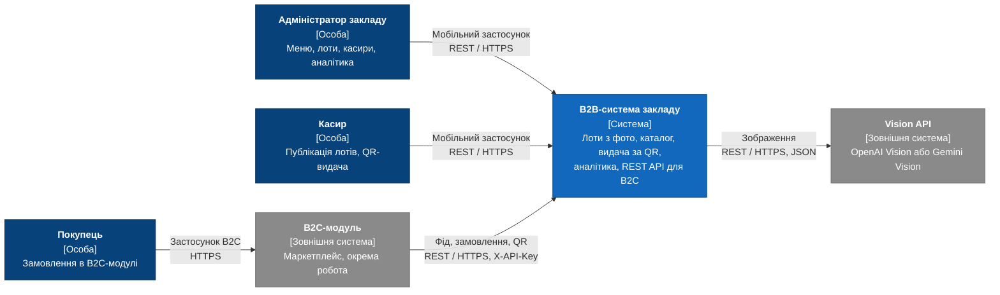
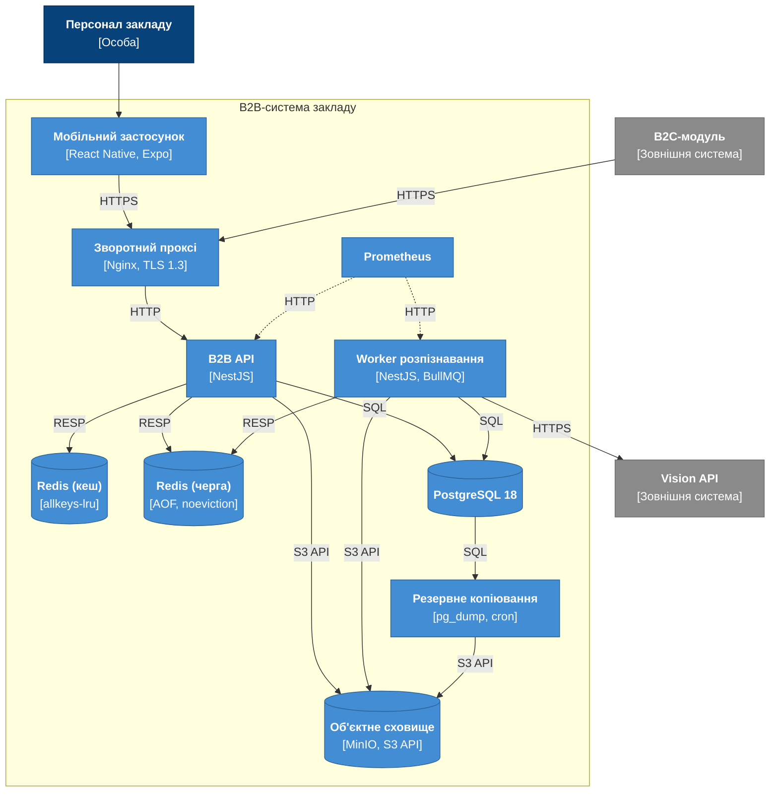

# РОЗДІЛ 2. АРХІТЕКТУРНЕ ПРОЄКТУВАННЯ

Розділ містить архітектурну модель системи за методологією C4 (рівні Context, Container, Component), виконану за принципом Diagrams-as-Code у Mermaid.js, та журнал архітектурних рішень. Вимоги, які реалізує архітектура, наведено в [SRS](./srs.md); обґрунтування вибору технологій — в [ADR-001](./adr/0001-choice-of-technology.md).

## 2.1 Контекстне та контейнерне моделювання системи (C4 Model)

Контекстне та контейнерне моделювання виконано за методологією C4, яка передбачає послідовну деталізацію системи: від її зовнішнього оточення до окремо розгортаних контейнерів. Діаграми описано мовою Mermaid і зберігаються в репозиторії разом із текстовою документацією (Diagrams-as-Code), тому зміни архітектури версіонуються так само, як зміни коду. Елементи позначено за нотацією C4: темно-синім кольором — особи, синім — система та контейнери, сірим — зовнішні системи, світло-синім — компоненти, жовтим — порти (інтерфейси); пунктирна лінія позначає зв'язок, що не є прямим викликом (збір метрик, реалізація інтерфейсу). Вимоги, які реалізує архітектура, наведено в [SRS](./srs.md); кожен елемент діаграм зіставлено з ідентифікаторами цих вимог.

### 2.1.1 Рівень 1. System Context

На першому рівні B2B-система розглядається як єдиний об'єкт без внутрішньої структури. Визначено три групи користувачів. Адміністратор закладу керує меню, лотами та обліковими записами касирів і переглядає фінансову аналітику. Касир публікує лоти, скануює QR-код і підтверджує видачу замовлення. Покупець оформлює замовлення в B2C-модулі та взаємодіє з B2B-системою лише опосередковано, через пред'явлення QR-коду. Зовнішніми системами є B2C-модуль, який розробляється як окрема робота, та Vision API (OpenAI Vision або Google Gemini Vision), що виконує розпізнавання товарів на зображеннях. Склад учасників і їхніх ролей подано в таблиці 2.1.

B2C-модуль взаємодіє з B2B-системою за моделлю pull: самостійно забирає фід лотів і викликає ендпоінти створення замовлення та запиту QR-коду за REST-контрактом OpenAPI 3.1 з автентифікацією заголовком `X-API-Key`. Протоколи всіх зв'язків першого рівня наведено в таблиці 2.2, діаграму — на рисунку 2.1.

Рисунок 2.1 — Діаграма System Context (рівень 1 моделі C4)

Таблиця 2.1 — Учасники діаграми рівня 1

| Учасник | Тип | Опис |
| --- | --- | --- |
| Адміністратор закладу | Person | Керує меню, лотами та обліковими записами касирів, переглядає аналітику ([SRS-FUN-12](./srs.md#srs-fun-12), [SRS-FUN-13](./srs.md#srs-fun-13), [SRS-FUN-14](./srs.md#srs-fun-14), [SRS-FUN-15](./srs.md#srs-fun-15), [SRS-FUN-16](./srs.md#srs-fun-16), [SRS-FUN-17](./srs.md#srs-fun-17), [SRS-FUN-18](./srs.md#srs-fun-18), [SRS-FUN-19](./srs.md#srs-fun-19), [SRS-FUN-20](./srs.md#srs-fun-20), [SRS-FUN-21](./srs.md#srs-fun-21), [SRS-FUN-29](./srs.md#srs-fun-29), [SRS-FUN-30](./srs.md#srs-fun-30)) |
| Касир | Person | Публікує лоти, скануює QR-код і підтверджує видачу ([SRS-FUN-15](./srs.md#srs-fun-15), [SRS-FUN-25](./srs.md#srs-fun-25), [SRS-FUN-26](./srs.md#srs-fun-26), [SRS-FUN-27](./srs.md#srs-fun-27), [SRS-FUN-28](./srs.md#srs-fun-28)) |
| Покупець | Person | Оформлює замовлення в B2C-модулі; взаємодіє з B2B-системою лише опосередковано, через B2C-модуль |
| B2B-система закладу | System | Предмет проєктування: формування лотів із фото, каталог, видача за QR, аналітика, REST API для B2C-модуля |
| B2C-модуль | System_Ext | Незалежна система маркетплейсу (ціноутворення, бронювання, оплата) |
| Vision API | System_Ext | Зовнішній сервіс розпізнавання зображень (OpenAI Vision або Google Gemini Vision) |

Таблиця 2.2 — Зв'язки діаграми рівня 1

| Зв'язок | Протокол | Вимоги |
| --- | --- | --- |
| Адміністратор, Касир → B2B-система | Мобільний застосунок, REST / HTTPS | [SRS-FUN-17](./srs.md#srs-fun-17), [SRS-FUN-18](./srs.md#srs-fun-18), [SRS-FUN-19](./srs.md#srs-fun-19), [SRS-FUN-20](./srs.md#srs-fun-20), [SRS-FUN-21](./srs.md#srs-fun-21) |
| B2C-модуль → B2B-система | REST / HTTPS, JSON, заголовок `X-API-Key` (контракт [`b2c-contract.yaml`](../contracts/b2c-contract.yaml)) | [SRS-FUN-22](./srs.md#srs-fun-22), [SRS-FUN-23](./srs.md#srs-fun-23), [SRS-FUN-24](./srs.md#srs-fun-24), [SRS-FUN-32](./srs.md#srs-fun-32), [SRS-FUN-33](./srs.md#srs-fun-33), [SRS-FUN-34](./srs.md#srs-fun-34), [SRS-FUN-35](./srs.md#srs-fun-35) |
| B2B-система → Vision API | REST / HTTPS, JSON | [SRS-FUN-06](./srs.md#srs-fun-06) |
| Покупець → B2C-модуль | Мобільний застосунок B2C, HTTPS | Поза межами системи |

### 2.1.2 Рівень 2. Container Diagram

На другому рівні систему розкладено на контейнери, кожен із яких розгортається як окремий процес або образ Docker. Клієнтську частину становить мобільний застосунок на React Native (Expo). Єдиною точкою входу для застосунку й B2C-модуля є зворотний проксі Nginx, на якому завершується TLS 1.3. Серверна частина складається з двох застосунків NestJS: B2B API, що обробляє синхронні запити, та Worker розпізнавання, що виконує фонові завдання з черги BullMQ. Дані зберігаються в PostgreSQL 18, зображення — в об'єктному сховищі MinIO з інтерфейсом S3. Метрики збирає Prometheus, щодобове резервне копіювання бази даних виконує окреме завдання `pg_dump`. Призначення контейнерів і їхній зв'язок з вимогами подано в таблиці 2.3, протоколи взаємодії — у таблиці 2.4, діаграму — на рисунку 2.2.

Рисунок 2.2 — Діаграма Container (рівень 2 моделі C4)

Таблиця 2.3 — Контейнери системи

| Контейнер | Технологія | Призначення | Вимоги |
| --- | --- | --- | --- |
| Мобільний застосунок | React Native (Expo), TypeScript | Клієнт персоналу: фото, чернетки лотів, каталог, QR-сканер, аналітика | [SRS-NFR-TEST-02](./srs.md#srs-nfr-test-02) |
| Зворотний проксі | Nginx | Завершення TLS 1.3, єдина точка входу для застосунку й B2C-модуля | [SRS-NFR-SEC-02](./srs.md#srs-nfr-sec-02) |
| B2B API | NestJS, TypeScript | Автентифікація, каталог, замовлення, аналітика, фід лотів, приймання зображень, постановка завдань у чергу | [SRS-FUN-01](./srs.md#srs-fun-01), [SRS-FUN-02](./srs.md#srs-fun-02), [SRS-FUN-03](./srs.md#srs-fun-03), [SRS-FUN-04](./srs.md#srs-fun-04), [SRS-FUN-09](./srs.md#srs-fun-09), [SRS-FUN-12](./srs.md#srs-fun-12), [SRS-FUN-13](./srs.md#srs-fun-13), [SRS-FUN-14](./srs.md#srs-fun-14), [SRS-FUN-15](./srs.md#srs-fun-15), [SRS-FUN-16](./srs.md#srs-fun-16), [SRS-FUN-17](./srs.md#srs-fun-17), [SRS-FUN-18](./srs.md#srs-fun-18), [SRS-FUN-19](./srs.md#srs-fun-19), [SRS-FUN-20](./srs.md#srs-fun-20), [SRS-FUN-21](./srs.md#srs-fun-21), [SRS-FUN-22](./srs.md#srs-fun-22), [SRS-FUN-23](./srs.md#srs-fun-23), [SRS-FUN-24](./srs.md#srs-fun-24), [SRS-FUN-25](./srs.md#srs-fun-25), [SRS-FUN-26](./srs.md#srs-fun-26), [SRS-FUN-27](./srs.md#srs-fun-27), [SRS-FUN-28](./srs.md#srs-fun-28), [SRS-FUN-29](./srs.md#srs-fun-29), [SRS-FUN-30](./srs.md#srs-fun-30), [SRS-FUN-31](./srs.md#srs-fun-31), [SRS-FUN-32](./srs.md#srs-fun-32), [SRS-FUN-33](./srs.md#srs-fun-33), [SRS-FUN-34](./srs.md#srs-fun-34), [SRS-FUN-35](./srs.md#srs-fun-35), [SRS-FUN-36](./srs.md#srs-fun-36), [SRS-NFR-SEC-01](./srs.md#srs-nfr-sec-01), [SRS-NFR-SEC-03](./srs.md#srs-nfr-sec-03), [SRS-NFR-SEC-05](./srs.md#srs-nfr-sec-05), [SRS-NFR-PERF-01](./srs.md#srs-nfr-perf-01), [SRS-NFR-PERF-02](./srs.md#srs-nfr-perf-02), [SRS-NFR-PERF-03](./srs.md#srs-nfr-perf-03), [SRS-NFR-OBS-01](./srs.md#srs-nfr-obs-01) |
| Worker розпізнавання | NestJS, BullMQ | Обробка завдань розпізнавання, формування чернеток лотів і бандлів, обслуговування (очищення зображень, повернення застряглих завдань) | [SRS-FUN-05](./srs.md#srs-fun-05), [SRS-FUN-06](./srs.md#srs-fun-06), [SRS-FUN-07](./srs.md#srs-fun-07), [SRS-FUN-08](./srs.md#srs-fun-08), [SRS-FUN-10](./srs.md#srs-fun-10), [SRS-FUN-11](./srs.md#srs-fun-11), [SRS-NFR-PERF-04](./srs.md#srs-nfr-perf-04), [SRS-NFR-QUAL-01](./srs.md#srs-nfr-qual-01), [SRS-NFR-SCAL-01](./srs.md#srs-nfr-scal-01), [SRS-NFR-REL-01](./srs.md#srs-nfr-rel-01), [SRS-NFR-REL-02](./srs.md#srs-nfr-rel-02), [SRS-NFR-REL-04](./srs.md#srs-nfr-rel-04), [SRS-NFR-REL-06](./srs.md#srs-nfr-rel-06), [SRS-NFR-COMP-01](./srs.md#srs-nfr-comp-01) |
| PostgreSQL | PostgreSQL 18 | Лоти, меню, замовлення, користувачі, журнал видач, статус завдань | [SRS-FUN-28](./srs.md#srs-fun-28), [SRS-NFR-COMP-02](./srs.md#srs-nfr-comp-02), [SRS-NFR-REL-03](./srs.md#srs-nfr-rel-03) |
| Redis (черга) | Redis 8, AOF, `noeviction` | Черга BullMQ і dead-letter | [SRS-FUN-03](./srs.md#srs-fun-03), [SRS-NFR-REL-01](./srs.md#srs-nfr-rel-01); [ADR-001](./adr/0001-choice-of-technology.md) |
| Redis (кеш) | Redis 8, `allkeys-lru` | Кеш аналітики, лічильники rate limiting | [SRS-FUN-31](./srs.md#srs-fun-31), [SRS-NFR-SEC-03](./srs.md#srs-nfr-sec-03) |
| Об'єктне сховище | MinIO (S3 API) | Зображення, резервні копії | [SRS-NFR-INFRA-02](./srs.md#srs-nfr-infra-02), [SRS-NFR-COMP-01](./srs.md#srs-nfr-comp-01) |
| Prometheus | Prometheus | Збір метрик API і Worker | [SRS-NFR-OBS-02](./srs.md#srs-nfr-obs-02) |
| Резервне копіювання | pg_dump, cron | Щодобова резервна копія PostgreSQL | [SRS-NFR-REL-03](./srs.md#srs-nfr-rel-03) |

Таблиця 2.4 — Зв'язки між контейнерами

| Від → до | Протокол | Призначення |
| --- | --- | --- |
| Мобільний застосунок → Зворотний проксі | REST / HTTPS (TLS 1.3), JSON | Запити API |
| B2C-модуль → Зворотний проксі | REST / HTTPS (TLS 1.3), `X-API-Key` | Фід лотів, підтвердження покупок, QR-код |
| Зворотний проксі → B2B API | HTTP/1.1 | Проксіювання у внутрішній мережі |
| B2B API → Redis (кеш) | RESP / TCP | Кеш аналітики, лічильники запитів |
| B2B API → Redis (черга) | RESP / TCP | Постановка завдань розпізнавання |
| B2B API → PostgreSQL | SQL / TCP | Каталог, замовлення, користувачі |
| B2B API → Об'єктне сховище | S3 API / HTTP | Збереження завантаженого зображення |
| Worker → Redis (черга) | RESP / TCP | Отримання завдань, оновлення стану |
| Worker → PostgreSQL | SQL / TCP | Чернетки лотів, статус завдання |
| Worker → Об'єктне сховище | S3 API / HTTP | Читання та видалення зображень |
| Worker → Vision API | REST / HTTPS, JSON | Розпізнавання |
| Prometheus → B2B API, Worker | HTTP (`/metrics`) | Збір метрик |
| Резервне копіювання → PostgreSQL | SQL / TCP (`pg_dump`) | Дамп БД |
| Резервне копіювання → Об'єктне сховище | S3 API / HTTP | Архів дампу |

Для рівня 2 ухвалено такі архітектурні рішення.

Черга й кеш розміщено на двох окремих екземплярах Redis. Черга BullMQ потребує політики `noeviction` і персистентності AOF, а кеш аналітики — політики `allkeys-lru`. За спільної політики витіснення тиск пам'яті від кешу міг би призвести до втрати ключів черги, що суперечить вимозі відмовостійкості [SRS-NFR-REL-01](./srs.md#srs-nfr-rel-01). Вибір BullMQ як брокера черги обґрунтовано в [ADR-001](./adr/0001-choice-of-technology.md).

Автентифікацію персоналу виконує модуль у складі B2B API на основі JWT ([SRS-FUN-17](./srs.md#srs-fun-17), [SRS-NFR-SEC-01](./srs.md#srs-nfr-sec-01)). Окремий Identity Provider не застосовується, оскільки він додав би контейнер і операційну складність без відповідної вимоги в [SRS](./srs.md).

Реплікація PostgreSQL і Redis не передбачена, оскільки розгортання виконується на одному вузлі (розділ «System Context» у [SRS](./srs.md)).

### Підсумок підрозділу 2.1

Побудовано діаграми рівнів 1 і 2 моделі C4: виокремлено 3 групи користувачів, 2 зовнішні системи та 10 контейнерів, а для кожного зв'язку вказано протокол. Усі контейнери зіставлено з вимогами [SRS](./srs.md), що забезпечує трасування від вимоги до елемента архітектури.

## 2.2 Компонентне моделювання критичного сервісу системи

Для компонентної декомпозиції обрано контейнер Worker розпізнавання. Саме він виконує найскладнішу обробку в системі: взаємодіє із зовнішнім Vision API, перевіряє недетермінований результат розпізнавання, забезпечує ідемпотентність обробки, повтори та узгодження станів між PostgreSQL і Redis. Помилка в цьому контейнері безпосередньо впливає на головну функцію системи, формування лотів із фотографій, тому його внутрішню структуру деталізовано до рівня компонентів.

Структуру побудовано за принципами чистої архітектури з п'ятьма шарами: Inbound (вхід), Application (сценарії), Domain (ядро), Ports (інтерфейси) та Outbound (адаптери й наскрізні сервіси). Залежності спрямовані до ядра: Inbound викликає Application, Application залежить лише від Domain і Ports, а адаптери шару Outbound реалізують порти за принципом Dependency Inversion та підключаються через Dependency Injection фреймворку NestJS. Завдяки цьому сценарії `ProcessRecognitionUseCase` і `MaintenanceUseCase` не імпортують класи адаптерів, а ядро можна перевіряти модульними тестами без мережі. Склад компонентів, їхню роль і зв'язок з вимогами подано в таблиці 2.5, діаграму — на рисунку 2.3. Черга Redis зображена двічі (на вході та на виході `MaintenanceUseCase`) лише для уникнення перетину ліній; це один і той самий контейнер. Виклики `ProcessRecognitionUseCase` до компонентів домену показано одним зв'язком із шаром Domain.

```mermaid
flowchart TB
    rq[("<b>Redis (черга)</b><br/>[BullMQ]")]:::db
    prom["<b>Prometheus</b>"]:::cont
    vision["<b>Vision API</b><br/>[Зовнішня система]"]:::ext
    s3[("<b>Об'єктне сховище</b><br/>[MinIO]")]:::db
    pg[("<b>PostgreSQL 18</b>")]:::db
    rq2[("<b>Redis (черга)</b><br/>[BullMQ]")]:::db

    subgraph W["Worker розпізнавання [NestJS]"]
        direction TB
        subgraph INB["Inbound: шар входу"]
                sched["<b>MaintenanceScheduler</b><br/>[BullMQ repeatable job]"]:::comp
            cons["<b>RecognitionConsumer</b><br/>[@Processor]"]:::comp
            val["<b>JobPayloadValidator</b><br/>[ValidationPipe]"]:::comp
            guard["<b>TenantGuard</b><br/>[Guard]"]:::comp
            filter["<b>JobExceptionFilter</b><br/>[ExceptionFilter]"]:::comp
        end
        subgraph APP["Application: сценарії"]
            direction LR
            cleanup["<b>MaintenanceUseCase</b>"]:::comp
            uc["<b>ProcessRecognitionUseCase</b>"]:::comp
            exif["<b>ImageSanitizer</b><br/>[sharp]"]:::comp
        end
        subgraph DOM["Domain: ядро"]
            direction LR
            rv["<b>VisionResponseValidator</b><br/>[JSON Schema]"]:::comp
            pol["<b>ConfidencePolicy</b><br/>[поріг 0,7]"]:::comp
            bun["<b>BundleSuggester</b>"]:::comp
        end
        subgraph PRT["Ports: інтерфейси"]
            direction LR
            ps["<b>ImageStoragePort</b>"]:::port
            pv["<b>VisionPort</b>"]:::port
            pr["<b>RecognitionRepositoryPort</b>"]:::port
        end
        subgraph OUT["Outbound: адаптери"]
            direction LR
            sa["<b>S3ImageStorageAdapter</b><br/>[AWS SDK]"]:::comp
            va["<b>VisionAdapter</b><br/>[Strategy, таймаут 10 с]"]:::comp
            ra["<b>PgRecognitionRepository</b><br/>[pg]"]:::comp
            tel["<b>TelemetryService</b><br/>[prom-client, Pino]"]:::comp
        end
    end

    rq -- "BullMQ" --> cons
    rq -- "BullMQ" --> sched
    cons --> val
    cons --> guard
    cons --> filter
    cons -- "DI" --> uc
    sched -- "DI" --> cleanup
    uc --> exif
    uc -- "правила домену" --> DOM
    uc --> ps
    uc --> pv
    uc --> pr
    cleanup --> ps
    cleanup --> pr
    cleanup -- "BullMQ" --> rq2
    sa -. "реалізує" .-> ps
    va -. "реалізує" .-> pv
    ra -. "реалізує" .-> pr
    cons -. "метрики, логи" .-> tel
    sa -- "S3 API" --> s3
    va -- "HTTPS" --> vision
    ra -- "SQL" --> pg
    prom -. "HTTP /metrics" .-> tel

    classDef cont fill:#438dd5,stroke:#2e6295,color:#fff
    classDef db fill:#438dd5,stroke:#2e6295,color:#fff
    classDef ext fill:#8a8a8a,stroke:#6b6b6b,color:#fff
    classDef comp fill:#85bbf0,stroke:#5d99c6,color:#000
    classDef port fill:#fff2cc,stroke:#bf9000,color:#000
```

Рисунок 2.3 — Діаграма Component для контейнера Worker розпізнавання (рівень 3 моделі C4)

Таблиця 2.5 — Компоненти контейнера Worker розпізнавання

| Шар | Компонент | Роль | Вимоги |
| --- | --- | --- | --- |
| Inbound | `RecognitionConsumer` | Приймає завдання з черги BullMQ; точка входу шару | [SRS-FUN-03](./srs.md#srs-fun-03) |
| Inbound | `JobPayloadValidator` | Валідація структури завдання (DTO, `class-validator`, `ValidationPipe`) | [SRS-FUN-01](./srs.md#srs-fun-01) |
| Inbound | `TenantGuard` | Перевіряє, що ключ зображення належить закладу, зазначеному в завданні | [SRS-FUN-21](./srs.md#srs-fun-21) |
| Inbound | `MaintenanceScheduler` | Періодичне завдання BullMQ: запускає обслуговування | [SRS-NFR-COMP-01](./srs.md#srs-nfr-comp-01), [SRS-NFR-REL-06](./srs.md#srs-nfr-rel-06) |
| Inbound | `JobExceptionFilter` | Глобальний обробник винятків: розрізняє помилки, що повторюються (мережа, 5xx, 429), і ті, що не повторюються (невалідна схема, пошкоджене зображення) | [SRS-NFR-REL-01](./srs.md#srs-nfr-rel-01) |
| Application | `ProcessRecognitionUseCase` | Оркеструє обробку одного завдання; залежить лише від портів і доменних компонентів | [SRS-FUN-03](./srs.md#srs-fun-03), [SRS-FUN-04](./srs.md#srs-fun-04), [SRS-FUN-05](./srs.md#srs-fun-05), [SRS-FUN-06](./srs.md#srs-fun-06), [SRS-FUN-07](./srs.md#srs-fun-07), [SRS-FUN-08](./srs.md#srs-fun-08), [SRS-NFR-REL-02](./srs.md#srs-nfr-rel-02) |
| Application | `MaintenanceUseCase` | Видаляє зображення за строком; повертає в чергу завдання зі статусом `queued` старші за 5 хв | [SRS-NFR-COMP-01](./srs.md#srs-nfr-comp-01), [SRS-NFR-REL-06](./srs.md#srs-nfr-rel-06) |
| Application | `ImageSanitizer` | Видаляє EXIF-метадані перед передаванням провайдеру | [SRS-FUN-05](./srs.md#srs-fun-05) |
| Domain | `VisionResponseValidator` | Перевіряє відповідь Vision API за JSON-схемою | [SRS-FUN-06](./srs.md#srs-fun-06) |
| Domain | `ConfidencePolicy` | Поріг достовірності 0,7; рішення про `needs_review` | [SRS-FUN-07](./srs.md#srs-fun-07), [SRS-FUN-08](./srs.md#srs-fun-08) |
| Domain | `BundleSuggester` | Формує смарт-бандли за довідником сумісних категорій | [SRS-FUN-10](./srs.md#srs-fun-10), [SRS-FUN-11](./srs.md#srs-fun-11) |
| Port | `VisionPort`, `ImageStoragePort`, `RecognitionRepositoryPort` | Інтерфейси залежностей ядра | Dependency Inversion |
| Outbound | `VisionAdapter` | Стратегія OpenAI або Gemini; таймаут виклику 10 с | [SRS-NFR-PERF-04](./srs.md#srs-nfr-perf-04) |
| Outbound | `S3ImageStorageAdapter` | Читання й видалення зображень | [SRS-NFR-INFRA-02](./srs.md#srs-nfr-infra-02), [SRS-NFR-COMP-01](./srs.md#srs-nfr-comp-01) |
| Outbound | `PgRecognitionRepository` | Транзакційний запис чернеток і статусу; унікальний ключ `job_id` забезпечує ідемпотентність | [SRS-NFR-REL-02](./srs.md#srs-nfr-rel-02) |
| Cross-cutting | `TelemetryService` | Метрики Prometheus і структуровані логи з кореляційним ідентифікатором | [SRS-NFR-OBS-01](./srs.md#srs-nfr-obs-01), [SRS-NFR-OBS-02](./srs.md#srs-nfr-obs-02) |

Основний сценарій обробки такий. `RecognitionConsumer` приймає завдання з черги BullMQ, `JobPayloadValidator` перевіряє його структуру, а `TenantGuard` підтверджує, що ключ зображення належить закладу, зазначеному в завданні. Далі `ProcessRecognitionUseCase` читає зображення через `ImageStoragePort`, видаляє EXIF-метадані компонентом `ImageSanitizer`, передає зображення в `VisionPort`, перевіряє відповідь за JSON-схемою (`VisionResponseValidator`), застосовує поріг достовірності 0,7 (`ConfidencePolicy`), формує смарт-бандли (`BundleSuggester`) і зберігає результат через `RecognitionRepositoryPort`. Помилки класифікує `JobExceptionFilter`: збої мережі, відповіді 5xx і 429 повторюються, а невалідна схема та пошкоджене зображення завершують завдання без повторів.

Обслуговування виконує `MaintenanceScheduler`: періодичне завдання BullMQ запускає `MaintenanceUseCase`, який видаляє зображення за строком зберігання та повертає в чергу завдання зі статусом `queued`, старші за 5 хв. Це усуває розбіжність між PostgreSQL і Redis, що виникає при збої між записом статусу та постановкою завдання в чергу ([SRS-NFR-REL-06](./srs.md#srs-nfr-rel-06)).

Застосовано такі патерни. Вибір провайдера розпізнавання (OpenAI або Gemini) реалізовано шаблоном Strategy у `VisionAdapter`, що не змінює ядро. Репозиторій доступний лише через `RecognitionRepositoryPort`, а `RecognitionConsumer` не звертається до сховищ напряму. Ідемпотентність забезпечує унікальний ключ `job_id` у `PgRecognitionRepository` ([SRS-NFR-REL-02](./srs.md#srs-nfr-rel-02)).

Межу довіри визначено так. Перевірку JWT і RBAC виконує контейнер B2B API ([SRS-FUN-17](./srs.md#srs-fun-17), [SRS-FUN-20](./srs.md#srs-fun-20)) до постановки завдання в чергу, а Worker не приймає запитів клієнтів. На рівні Worker захист забезпечують `TenantGuard`, валідація вхідних даних, автентифікація Redis (ACL) і мережева ізоляція контейнерів. Повторні спроби з експоненційною затримкою та dead-letter налаштовано на рівні черги BullMQ ([SRS-NFR-REL-01](./srs.md#srs-nfr-rel-01), [ADR-001](./adr/0001-choice-of-technology.md)).

### Підсумок підрозділу 2.2

Для критичного сервісу побудовано діаграму рівня 3, що містить 18 компонентів у п'яти шарах. Залежності ядра від зовнішніх систем замінено інтерфейсами, що дозволяє змінювати провайдера розпізнавання, сховище та СУБД без змін у сценаріях обробки.

## 2.3 Документування архітектурних рішень (Architecture Decision Records)

Значущі архітектурні рішення зафіксовано у форматі Architecture Decision Record за шаблоном Майкла Нігарда. Кожен запис складається з розділів Title, Status, Context, Alternatives, Decision і Consequences та зберігається в каталозі `docs/adr/` разом із кодом. Такий підхід зберігає обґрунтування рішення на момент його ухвалення й дозволяє відстежити, які вимоги до нього призвели. Перелік записів подано в таблиці 2.6.

Таблиця 2.6 — Журнал архітектурних рішень

| ID | Рішення | Статус |
| --- | --- | --- |
| [ADR-001](./adr/0001-choice-of-technology.md) | Вибір черги фонових задач для асинхронного розпізнавання зображень (BullMQ на Redis) | Approved |

Рішення ADR-001 стосується способу асинхронної обробки зображень. Синхронний виклик Vision API з HTTP-обробника суперечить вимозі [SRS-NFR-PERF-03](./srs.md#srs-nfr-perf-03) (відповідь 202 Accepted з p95 не більше 1000 мс) і за піку наприкінці зміни вичерпує пул з'єднань API. Розглянуто чотири альтернативи: RabbitMQ, Amazon SQS, Apache Kafka та BullMQ на Redis. RabbitMQ потребує окремого брокера, плагіна або ланцюжка черг із TTL для відкладених повторів і власної таблиці статусів завдань. Amazon SQS пов'язує систему з хмарним провайдером, що суперечить розгортанню на одному вузлі. Apache Kafka реалізує модель журналу подій без підтвердження й повтору окремого повідомлення, а експлуатація кластера непропорційна навантаженню.

Обрано BullMQ на окремому екземплярі Redis із персистентністю AOF і політикою `noeviction`. Рішення відповідає вимозі [SRS-NFR-REL-01](./srs.md#srs-nfr-rel-01) без власного коду, надає стан завдання як частину API ([SRS-FUN-04](./srs.md#srs-fun-04)), не додає нового протоколу до стеку й допускає підключення до чотирьох обробників ([SRS-NFR-SCAL-01](./srs.md#srs-nfr-scal-01)). До негативних наслідків віднесено вікно втрати записів черги до 1 с за `appendfsync everysec`, семантику доставки «щонайменше одна обробка», неатомарність запису статусу в PostgreSQL і постановки в Redis, а також єдиний екземпляр Redis без реплікації. Їх компенсовано збереженням стану завдань у PostgreSQL як джерела істини, ідемпотентною обробкою за `job_id` і періодичним поверненням застряглих завдань у чергу. Повний текст записано у файлі [ADR-001](./adr/0001-choice-of-technology.md).

### Підсумок підрозділу 2.3

Зафіксовано перше архітектурне рішення проєкту зі статусом Approved. Для нього наведено альтернативи, числові обмеження з [SRS](./srs.md) та аналіз ризиків із компенсаціями.
