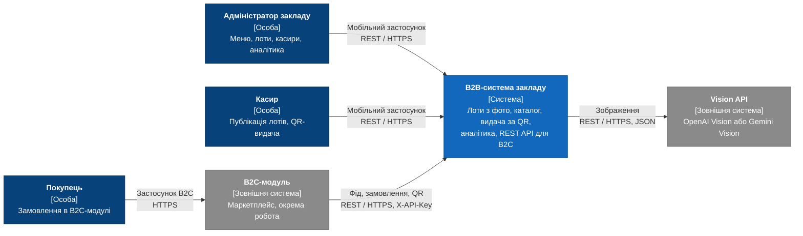
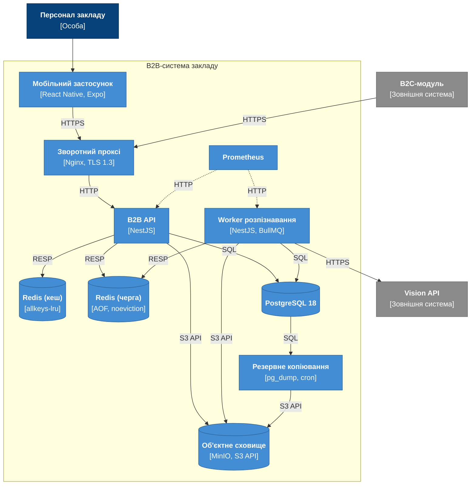
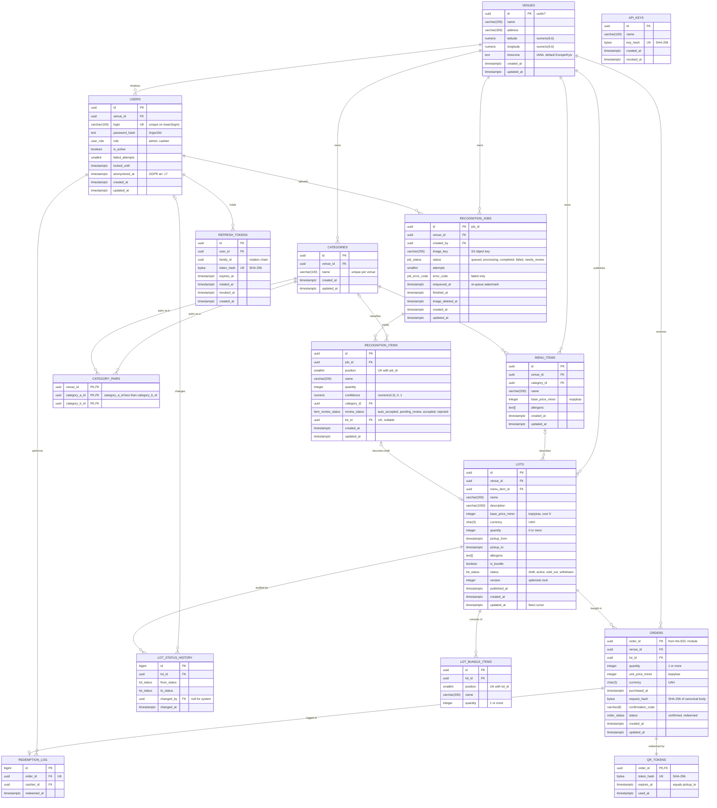
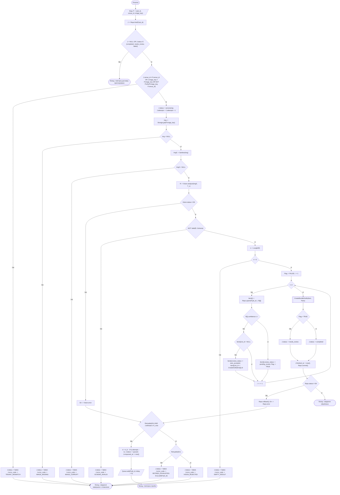
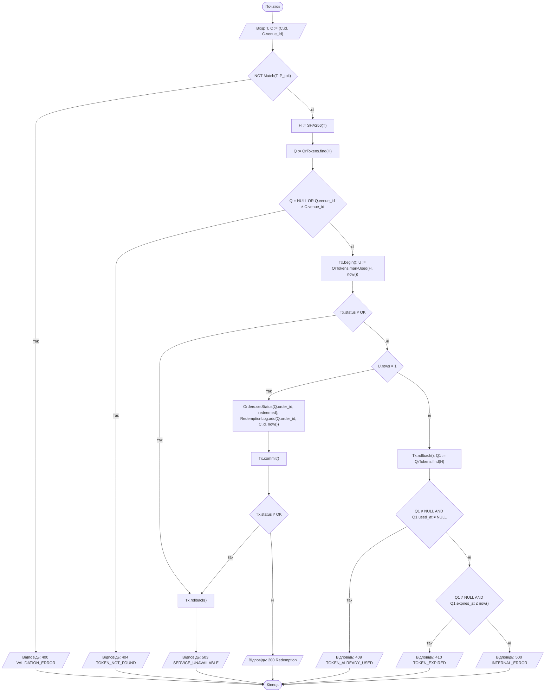
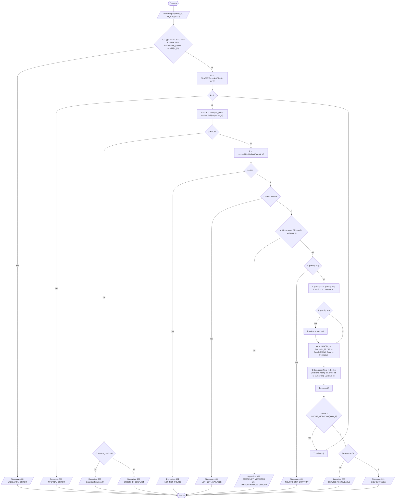

# РОЗДІЛ 2. АРХІТЕКТУРНЕ ПРОЄКТУВАННЯ

Розділ містить архітектурну модель системи за методологією C4 (рівні Context, Container, Component), виконану за принципом Diagrams-as-Code у Mermaid.js, та журнал архітектурних рішень. Вимоги, які реалізує архітектура, наведено в [SRS](./srs.md); обґрунтування вибору технологій — в [ADR-001](./adr/0001-choice-of-technology.md).

## 2.1 Контекстне та контейнерне моделювання системи (C4 Model)

Контекстне та контейнерне моделювання виконано за методологією C4, яка передбачає послідовну деталізацію системи: від її зовнішнього оточення до окремо розгортаних контейнерів. Діаграми описано мовою Mermaid і зберігаються в репозиторії разом із текстовою документацією (Diagrams-as-Code), тому зміни архітектури версіонуються так само, як зміни коду. Елементи позначено за нотацією C4: темно-синім кольором — особи, синім — система та контейнери, сірим — зовнішні системи, світло-синім — компоненти, жовтим — порти (інтерфейси); пунктирна лінія позначає зв'язок, що не є прямим викликом (збір метрик, реалізація інтерфейсу). Вимоги, які реалізує архітектура, наведено в [SRS](./srs.md); кожен елемент діаграм зіставлено з ідентифікаторами цих вимог.

### 2.1.1 Рівень 1. System Context

На першому рівні B2B-система розглядається як єдиний об'єкт без внутрішньої структури. Визначено три групи користувачів. Адміністратор закладу керує меню, лотами та обліковими записами касирів і переглядає фінансову аналітику. Касир публікує лоти, скануює QR-код і підтверджує видачу замовлення. Покупець оформлює замовлення в B2C-модулі та взаємодіє з B2B-системою лише опосередковано, через пред'явлення QR-коду. Зовнішніми системами є B2C-модуль, який розробляється як окрема робота, та Vision API (OpenAI Vision або Google Gemini Vision), що виконує розпізнавання товарів на зображеннях. Склад учасників і їхніх ролей подано в таблиці 2.1.

B2C-модуль взаємодіє з B2B-системою за моделлю pull: самостійно забирає фід лотів і викликає ендпоінти створення замовлення та запиту QR-коду за REST-контрактом OpenAPI 3.1 з автентифікацією заголовком `X-API-Key`. Протоколи всіх зв'язків першого рівня наведено в таблиці 2.2, діаграму — на рисунку 2.1.

Рисунок 2.1 — Діаграма System Context (рівень 1 моделі C4)

Таблиця 2.1 — Учасники діаграми рівня 1

| Учасник | Тип | Опис |
| --- | --- | --- |
| Адміністратор закладу | Person | Керує меню, лотами та обліковими записами касирів, переглядає аналітику ([SRS-FUN-12](./srs.md#srs-fun-12), [SRS-FUN-13](./srs.md#srs-fun-13), [SRS-FUN-14](./srs.md#srs-fun-14), [SRS-FUN-15](./srs.md#srs-fun-15), [SRS-FUN-16](./srs.md#srs-fun-16), [SRS-FUN-17](./srs.md#srs-fun-17), [SRS-FUN-18](./srs.md#srs-fun-18), [SRS-FUN-19](./srs.md#srs-fun-19), [SRS-FUN-20](./srs.md#srs-fun-20), [SRS-FUN-21](./srs.md#srs-fun-21), [SRS-FUN-29](./srs.md#srs-fun-29), [SRS-FUN-30](./srs.md#srs-fun-30)) |
| Касир | Person | Публікує лоти, скануює QR-код і підтверджує видачу ([SRS-FUN-15](./srs.md#srs-fun-15), [SRS-FUN-25](./srs.md#srs-fun-25), [SRS-FUN-26](./srs.md#srs-fun-26), [SRS-FUN-27](./srs.md#srs-fun-27), [SRS-FUN-28](./srs.md#srs-fun-28)) |
| Покупець | Person | Оформлює замовлення в B2C-модулі; взаємодіє з B2B-системою лише опосередковано, через B2C-модуль |
| B2B-система закладу | System | Предмет проєктування: формування лотів із фото, каталог, видача за QR, аналітика, REST API для B2C-модуля |
| B2C-модуль | System_Ext | Незалежна система маркетплейсу (ціноутворення, бронювання, оплата) |
| Vision API | System_Ext | Зовнішній сервіс розпізнавання зображень (OpenAI Vision або Google Gemini Vision) |

Таблиця 2.2 — Зв'язки діаграми рівня 1

| Зв'язок | Протокол | Вимоги |
| --- | --- | --- |
| Адміністратор, Касир → B2B-система | Мобільний застосунок, REST / HTTPS | [SRS-FUN-17](./srs.md#srs-fun-17), [SRS-FUN-18](./srs.md#srs-fun-18), [SRS-FUN-19](./srs.md#srs-fun-19), [SRS-FUN-20](./srs.md#srs-fun-20), [SRS-FUN-21](./srs.md#srs-fun-21) |
| B2C-модуль → B2B-система | REST / HTTPS, JSON, заголовок `X-API-Key` (контракт [`b2c-contract.yaml`](../contracts/b2c-contract.yaml)) | [SRS-FUN-22](./srs.md#srs-fun-22), [SRS-FUN-23](./srs.md#srs-fun-23), [SRS-FUN-24](./srs.md#srs-fun-24), [SRS-FUN-32](./srs.md#srs-fun-32), [SRS-FUN-33](./srs.md#srs-fun-33), [SRS-FUN-34](./srs.md#srs-fun-34), [SRS-FUN-35](./srs.md#srs-fun-35) |
| B2B-система → Vision API | REST / HTTPS, JSON | [SRS-FUN-06](./srs.md#srs-fun-06) |
| Покупець → B2C-модуль | Мобільний застосунок B2C, HTTPS | Поза межами системи |

### 2.1.2 Рівень 2. Container Diagram

На другому рівні систему розкладено на контейнери, кожен із яких розгортається як окремий процес або образ Docker. Клієнтську частину становить мобільний застосунок на React Native (Expo). Єдиною точкою входу для застосунку й B2C-модуля є зворотний проксі Nginx, на якому завершується TLS 1.3. Серверна частина складається з двох застосунків NestJS: B2B API, що обробляє синхронні запити, та Worker розпізнавання, що виконує фонові завдання з черги BullMQ. Дані зберігаються в PostgreSQL 18, зображення — в об'єктному сховищі MinIO з інтерфейсом S3. Метрики збирає Prometheus, щодобове резервне копіювання бази даних виконує окреме завдання `pg_dump`. Призначення контейнерів і їхній зв'язок з вимогами подано в таблиці 2.3, протоколи взаємодії — у таблиці 2.4, діаграму — на рисунку 2.2.

Рисунок 2.2 — Діаграма Container (рівень 2 моделі C4)

Таблиця 2.3 — Контейнери системи

| Контейнер | Технологія | Призначення | Вимоги |
| --- | --- | --- | --- |
| Мобільний застосунок | React Native (Expo), TypeScript | Клієнт персоналу: фото, чернетки лотів, каталог, QR-сканер, аналітика | [SRS-NFR-TEST-02](./srs.md#srs-nfr-test-02) |
| Зворотний проксі | Nginx | Завершення TLS 1.3, єдина точка входу для застосунку й B2C-модуля | [SRS-NFR-SEC-02](./srs.md#srs-nfr-sec-02) |
| B2B API | NestJS, TypeScript | Автентифікація, каталог, замовлення, аналітика, фід лотів, приймання зображень, постановка завдань у чергу | [SRS-FUN-01](./srs.md#srs-fun-01), [SRS-FUN-02](./srs.md#srs-fun-02), [SRS-FUN-03](./srs.md#srs-fun-03), [SRS-FUN-04](./srs.md#srs-fun-04), [SRS-FUN-09](./srs.md#srs-fun-09), [SRS-FUN-12](./srs.md#srs-fun-12), [SRS-FUN-13](./srs.md#srs-fun-13), [SRS-FUN-14](./srs.md#srs-fun-14), [SRS-FUN-15](./srs.md#srs-fun-15), [SRS-FUN-16](./srs.md#srs-fun-16), [SRS-FUN-17](./srs.md#srs-fun-17), [SRS-FUN-18](./srs.md#srs-fun-18), [SRS-FUN-19](./srs.md#srs-fun-19), [SRS-FUN-20](./srs.md#srs-fun-20), [SRS-FUN-21](./srs.md#srs-fun-21), [SRS-FUN-22](./srs.md#srs-fun-22), [SRS-FUN-23](./srs.md#srs-fun-23), [SRS-FUN-24](./srs.md#srs-fun-24), [SRS-FUN-25](./srs.md#srs-fun-25), [SRS-FUN-26](./srs.md#srs-fun-26), [SRS-FUN-27](./srs.md#srs-fun-27), [SRS-FUN-28](./srs.md#srs-fun-28), [SRS-FUN-29](./srs.md#srs-fun-29), [SRS-FUN-30](./srs.md#srs-fun-30), [SRS-FUN-31](./srs.md#srs-fun-31), [SRS-FUN-32](./srs.md#srs-fun-32), [SRS-FUN-33](./srs.md#srs-fun-33), [SRS-FUN-34](./srs.md#srs-fun-34), [SRS-FUN-35](./srs.md#srs-fun-35), [SRS-FUN-36](./srs.md#srs-fun-36), [SRS-NFR-SEC-01](./srs.md#srs-nfr-sec-01), [SRS-NFR-SEC-03](./srs.md#srs-nfr-sec-03), [SRS-NFR-SEC-05](./srs.md#srs-nfr-sec-05), [SRS-NFR-PERF-01](./srs.md#srs-nfr-perf-01), [SRS-NFR-PERF-02](./srs.md#srs-nfr-perf-02), [SRS-NFR-PERF-03](./srs.md#srs-nfr-perf-03), [SRS-NFR-OBS-01](./srs.md#srs-nfr-obs-01) |
| Worker розпізнавання | NestJS, BullMQ | Обробка завдань розпізнавання, формування чернеток лотів і бандлів, обслуговування (очищення зображень, повернення застряглих завдань) | [SRS-FUN-05](./srs.md#srs-fun-05), [SRS-FUN-06](./srs.md#srs-fun-06), [SRS-FUN-07](./srs.md#srs-fun-07), [SRS-FUN-08](./srs.md#srs-fun-08), [SRS-FUN-10](./srs.md#srs-fun-10), [SRS-FUN-11](./srs.md#srs-fun-11), [SRS-NFR-PERF-04](./srs.md#srs-nfr-perf-04), [SRS-NFR-QUAL-01](./srs.md#srs-nfr-qual-01), [SRS-NFR-SCAL-01](./srs.md#srs-nfr-scal-01), [SRS-NFR-REL-01](./srs.md#srs-nfr-rel-01), [SRS-NFR-REL-02](./srs.md#srs-nfr-rel-02), [SRS-NFR-REL-04](./srs.md#srs-nfr-rel-04), [SRS-NFR-REL-06](./srs.md#srs-nfr-rel-06), [SRS-NFR-COMP-01](./srs.md#srs-nfr-comp-01) |
| PostgreSQL | PostgreSQL 18 | Лоти, меню, замовлення, користувачі, журнал видач, статус завдань | [SRS-FUN-28](./srs.md#srs-fun-28), [SRS-NFR-COMP-02](./srs.md#srs-nfr-comp-02), [SRS-NFR-REL-03](./srs.md#srs-nfr-rel-03) |
| Redis (черга) | Redis 8, AOF, `noeviction` | Черга BullMQ і dead-letter | [SRS-FUN-03](./srs.md#srs-fun-03), [SRS-NFR-REL-01](./srs.md#srs-nfr-rel-01); [ADR-001](./adr/0001-choice-of-technology.md) |
| Redis (кеш) | Redis 8, `allkeys-lru` | Кеш аналітики, лічильники rate limiting | [SRS-FUN-31](./srs.md#srs-fun-31), [SRS-NFR-SEC-03](./srs.md#srs-nfr-sec-03) |
| Об'єктне сховище | MinIO (S3 API) | Зображення, резервні копії | [SRS-NFR-INFRA-02](./srs.md#srs-nfr-infra-02), [SRS-NFR-COMP-01](./srs.md#srs-nfr-comp-01) |
| Prometheus | Prometheus | Збір метрик API і Worker | [SRS-NFR-OBS-02](./srs.md#srs-nfr-obs-02) |
| Резервне копіювання | pg_dump, cron | Щодобова резервна копія PostgreSQL | [SRS-NFR-REL-03](./srs.md#srs-nfr-rel-03) |

Таблиця 2.4 — Зв'язки між контейнерами

| Від → до | Протокол | Призначення |
| --- | --- | --- |
| Мобільний застосунок → Зворотний проксі | REST / HTTPS (TLS 1.3), JSON | Запити API |
| B2C-модуль → Зворотний проксі | REST / HTTPS (TLS 1.3), `X-API-Key` | Фід лотів, підтвердження покупок, QR-код |
| Зворотний проксі → B2B API | HTTP/1.1 | Проксіювання у внутрішній мережі |
| B2B API → Redis (кеш) | RESP / TCP | Кеш аналітики, лічильники запитів |
| B2B API → Redis (черга) | RESP / TCP | Постановка завдань розпізнавання |
| B2B API → PostgreSQL | SQL / TCP | Каталог, замовлення, користувачі |
| B2B API → Об'єктне сховище | S3 API / HTTP | Збереження завантаженого зображення |
| Worker → Redis (черга) | RESP / TCP | Отримання завдань, оновлення стану |
| Worker → PostgreSQL | SQL / TCP | Чернетки лотів, статус завдання |
| Worker → Об'єктне сховище | S3 API / HTTP | Читання та видалення зображень |
| Worker → Vision API | REST / HTTPS, JSON | Розпізнавання |
| Prometheus → B2B API, Worker | HTTP (`/metrics`) | Збір метрик |
| Резервне копіювання → PostgreSQL | SQL / TCP (`pg_dump`) | Дамп БД |
| Резервне копіювання → Об'єктне сховище | S3 API / HTTP | Архів дампу |

Для рівня 2 ухвалено такі архітектурні рішення.

Черга й кеш розміщено на двох окремих екземплярах Redis. Черга BullMQ потребує політики `noeviction` і персистентності AOF, а кеш аналітики — політики `allkeys-lru`. За спільної політики витіснення тиск пам'яті від кешу міг би призвести до втрати ключів черги, що суперечить вимозі відмовостійкості [SRS-NFR-REL-01](./srs.md#srs-nfr-rel-01). Вибір BullMQ як брокера черги обґрунтовано в [ADR-001](./adr/0001-choice-of-technology.md).

Автентифікацію персоналу виконує модуль у складі B2B API на основі JWT ([SRS-FUN-17](./srs.md#srs-fun-17), [SRS-NFR-SEC-01](./srs.md#srs-nfr-sec-01)). Окремий Identity Provider не застосовується, оскільки він додав би контейнер і операційну складність без відповідної вимоги в [SRS](./srs.md).

Реплікація PostgreSQL і Redis не передбачена, оскільки розгортання виконується на одному вузлі (розділ «System Context» у [SRS](./srs.md)).

### Підсумок підрозділу 2.1

Побудовано діаграми рівнів 1 і 2 моделі C4: виокремлено 3 групи користувачів, 2 зовнішні системи та 10 контейнерів, а для кожного зв'язку вказано протокол. Усі контейнери зіставлено з вимогами [SRS](./srs.md), що забезпечує трасування від вимоги до елемента архітектури.

## 2.2 Компонентне моделювання критичного сервісу системи

Для компонентної декомпозиції обрано контейнер Worker розпізнавання. Саме він виконує найскладнішу обробку в системі: взаємодіє із зовнішнім Vision API, перевіряє недетермінований результат розпізнавання, забезпечує ідемпотентність обробки, повтори та узгодження станів між PostgreSQL і Redis. Помилка в цьому контейнері безпосередньо впливає на головну функцію системи, формування лотів із фотографій, тому його внутрішню структуру деталізовано до рівня компонентів.

Структуру побудовано за принципами чистої архітектури з п'ятьма шарами: Inbound (вхід), Application (сценарії), Domain (ядро), Ports (інтерфейси) та Outbound (адаптери й наскрізні сервіси). Залежності спрямовані до ядра: Inbound викликає Application, Application залежить лише від Domain і Ports, а адаптери шару Outbound реалізують порти за принципом Dependency Inversion та підключаються через Dependency Injection фреймворку NestJS. Завдяки цьому сценарії `ProcessRecognitionUseCase` і `MaintenanceUseCase` не імпортують класи адаптерів, а ядро можна перевіряти модульними тестами без мережі. Склад компонентів, їхню роль і зв'язок з вимогами подано в таблиці 2.5, діаграму — на рисунку 2.3. Черга Redis зображена двічі (на вході та на виході `MaintenanceUseCase`) лише для уникнення перетину ліній; це один і той самий контейнер. Виклики `ProcessRecognitionUseCase` до компонентів домену показано одним зв'язком із шаром Domain.

```mermaid
flowchart TB
    rq[("<b>Redis (черга)</b><br/>[BullMQ]")]:::db
    prom["<b>Prometheus</b>"]:::cont
    vision["<b>Vision API</b><br/>[Зовнішня система]"]:::ext
    s3[("<b>Об'єктне сховище</b><br/>[MinIO]")]:::db
    pg[("<b>PostgreSQL 18</b>")]:::db
    rq2[("<b>Redis (черга)</b><br/>[BullMQ]")]:::db

    subgraph W["Worker розпізнавання [NestJS]"]
        direction TB
        subgraph INB["Inbound: шар входу"]
                sched["<b>MaintenanceScheduler</b><br/>[BullMQ repeatable job]"]:::comp
            cons["<b>RecognitionConsumer</b><br/>[@Processor]"]:::comp
            val["<b>JobPayloadValidator</b><br/>[ValidationPipe]"]:::comp
            guard["<b>TenantGuard</b><br/>[Guard]"]:::comp
            filter["<b>JobExceptionFilter</b><br/>[ExceptionFilter]"]:::comp
        end
        subgraph APP["Application: сценарії"]
            direction LR
            cleanup["<b>MaintenanceUseCase</b>"]:::comp
            uc["<b>ProcessRecognitionUseCase</b>"]:::comp
            exif["<b>ImageSanitizer</b><br/>[sharp]"]:::comp
        end
        subgraph DOM["Domain: ядро"]
            direction LR
            rv["<b>VisionResponseValidator</b><br/>[JSON Schema]"]:::comp
            pol["<b>ConfidencePolicy</b><br/>[поріг 0,7]"]:::comp
            bun["<b>BundleSuggester</b>"]:::comp
        end
        subgraph PRT["Ports: інтерфейси"]
            direction LR
            ps["<b>ImageStoragePort</b>"]:::port
            pv["<b>VisionPort</b>"]:::port
            pr["<b>RecognitionRepositoryPort</b>"]:::port
        end
        subgraph OUT["Outbound: адаптери"]
            direction LR
            sa["<b>S3ImageStorageAdapter</b><br/>[AWS SDK]"]:::comp
            va["<b>VisionAdapter</b><br/>[Strategy, таймаут 10 с]"]:::comp
            ra["<b>PgRecognitionRepository</b><br/>[pg]"]:::comp
            tel["<b>TelemetryService</b><br/>[prom-client, Pino]"]:::comp
        end
    end

    rq -- "BullMQ" --> cons
    rq -- "BullMQ" --> sched
    cons --> val
    cons --> guard
    cons --> filter
    cons -- "DI" --> uc
    sched -- "DI" --> cleanup
    uc --> exif
    uc -- "правила домену" --> DOM
    uc --> ps
    uc --> pv
    uc --> pr
    cleanup --> ps
    cleanup --> pr
    cleanup -- "BullMQ" --> rq2
    sa -. "реалізує" .-> ps
    va -. "реалізує" .-> pv
    ra -. "реалізує" .-> pr
    cons -. "метрики, логи" .-> tel
    sa -- "S3 API" --> s3
    va -- "HTTPS" --> vision
    ra -- "SQL" --> pg
    prom -. "HTTP /metrics" .-> tel

    classDef cont fill:#438dd5,stroke:#2e6295,color:#fff
    classDef db fill:#438dd5,stroke:#2e6295,color:#fff
    classDef ext fill:#8a8a8a,stroke:#6b6b6b,color:#fff
    classDef comp fill:#85bbf0,stroke:#5d99c6,color:#000
    classDef port fill:#fff2cc,stroke:#bf9000,color:#000
```

Рисунок 2.3 — Діаграма Component для контейнера Worker розпізнавання (рівень 3 моделі C4)

Таблиця 2.5 — Компоненти контейнера Worker розпізнавання

| Шар | Компонент | Роль | Вимоги |
| --- | --- | --- | --- |
| Inbound | `RecognitionConsumer` | Приймає завдання з черги BullMQ; точка входу шару | [SRS-FUN-03](./srs.md#srs-fun-03) |
| Inbound | `JobPayloadValidator` | Валідація структури завдання (DTO, `class-validator`, `ValidationPipe`) | [SRS-FUN-01](./srs.md#srs-fun-01) |
| Inbound | `TenantGuard` | Перевіряє, що ключ зображення належить закладу, зазначеному в завданні | [SRS-FUN-21](./srs.md#srs-fun-21) |
| Inbound | `MaintenanceScheduler` | Періодичне завдання BullMQ: запускає обслуговування | [SRS-NFR-COMP-01](./srs.md#srs-nfr-comp-01), [SRS-NFR-REL-06](./srs.md#srs-nfr-rel-06) |
| Inbound | `JobExceptionFilter` | Глобальний обробник винятків: розрізняє помилки, що повторюються (мережа, 5xx, 429), і ті, що не повторюються (невалідна схема, пошкоджене зображення) | [SRS-NFR-REL-01](./srs.md#srs-nfr-rel-01) |
| Application | `ProcessRecognitionUseCase` | Оркеструє обробку одного завдання; залежить лише від портів і доменних компонентів | [SRS-FUN-03](./srs.md#srs-fun-03), [SRS-FUN-04](./srs.md#srs-fun-04), [SRS-FUN-05](./srs.md#srs-fun-05), [SRS-FUN-06](./srs.md#srs-fun-06), [SRS-FUN-07](./srs.md#srs-fun-07), [SRS-FUN-08](./srs.md#srs-fun-08), [SRS-NFR-REL-02](./srs.md#srs-nfr-rel-02) |
| Application | `MaintenanceUseCase` | Видаляє зображення за строком; повертає в чергу завдання зі статусом `queued` старші за 5 хв | [SRS-NFR-COMP-01](./srs.md#srs-nfr-comp-01), [SRS-NFR-REL-06](./srs.md#srs-nfr-rel-06) |
| Application | `ImageSanitizer` | Видаляє EXIF-метадані перед передаванням провайдеру | [SRS-FUN-05](./srs.md#srs-fun-05) |
| Domain | `VisionResponseValidator` | Перевіряє відповідь Vision API за JSON-схемою | [SRS-FUN-06](./srs.md#srs-fun-06) |
| Domain | `ConfidencePolicy` | Поріг достовірності 0,7; рішення про `needs_review` | [SRS-FUN-07](./srs.md#srs-fun-07), [SRS-FUN-08](./srs.md#srs-fun-08) |
| Domain | `BundleSuggester` | Формує смарт-бандли за довідником сумісних категорій | [SRS-FUN-10](./srs.md#srs-fun-10), [SRS-FUN-11](./srs.md#srs-fun-11) |
| Port | `VisionPort`, `ImageStoragePort`, `RecognitionRepositoryPort` | Інтерфейси залежностей ядра | Dependency Inversion |
| Outbound | `VisionAdapter` | Стратегія OpenAI або Gemini; таймаут виклику 10 с | [SRS-NFR-PERF-04](./srs.md#srs-nfr-perf-04) |
| Outbound | `S3ImageStorageAdapter` | Читання й видалення зображень | [SRS-NFR-INFRA-02](./srs.md#srs-nfr-infra-02), [SRS-NFR-COMP-01](./srs.md#srs-nfr-comp-01) |
| Outbound | `PgRecognitionRepository` | Транзакційний запис чернеток і статусу; унікальний ключ `job_id` забезпечує ідемпотентність | [SRS-NFR-REL-02](./srs.md#srs-nfr-rel-02) |
| Cross-cutting | `TelemetryService` | Метрики Prometheus і структуровані логи з кореляційним ідентифікатором | [SRS-NFR-OBS-01](./srs.md#srs-nfr-obs-01), [SRS-NFR-OBS-02](./srs.md#srs-nfr-obs-02) |

Основний сценарій обробки такий. `RecognitionConsumer` приймає завдання з черги BullMQ, `JobPayloadValidator` перевіряє його структуру, а `TenantGuard` підтверджує, що ключ зображення належить закладу, зазначеному в завданні. Далі `ProcessRecognitionUseCase` читає зображення через `ImageStoragePort`, видаляє EXIF-метадані компонентом `ImageSanitizer`, передає зображення в `VisionPort`, перевіряє відповідь за JSON-схемою (`VisionResponseValidator`), застосовує поріг достовірності 0,7 (`ConfidencePolicy`), формує смарт-бандли (`BundleSuggester`) і зберігає результат через `RecognitionRepositoryPort`. Помилки класифікує `JobExceptionFilter`: збої мережі, відповіді 5xx і 429 повторюються, а невалідна схема та пошкоджене зображення завершують завдання без повторів.

Обслуговування виконує `MaintenanceScheduler`: періодичне завдання BullMQ запускає `MaintenanceUseCase`, який видаляє зображення за строком зберігання та повертає в чергу завдання зі статусом `queued`, старші за 5 хв. Це усуває розбіжність між PostgreSQL і Redis, що виникає при збої між записом статусу та постановкою завдання в чергу ([SRS-NFR-REL-06](./srs.md#srs-nfr-rel-06)).

Застосовано такі патерни. Вибір провайдера розпізнавання (OpenAI або Gemini) реалізовано шаблоном Strategy у `VisionAdapter`, що не змінює ядро. Репозиторій доступний лише через `RecognitionRepositoryPort`, а `RecognitionConsumer` не звертається до сховищ напряму. Ідемпотентність забезпечує унікальний ключ `job_id` у `PgRecognitionRepository` ([SRS-NFR-REL-02](./srs.md#srs-nfr-rel-02)).

Межу довіри визначено так. Перевірку JWT і RBAC виконує контейнер B2B API ([SRS-FUN-17](./srs.md#srs-fun-17), [SRS-FUN-20](./srs.md#srs-fun-20)) до постановки завдання в чергу, а Worker не приймає запитів клієнтів. На рівні Worker захист забезпечують `TenantGuard`, валідація вхідних даних, автентифікація Redis (ACL) і мережева ізоляція контейнерів. Повторні спроби з експоненційною затримкою та dead-letter налаштовано на рівні черги BullMQ ([SRS-NFR-REL-01](./srs.md#srs-nfr-rel-01), [ADR-001](./adr/0001-choice-of-technology.md)).

### Підсумок підрозділу 2.2

Для критичного сервісу побудовано діаграму рівня 3, що містить 18 компонентів у п'яти шарах. Залежності ядра від зовнішніх систем замінено інтерфейсами, що дозволяє змінювати провайдера розпізнавання, сховище та СУБД без змін у сценаріях обробки.

## 2.3 Документування архітектурних рішень (Architecture Decision Records)

Значущі архітектурні рішення зафіксовано у форматі Architecture Decision Record за шаблоном Майкла Нігарда. Кожен запис складається з розділів Title, Status, Context, Alternatives, Decision і Consequences та зберігається в каталозі `docs/adr/` разом із кодом. Такий підхід зберігає обґрунтування рішення на момент його ухвалення й дозволяє відстежити, які вимоги до нього призвели. Перелік записів подано в таблиці 2.6.

Таблиця 2.6 — Журнал архітектурних рішень

| ID | Рішення | Статус |
| --- | --- | --- |
| [ADR-001](./adr/0001-choice-of-technology.md) | Вибір черги фонових задач для асинхронного розпізнавання зображень (BullMQ на Redis) | Approved |

Рішення ADR-001 стосується способу асинхронної обробки зображень. Синхронний виклик Vision API з HTTP-обробника суперечить вимозі [SRS-NFR-PERF-03](./srs.md#srs-nfr-perf-03) (відповідь 202 Accepted з p95 не більше 1000 мс) і за піку наприкінці зміни вичерпує пул з'єднань API. Розглянуто чотири альтернативи: RabbitMQ, Amazon SQS, Apache Kafka та BullMQ на Redis. RabbitMQ потребує окремого брокера, плагіна або ланцюжка черг із TTL для відкладених повторів і власної таблиці статусів завдань. Amazon SQS пов'язує систему з хмарним провайдером, що суперечить розгортанню на одному вузлі. Apache Kafka реалізує модель журналу подій без підтвердження й повтору окремого повідомлення, а експлуатація кластера непропорційна навантаженню.

Обрано BullMQ на окремому екземплярі Redis із персистентністю AOF і політикою `noeviction`. Рішення відповідає вимозі [SRS-NFR-REL-01](./srs.md#srs-nfr-rel-01) без власного коду, надає стан завдання як частину API ([SRS-FUN-04](./srs.md#srs-fun-04)), не додає нового протоколу до стеку й допускає підключення до чотирьох обробників ([SRS-NFR-SCAL-01](./srs.md#srs-nfr-scal-01)). До негативних наслідків віднесено вікно втрати записів черги до 1 с за `appendfsync everysec`, семантику доставки «щонайменше одна обробка», неатомарність запису статусу в PostgreSQL і постановки в Redis, а також єдиний екземпляр Redis без реплікації. Їх компенсовано збереженням стану завдань у PostgreSQL як джерела істини, ідемпотентною обробкою за `job_id` і періодичним поверненням застряглих завдань у чергу. Повний текст записано у файлі [ADR-001](./adr/0001-choice-of-technology.md).

### Підсумок підрозділу 2.3

Зафіксовано перше архітектурне рішення проєкту зі статусом Approved. Для нього наведено альтернативи, числові обмеження з [SRS](./srs.md) та аналіз ризиків із компенсаціями.

## 2.4 Проєктування та документування моделей даних

Шар збереження даних деталізує контейнери PostgreSQL 18, Redis (черга), Redis (кеш) та об'єктне сховище MinIO, визначені на діаграмі рівня 2 ([підрозділ 2.1](#21-контекстне-та-контейнерне-моделювання-системи-c4-model)). Реляційну схему виконано у PostgreSQL, оскільки замовлення, залишки лотів і журнал видач потребують транзакційної цілісності та атомарних умовних оновлень ([SRS-FUN-22](./srs.md#srs-fun-22), [SRS-FUN-27](./srs.md#srs-fun-27)). Схему описано мовою Mermaid (`erDiagram`) за принципом Diagrams-as-Code, тому її зміни версіонуються разом із документацією. Зображення не зберігаються в PostgreSQL ([SRS-NFR-INFRA-02](./srs.md#srs-nfr-infra-02)): таблиця `recognition_jobs` містить лише ключ об'єкта в S3-сховищі. Векторні та графові структури не застосовуються, оскільки розпізнавання виконує зовнішній Vision API. Вимоги, які реалізує схема, наведено в [SRS](./srs.md).

### 2.4.1 Логічна модель даних

Схема містить 15 таблиць, 6 типів ENUM і 2 trigger. Усі первинні ключі типу `uuid` генеруються функцією `uuidv7()` PostgreSQL 18: значення впорядковані за часом створення, що зменшує фрагментацію індексів B-Tree порівняно з випадковими значеннями UUID версії 4. Грошові значення зберігаються цілими числами в копійках (`*_minor`), що збігається з контрактом API та виключає похибки округлення. Моменти часу мають тип `timestamptz`. Зв'язки між сутностями закладу оформлено складеними зовнішніми ключами `(venue_id, id)`, тому посилання на запис іншого закладу неможливе на рівні СУБД ([SRS-FUN-21](./srs.md#srs-fun-21)). Діаграму подано на рисунку 2.4.

Рисунок 2.4 — ER-діаграма бази даних B2B-системи (нотація Crow's Foot)

Діаграма Mermaid не відображає складені зовнішні ключі, обмеження `CHECK`, часткові індекси та trigger; їх наведено в таблицях 2.7–2.21 і 2.23. Позначення `PK, FK` у таблиці `category_pairs` і `qr_tokens` відповідає ключу, що одночасно є зовнішнім.

### 2.4.2 Специфікація таблиць

Для кожної таблиці наведено назву поля, тип даних, обмеження та призначення. Поля `created_at` і `updated_at` присутні в усіх таблицях із змінюваними записами; `updated_at` оновлює trigger `lots_touch` для `lots`, а для інших таблиць — застосунок. Таблиці `lot_status_history` і `redemption_log` призначені лише для додавання записів. Фізичне видалення записів `categories` і `menu_items` виконується командою `DELETE`; за наявності залежних записів категорії операція відхиляється з кодом `409` (`ON DELETE NO ACTION`), при видаленні позиції меню поле `lots.menu_item_id` отримує значення NULL (`ON DELETE SET NULL (menu_item_id)`), оскільки лот зберігає власні копії назви та ціни. Видалення облікових записів персоналу не виконується: застосовуються деактивація (`is_active`) і знеособлення (`anonymized_at`).

Таблиця 2.7 — Таблиця `venues` (заклади харчування (орендарі системи))

| Поле | Тип | Обмеження | Призначення |
| --- | --- | --- | --- |
| id | uuid | PK, DEFAULT uuidv7() | Ідентифікатор закладу |
| name | varchar(200) | NOT NULL | Назва закладу, що передається в `venue.name` фіду |
| address | varchar(300) | NOT NULL | Адреса закладу |
| latitude | numeric(9,6) | NOT NULL, CHECK від −90 до 90 | Широта; шість знаків дають точність близько 0,1 м |
| longitude | numeric(9,6) | NOT NULL, CHECK від −180 до 180 | Довгота |
| timezone | text | NOT NULL, DEFAULT 'Europe/Kyiv' | Часовий пояс IANA для групування аналітики за днями |
| created_at | timestamptz | NOT NULL, DEFAULT now() | Момент створення запису |
| updated_at | timestamptz | NOT NULL, DEFAULT now() | Момент останньої зміни запису |

Таблиця 2.8 — Таблиця `users` (облікові записи персоналу)

| Поле | Тип | Обмеження | Призначення |
| --- | --- | --- | --- |
| id | uuid | PK, DEFAULT uuidv7() | Ідентифікатор облікового запису |
| venue_id | uuid | NOT NULL, FK → venues(id) | Заклад, до якого належить обліковий запис |
| login | varchar(100) | NOT NULL; UNIQUE за `lower(login)` | Ідентифікатор для входу ([SRS-FUN-17](./srs.md#srs-fun-17)) |
| password_hash | text | NOT NULL | Рядок Argon2id у форматі PHC (m = 19 МіБ, t = 2, p = 1; [SRS-NFR-SEC-02](./srs.md#srs-nfr-sec-02)); довжина закодованого рядка близько 100 символів |
| role | user_role | NOT NULL | Роль: `admin` або `cashier` ([SRS-FUN-20](./srs.md#srs-fun-20)) |
| is_active | boolean | NOT NULL, DEFAULT true | Ознака активного облікового запису; `false` після деактивації ([SRS-FUN-19](./srs.md#srs-fun-19)) |
| failed_attempts | smallint | NOT NULL, DEFAULT 0, CHECK ≥ 0 | Лічильник послідовних невдалих спроб входу ([SRS-FUN-18](./srs.md#srs-fun-18)) |
| locked_until | timestamptz | NULL | Кінець блокування входу: `now() + 15 хв` після п'ятої невдалої спроби |
| anonymized_at | timestamptz | NULL | Момент знеособлення; `login` і `password_hash` замінюються випадковими значеннями ([SRS-NFR-COMP-02](./srs.md#srs-nfr-comp-02)) |
| created_at | timestamptz | NOT NULL, DEFAULT now() | Момент створення запису |
| updated_at | timestamptz | NOT NULL, DEFAULT now() | Момент останньої зміни запису |

Таблиця 2.9 — Таблиця `refresh_tokens` (refresh-токени з ротацією)

| Поле | Тип | Обмеження | Призначення |
| --- | --- | --- | --- |
| id | uuid | PK, DEFAULT uuidv7() | Ідентифікатор запису |
| user_id | uuid | NOT NULL, FK → users(id), ON DELETE CASCADE | Власник токена |
| family_id | uuid | NOT NULL | Ідентифікатор ланцюга ротації; при повторному використанні токена, що вже замінений, відкликається весь ланцюг |
| token_hash | bytea | NOT NULL, UNIQUE | SHA-256 від значення токена; значення токена не зберігається |
| expires_at | timestamptz | NOT NULL | Кінець строку дії: не більше 7 діб від видачі ([SRS-NFR-SEC-01](./srs.md#srs-nfr-sec-01)) |
| rotated_at | timestamptz | NULL | Момент заміни токена новим при ротації |
| revoked_at | timestamptz | NULL | Момент відкликання |
| created_at | timestamptz | NOT NULL, DEFAULT now() | Момент видачі |

Таблиця 2.10 — Таблиця `api_keys` (API-ключі B2C-модуля)

| Поле | Тип | Обмеження | Призначення |
| --- | --- | --- | --- |
| id | uuid | PK, DEFAULT uuidv7() | Ідентифікатор ключа |
| name | varchar(100) | NOT NULL | Назва споживача ключа, наприклад `b2c-module` |
| key_hash | bytea | NOT NULL, UNIQUE | SHA-256 від значення ключа; значення ключа не зберігається ([SRS-FUN-35](./srs.md#srs-fun-35)) |
| created_at | timestamptz | NOT NULL, DEFAULT now() | Момент створення |
| revoked_at | timestamptz | NULL | Момент відкликання; ключ із заповненим полем відхиляється без зупинки системи |

Таблиця 2.11 — Таблиця `categories` (категорії закладу)

| Поле | Тип | Обмеження | Призначення |
| --- | --- | --- | --- |
| id | uuid | PK, DEFAULT uuidv7() | Ідентифікатор категорії |
| venue_id | uuid | NOT NULL, FK → venues(id) | Заклад-власник категорії |
| name | varchar(100) | NOT NULL; UNIQUE (venue_id, name) | Назва категорії в межах закладу |
| created_at | timestamptz | NOT NULL, DEFAULT now() | Момент створення запису |
| updated_at | timestamptz | NOT NULL, DEFAULT now() | Момент останньої зміни запису |

Таблиця 2.12 — Таблиця `category_pairs` (довідник сумісних категорій для бандлів)

| Поле | Тип | Обмеження | Призначення |
| --- | --- | --- | --- |
| venue_id | uuid | PK, NOT NULL | Заклад, для якого визначено пару |
| category_a_id | uuid | PK, NOT NULL, FK (venue_id, category_a_id) → categories(venue_id, id), ON DELETE CASCADE | Перша категорія пари |
| category_b_id | uuid | PK, NOT NULL, FK (venue_id, category_b_id) → categories(venue_id, id), ON DELETE CASCADE | Друга категорія пари; CHECK `category_a_id < category_b_id` виключає дублі `(A, B)` і `(B, A)` |

Таблиця 2.13 — Таблиця `menu_items` (позиції меню)

| Поле | Тип | Обмеження | Призначення |
| --- | --- | --- | --- |
| id | uuid | PK, DEFAULT uuidv7() | Ідентифікатор позиції меню |
| venue_id | uuid | NOT NULL, FK → venues(id); UNIQUE (venue_id, id) | Заклад-власник позиції |
| category_id | uuid | NOT NULL, FK (venue_id, category_id) → categories(venue_id, id) | Категорія позиції; складений FK виключає категорію іншого закладу |
| name | varchar(200) | NOT NULL | Назва позиції |
| base_price_minor | integer | NOT NULL, CHECK > 0 | Базова ціна в копійках |
| allergens | text[] | NOT NULL, DEFAULT '{}' | Алергени для маркування; порожній масив означає, що алергенів не виявлено |
| created_at | timestamptz | NOT NULL, DEFAULT now() | Момент створення запису |
| updated_at | timestamptz | NOT NULL, DEFAULT now() | Момент останньої зміни запису |

Таблиця 2.14 — Таблиця `recognition_jobs` (завдання розпізнавання)

| Поле | Тип | Обмеження | Призначення |
| --- | --- | --- | --- |
| id | uuid | PK, DEFAULT uuidv7() | Ідентифікатор завдання (`job_id`); ключ ідемпотентності обробки ([SRS-NFR-REL-02](./srs.md#srs-nfr-rel-02)) |
| venue_id | uuid | NOT NULL, FK → venues(id) | Заклад, що завантажив зображення; перевіряється `TenantGuard` |
| created_by | uuid | NOT NULL, FK → users(id) | Працівник, що завантажив зображення |
| image_key | varchar(255) | NOT NULL | Ключ об'єкта в S3-сховищі за шаблоном `venues/{venue_id}/jobs/{job_id}.jpg`; самі зображення в PostgreSQL не зберігаються ([SRS-NFR-INFRA-02](./srs.md#srs-nfr-infra-02)) |
| status | job_status | NOT NULL, DEFAULT 'queued' | Стан завдання ([SRS-FUN-03](./srs.md#srs-fun-03)) |
| attempts | smallint | NOT NULL, DEFAULT 0, CHECK від 0 до 4 | Кількість виконаних спроб: перша спроба та до трьох повторів ([SRS-NFR-REL-01](./srs.md#srs-nfr-rel-01)) |
| error_code | job_error_code | NULL; CHECK `(status = 'failed') = (error_code IS NOT NULL)` | Код причини збою; заповнюється лише для статусу `failed` |
| enqueued_at | timestamptz | NOT NULL, DEFAULT now() | Момент останньої постановки в чергу; за ним `MaintenanceUseCase` знаходить завдання, що застрягли ([SRS-NFR-REL-06](./srs.md#srs-nfr-rel-06)) |
| finished_at | timestamptz | NULL | Момент переходу в стан `completed`, `failed` або `needs_review` |
| image_deleted_at | timestamptz | NULL | Момент видалення зображення зі сховища ([SRS-NFR-COMP-01](./srs.md#srs-nfr-comp-01)) |
| created_at | timestamptz | NOT NULL, DEFAULT now() | Момент створення запису |
| updated_at | timestamptz | NOT NULL, DEFAULT now() | Момент останньої зміни запису |

Таблиця 2.15 — Таблиця `recognition_items` (розпізнані позиції)

| Поле | Тип | Обмеження | Призначення |
| --- | --- | --- | --- |
| id | uuid | PK, DEFAULT uuidv7() | Ідентифікатор розпізнаної позиції |
| job_id | uuid | NOT NULL, FK → recognition_jobs(id), ON DELETE CASCADE | Завдання, що створило позицію |
| position | smallint | NOT NULL, CHECK ≥ 1; UNIQUE (job_id, position) | Порядковий номер позиції у відповіді Vision API; унікальність виключає дублі при повторній доставці завдання ([SRS-NFR-REL-02](./srs.md#srs-nfr-rel-02)) |
| name | varchar(200) | NOT NULL | Назва, повернена Vision API |
| quantity | integer | NOT NULL, CHECK ≥ 1 | Кількість одиниць ([SRS-FUN-06](./srs.md#srs-fun-06)) |
| confidence | numeric(4,3) | NOT NULL, CHECK від 0 до 1 | Достовірність розпізнавання; поріг 0,7 ([SRS-FUN-07](./srs.md#srs-fun-07), [SRS-FUN-08](./srs.md#srs-fun-08)) |
| category_id | uuid | NULL, FK → categories(id) | Категорія, зіставлена з позицією для пошуку пар бандла |
| review_status | item_review_status | NOT NULL | `auto_accepted` — `confidence` ≥ 0,7; `pending_review` — очікує підтвердження; `accepted` і `rejected` — рішення працівника |
| lot_id | uuid | NULL, UNIQUE, FK → lots(id) | Чернетка лота, створена з позиції; унікальність забезпечує не більше однієї чернетки на позицію |
| created_at | timestamptz | NOT NULL, DEFAULT now() | Момент створення запису |
| updated_at | timestamptz | NOT NULL, DEFAULT now() | Момент останньої зміни запису |

Таблиця 2.16 — Таблиця `lots` (лоти)

| Поле | Тип | Обмеження | Призначення |
| --- | --- | --- | --- |
| id | uuid | PK, DEFAULT uuidv7() | Ідентифікатор лота |
| venue_id | uuid | NOT NULL, FK → venues(id); UNIQUE (venue_id, id) | Заклад-власник лота |
| menu_item_id | uuid | NULL, FK (venue_id, menu_item_id) → menu_items(venue_id, id), ON DELETE SET NULL (menu_item_id) | Позиція меню, з якої створено лот; NULL для бандла та лота без прив'язки |
| name | varchar(200) | NOT NULL | Назва лота |
| description | varchar(1000) | NULL | Опис лота |
| base_price_minor | integer | NOT NULL, CHECK > 0 | Базова ціна за одиницю в копійках |
| currency | char(3) | NOT NULL, DEFAULT 'UAH', CHECK = 'UAH' | Код валюти ISO 4217 |
| quantity | integer | NOT NULL, CHECK ≥ 0 | Доступний залишок; зменшується атомарним `UPDATE` у `POST /v1/orders` |
| pickup_from | timestamptz | NOT NULL | Початок інтервалу видачі |
| pickup_to | timestamptz | NOT NULL, CHECK `pickup_to > pickup_from` | Кінець інтервалу видачі |
| allergens | text[] | NOT NULL, DEFAULT '{}' | Алергени для маркування |
| is_bundle | boolean | NOT NULL, DEFAULT false | Ознака смарт-бандла; склад зберігається в `lot_bundle_items` |
| status | lot_status | NOT NULL, DEFAULT 'draft' | Стан лота ([SRS-FUN-15](./srs.md#srs-fun-15), [SRS-FUN-16](./srs.md#srs-fun-16)) |
| version | integer | NOT NULL, DEFAULT 1 | Номер версії для оптимістичного блокування: оновлення виконується за умови `version = :expected` ([SRS-FUN-09](./srs.md#srs-fun-09), [SRS-FUN-14](./srs.md#srs-fun-14)) |
| published_at | timestamptz | NULL | Момент переходу `draft` → `active` |
| created_at | timestamptz | NOT NULL, DEFAULT now() | Момент створення запису |
| updated_at | timestamptz | NOT NULL, DEFAULT now() | Момент останньої зміни; значення `clock_timestamp()` встановлює trigger `lots_touch`; використовується як ключ курсорної пагінації фіду ([SRS-FUN-32](./srs.md#srs-fun-32)) |

Таблиця 2.17 — Таблиця `lot_bundle_items` (склад смарт-бандлів)

| Поле | Тип | Обмеження | Призначення |
| --- | --- | --- | --- |
| id | uuid | PK, DEFAULT uuidv7() | Ідентифікатор складової |
| lot_id | uuid | NOT NULL, FK → lots(id), ON DELETE CASCADE | Лот-бандл |
| position | smallint | NOT NULL, CHECK ≥ 1; UNIQUE (lot_id, position) | Порядковий номер складової |
| name | varchar(200) | NOT NULL | Назва складової (`bundle_items[].name` у API) |
| quantity | integer | NOT NULL, CHECK ≥ 1 | Кількість складової в одному бандлі |

Таблиця 2.18 — Таблиця `lot_status_history` (журнал змін статусу лотів)

| Поле | Тип | Обмеження | Призначення |
| --- | --- | --- | --- |
| id | bigint | PK, GENERATED ALWAYS AS IDENTITY | Послідовний ідентифікатор запису журналу |
| lot_id | uuid | NOT NULL, FK → lots(id) | Лот, статус якого змінено |
| from_status | lot_status | NULL | Попередній статус; NULL для створення |
| to_status | lot_status | NOT NULL | Новий статус |
| changed_by | uuid | NULL, FK → users(id) | Працівник, що змінив статус; NULL для системних змін (розпродаж, обслуговування) |
| changed_at | timestamptz | NOT NULL, DEFAULT now() | Момент зміни |

Таблиця 2.19 — Таблиця `orders` (підтверджені замовлення)

| Поле | Тип | Обмеження | Призначення |
| --- | --- | --- | --- |
| order_id | uuid | PK | Номер замовлення з B2C-модуля; не генерується в B2B, що забезпечує ідемпотентність за `order_id` ([SRS-FUN-23](./srs.md#srs-fun-23)) |
| venue_id | uuid | NOT NULL, FK (venue_id, lot_id) → lots(venue_id, id) | Заклад лота; зберігається для аналітики та перевірки належності без з'єднання з `lots` |
| lot_id | uuid | NOT NULL, FK (venue_id, lot_id) → lots(venue_id, id) | Придбаний лот; складений FK виключає розбіжність закладу |
| quantity | integer | NOT NULL, CHECK ≥ 1 | Кількість одиниць або бандлів |
| unit_price_minor | integer | NOT NULL, CHECK ≥ 0 | Фінальна ціна за одиницю в копійках після динамічного ціноутворення |
| currency | char(3) | NOT NULL, CHECK = 'UAH' | Валюта замовлення |
| purchased_at | timestamptz | NOT NULL | Момент оплати або автовикупу в B2C-модулі |
| request_hash | bytea | NOT NULL | SHA-256 від канонічного тіла запиту; за збігом значень повторний виклик повертає `200`, за розбіжності — `409 ORDER_ID_CONFLICT` |
| confirmation_code | varchar(8) | NOT NULL | Короткий код для візуальної звірки касиром; обчислюється із HMAC-значення токена, без окремого сховища |
| status | order_status | NOT NULL, DEFAULT 'confirmed' | `confirmed` — очікує видачі; `redeemed` — видано |
| created_at | timestamptz | NOT NULL, DEFAULT now() | Момент створення запису |
| updated_at | timestamptz | NOT NULL, DEFAULT now() | Момент останньої зміни запису |

Таблиця 2.20 — Таблиця `qr_tokens` (токени QR-кодів)

| Поле | Тип | Обмеження | Призначення |
| --- | --- | --- | --- |
| order_id | uuid | PK, FK → orders(order_id) | Замовлення; зв'язок 1:1 |
| token_hash | bytea | NOT NULL, UNIQUE | SHA-256 від значення токена QR-коду; значення токена обчислюється як HMAC-SHA256 від `order_id` із серверним ключем і довжиною 256 біт ([SRS-FUN-24](./srs.md#srs-fun-24)), тому повторний виклик `GET /v1/orders/{orderId}/qr` повертає той самий код без зберігання значення |
| expires_at | timestamptz | NOT NULL | Кінець строку дії; дорівнює `lots.pickup_to` ([SRS-FUN-26](./srs.md#srs-fun-26)) |
| used_at | timestamptz | NULL | Момент погашення; `UPDATE ... WHERE used_at IS NULL` є атомарною операцією перевірки та погашення ([SRS-FUN-27](./srs.md#srs-fun-27)) |

Таблиця 2.21 — Таблиця `redemption_log` (журнал видач)

| Поле | Тип | Обмеження | Призначення |
| --- | --- | --- | --- |
| id | bigint | PK, GENERATED ALWAYS AS IDENTITY | Послідовний ідентифікатор запису |
| order_id | uuid | NOT NULL, UNIQUE, FK → orders(order_id) | Видане замовлення; унікальність виключає подвійну видачу |
| cashier_id | uuid | NOT NULL, FK → users(id) | Касир, що підтвердив видачу |
| redeemed_at | timestamptz | NOT NULL, DEFAULT now() | Час видачі; запис незмінний: trigger `redemption_log_immutable` забороняє `UPDATE` і `DELETE` ([SRS-FUN-28](./srs.md#srs-fun-28)) |

Таблиця 2.22 — Типи ENUM

| Тип | Значення | Використання |
| --- | --- | --- |
| user_role | `admin`, `cashier` | `users.role` |
| job_status | `queued`, `processing`, `completed`, `failed`, `needs_review` | `recognition_jobs.status` |
| job_error_code | `TENANT_MISMATCH`, `IMAGE_MISSING`, `IMAGE_CORRUPT`, `VISION_REJECTED`, `SCHEMA_INVALID`, `EMPTY_RESULT`, `RETRIES_EXHAUSTED` | `recognition_jobs.error_code` |
| item_review_status | `auto_accepted`, `pending_review`, `accepted`, `rejected` | `recognition_items.review_status` |
| lot_status | `draft`, `active`, `sold_out`, `withdrawn` | `lots.status`, `lot_status_history.from_status`, `lot_status_history.to_status` |
| order_status | `confirmed`, `redeemed` | `orders.status` |

Значення `job_status` збігаються з [SRS-FUN-03](./srs.md#srs-fun-03), значення `job_error_code` — зі схемою `RecognitionJob.error_code` у [специфікації API](./api/openapi.yaml) та алгоритмом, описаним у підрозділі 2.6, значення `lot_status` — зі схемою `LotStatus` контракту `b2c-contract.yaml` та [SRS-FUN-15](./srs.md#srs-fun-15), [SRS-FUN-16](./srs.md#srs-fun-16) (додатково `draft`, який не передається у фід). Тип ENUM обрано замість довідникових таблиць, оскільки набори значень закріплені вимогами та змінюються лише разом із кодом застосунку; додавання значення виконує команда `ALTER TYPE ... ADD VALUE`.

### 2.4.3 План індексування

Усі індекси мають тип B-Tree. Індекси GIN для `allergens` не створюються, оскільки B2B-система не виконує пошуку за алергенами, а лише передає масив споживачеві. Часткові індекси (`WHERE`) застосовано для вибірок, що охоплюють невелику частку рядків: чернетки виключено з індексу фіду, а в індексі повернення завдань у чергу присутні лише записи зі статусом `queued`. Для агрегатів аналітики застосовано покриваючий індекс із `INCLUDE`, що дає змогу виконати запит за схемою Index Only Scan. Запит фіду використовує порівняння кортежів `(updated_at, id) > (:t, :id)` із `ORDER BY updated_at, id LIMIT :n`, що відповідає ключу індексу `lots_feed_idx` і не потребує зміщення (`OFFSET`). Індекси, які створює PostgreSQL для первинних ключів та обмежень `UNIQUE`, також перелічено в таблиці 2.23.

Таблиця 2.23 — Індекси

| Таблиця | Індекс | Тип | Ключ | Умова або INCLUDE | Запит, який обслуговує | Вимога |
| --- | --- | --- | --- | --- | --- | --- |
| users | `users_login_uq` | UNIQUE B-Tree | `lower(login)` | — | Пошук облікового запису при вході; регістронезалежна унікальність | [SRS-FUN-17](./srs.md#srs-fun-17) |
| users | `users_venue_active_idx` | B-Tree | `venue_id` | `WHERE is_active` | Перелік активних касирів закладу | [SRS-FUN-19](./srs.md#srs-fun-19) |
| refresh_tokens | `refresh_tokens_token_hash_key` | UNIQUE B-Tree | `token_hash` | — | Пошук токена при оновленні пари токенів | [SRS-NFR-SEC-01](./srs.md#srs-nfr-sec-01) |
| refresh_tokens | `refresh_tokens_user_idx` | B-Tree | `user_id` | — | Відкликання всіх токенів користувача при деактивації | [SRS-FUN-19](./srs.md#srs-fun-19) |
| refresh_tokens | `refresh_tokens_expires_idx` | B-Tree | `expires_at` | — | Періодичне видалення прострочених токенів | [SRS-NFR-SEC-01](./srs.md#srs-nfr-sec-01) |
| api_keys | `api_keys_key_hash_key` | UNIQUE B-Tree | `key_hash` | — | Перевірка `X-API-Key` на кожному виклику B2C-модуля | [SRS-FUN-34](./srs.md#srs-fun-34) |
| categories | `categories_venue_id_name_key` | UNIQUE B-Tree | `venue_id, name` | — | Унікальність назви в закладі; пошук за назвою | [SRS-FUN-13](./srs.md#srs-fun-13) |
| categories | `categories_venue_id_id_key` | UNIQUE B-Tree | `venue_id, id` | — | Ціль складених FK з `menu_items` і `category_pairs` | [SRS-FUN-21](./srs.md#srs-fun-21) |
| category_pairs | `category_pairs_pkey` | PK B-Tree | `venue_id, category_a_id, category_b_id` | — | Пошук пар із категорією на першій позиції | [SRS-FUN-10](./srs.md#srs-fun-10) |
| category_pairs | `category_pairs_b_idx` | B-Tree | `venue_id, category_b_id` | — | Пошук пар із категорією на другій позиції | [SRS-FUN-10](./srs.md#srs-fun-10) |
| menu_items | `menu_items_category_idx` | B-Tree | `venue_id, category_id` | — | Перелік позицій категорії; перевірка перед видаленням категорії | [SRS-FUN-12](./srs.md#srs-fun-12), [SRS-FUN-13](./srs.md#srs-fun-13) |
| menu_items | `menu_items_venue_id_id_key` | UNIQUE B-Tree | `venue_id, id` | — | Ціль складеного FK з `lots` | [SRS-FUN-21](./srs.md#srs-fun-21) |
| lots | `lots_feed_idx` | B-Tree | `updated_at, id` | `WHERE status <> 'draft'` | Курсорна пагінація фіду (`updated_at, id) > (:cursor_time, :cursor_id)`; частковий індекс виключає чернетки й зменшує розмір | [SRS-FUN-32](./srs.md#srs-fun-32), [SRS-NFR-PERF-01](./srs.md#srs-nfr-perf-01) |
| lots | `lots_venue_status_idx` | B-Tree | `venue_id, status, updated_at DESC` | — | Перелік лотів закладу за статусом для мобільного застосунку | [SRS-FUN-14](./srs.md#srs-fun-14) |
| lots | `lots_venue_id_id_key` | UNIQUE B-Tree | `venue_id, id` | — | Ціль складеного FK з `orders`; перевірка належності лота закладу | [SRS-FUN-21](./srs.md#srs-fun-21) |
| recognition_jobs | `jobs_requeue_idx` | B-Tree | `enqueued_at` | `WHERE status = 'queued'` | Вибірка завдань, що перебувають у стані `queued` понад 5 хв | [SRS-NFR-REL-06](./srs.md#srs-nfr-rel-06) |
| recognition_jobs | `jobs_image_cleanup_idx` | B-Tree | `created_at` | `WHERE image_deleted_at IS NULL` | Вибірка зображень для видалення за строком 30 діб | [SRS-NFR-COMP-01](./srs.md#srs-nfr-comp-01) |
| recognition_items | `recognition_items_job_id_position_key` | UNIQUE B-Tree | `job_id, position` | — | Ідемпотентна вставка `ON CONFLICT DO NOTHING`; вибірка позицій завдання | [SRS-NFR-REL-02](./srs.md#srs-nfr-rel-02) |
| recognition_items | `recognition_items_lot_id_key` | UNIQUE B-Tree | `lot_id` | — | Не більше однієї чернетки на позицію | [SRS-FUN-07](./srs.md#srs-fun-07) |
| lot_bundle_items | `lot_bundle_items_lot_id_position_key` | UNIQUE B-Tree | `lot_id, position` | — | Складники лота у фіді в сталому порядку | [SRS-FUN-10](./srs.md#srs-fun-10) |
| lot_status_history | `lot_status_history_lot_idx` | B-Tree | `lot_id, changed_at` | — | Хронологія змін статусу лота | [SRS-FUN-15](./srs.md#srs-fun-15), [SRS-FUN-16](./srs.md#srs-fun-16) |
| orders | `orders_pkey` | PK B-Tree | `order_id` | — | Ідемпотентний пошук за номером замовлення B2C | [SRS-FUN-23](./srs.md#srs-fun-23) |
| orders | `orders_venue_purchased_idx` | B-Tree | `venue_id, purchased_at` | `INCLUDE (quantity, unit_price_minor)` | Агрегати доходу та кількості за період без звернення до таблиці (Index Only Scan) | [SRS-FUN-29](./srs.md#srs-fun-29), [SRS-FUN-30](./srs.md#srs-fun-30) |
| qr_tokens | `qr_tokens_pkey` | PK B-Tree | `order_id` | — | Видача QR-коду за номером замовлення | [SRS-FUN-24](./srs.md#srs-fun-24) |
| qr_tokens | `qr_tokens_token_hash_key` | UNIQUE B-Tree | `token_hash` | — | Пошук токена при скануванні | [SRS-FUN-25](./srs.md#srs-fun-25) |
| redemption_log | `redemption_log_order_id_key` | UNIQUE B-Tree | `order_id` | — | Не більше одного запису видачі на замовлення | [SRS-FUN-27](./srs.md#srs-fun-27), [SRS-FUN-28](./srs.md#srs-fun-28) |

### 2.4.4 Структури Redis

Два екземпляри Redis, визначені на діаграмі рівня 2, зберігають лише тимчасові дані. Стан завдань розпізнавання, замовлення та залишки зберігаються в PostgreSQL як в єдиному джерелі істини ([ADR-001](./adr/0001-choice-of-technology.md)). Кеш аналітики працює за патерном cache-aside: за відсутності ключа агрегат обчислюється запитом до `orders` і записується з часом життя 300 с.

Таблиця 2.24 — Ключі та структури Redis

| Екземпляр | Ключ або шаблон | Вміст | TTL | Вимога |
| --- | --- | --- | --- | --- |
| Redis (черга) | `bull:recognition:*` | Структури BullMQ: завдання розпізнавання, затримки повторів | За налаштуванням BullMQ; `removeOnComplete` | [SRS-FUN-03](./srs.md#srs-fun-03) |
| Redis (черга) | `bull:recognition-dlq:*` | Dead-letter: завдання після вичерпання повторних спроб | Зберігається до ручного розбору | [SRS-NFR-REL-01](./srs.md#srs-nfr-rel-01) |
| Redis (черга) | `bull:maintenance:*` | Повторюване завдання обслуговування | За налаштуванням BullMQ | [SRS-NFR-REL-06](./srs.md#srs-nfr-rel-06) |
| Redis (кеш) | `analytics:{venue_id}:summary:{period}` | JSON із відновленим доходом і кількістю врятованих товарів; `period` — `day`, `week` або `month` | 300 с | [SRS-FUN-29](./srs.md#srs-fun-29), [SRS-FUN-31](./srs.md#srs-fun-31) |
| Redis (кеш) | `analytics:{venue_id}:trend:{from}:{to}` | JSON із продажами по днях за період до 90 діб | 300 с | [SRS-FUN-30](./srs.md#srs-fun-30), [SRS-FUN-31](./srs.md#srs-fun-31) |
| Redis (кеш) | `rl:u:{user_id}`, `rl:k:{api_key_id}` | Лічильник запитів у фіксованому вікні 60 с (ліміт 100) | 60 с | [SRS-NFR-SEC-03](./srs.md#srs-nfr-sec-03) |

### 2.4.5 Трасування вимог до структур даних

Таблиця 2.25 — Трасування вимог SRS до структур даних

| Вимоги | Структури даних |
| --- | --- |
| [SRS-FUN-03](./srs.md#srs-fun-03), [SRS-FUN-04](./srs.md#srs-fun-04) | `recognition_jobs.status`, тип `job_status` |
| [SRS-FUN-06](./srs.md#srs-fun-06), [SRS-FUN-07](./srs.md#srs-fun-07), [SRS-FUN-08](./srs.md#srs-fun-08) | `recognition_items.confidence`, `review_status`, `lot_id` |
| [SRS-FUN-10](./srs.md#srs-fun-10), [SRS-FUN-11](./srs.md#srs-fun-11) | `category_pairs`, `lot_bundle_items`, `lots.is_bundle`, `lots.quantity` |
| [SRS-FUN-12](./srs.md#srs-fun-12), [SRS-FUN-13](./srs.md#srs-fun-13), [SRS-FUN-14](./srs.md#srs-fun-14) | `menu_items`, `categories`, `lots` |
| [SRS-FUN-15](./srs.md#srs-fun-15), [SRS-FUN-16](./srs.md#srs-fun-16) | `lots.status`, `lot_status_history` |
| [SRS-FUN-17](./srs.md#srs-fun-17), [SRS-FUN-18](./srs.md#srs-fun-18), [SRS-FUN-19](./srs.md#srs-fun-19) | `users`, `refresh_tokens` |
| [SRS-FUN-20](./srs.md#srs-fun-20), [SRS-FUN-21](./srs.md#srs-fun-21) | `users.role`; складені FK `(venue_id, id)` |
| [SRS-FUN-22](./srs.md#srs-fun-22), [SRS-FUN-23](./srs.md#srs-fun-23) | `orders` (PK `order_id`, `request_hash`), `lots.quantity` |
| [SRS-FUN-24](./srs.md#srs-fun-24), [SRS-FUN-25](./srs.md#srs-fun-25), [SRS-FUN-26](./srs.md#srs-fun-26), [SRS-FUN-27](./srs.md#srs-fun-27) | `qr_tokens`, `orders.status` |
| [SRS-FUN-28](./srs.md#srs-fun-28) | `redemption_log` (trigger `redemption_log_immutable`) |
| [SRS-FUN-29](./srs.md#srs-fun-29), [SRS-FUN-30](./srs.md#srs-fun-30), [SRS-FUN-31](./srs.md#srs-fun-31) | `orders` (індекс `orders_venue_purchased_idx`), ключі `analytics:*` у Redis |
| [SRS-FUN-32](./srs.md#srs-fun-32), [SRS-FUN-33](./srs.md#srs-fun-33) | `lots` (індекс `lots_feed_idx`), `venues`, `lot_bundle_items` |
| [SRS-FUN-34](./srs.md#srs-fun-34), [SRS-FUN-35](./srs.md#srs-fun-35) | `api_keys` |
| [SRS-NFR-SEC-01](./srs.md#srs-nfr-sec-01), [SRS-NFR-SEC-02](./srs.md#srs-nfr-sec-02), [SRS-NFR-SEC-03](./srs.md#srs-nfr-sec-03) | `refresh_tokens`, `users.password_hash`, ключі `rl:*` |
| [SRS-NFR-COMP-01](./srs.md#srs-nfr-comp-01), [SRS-NFR-COMP-02](./srs.md#srs-nfr-comp-02) | `recognition_jobs.image_deleted_at`, `users.anonymized_at` |
| [SRS-NFR-REL-01](./srs.md#srs-nfr-rel-01), [SRS-NFR-REL-02](./srs.md#srs-nfr-rel-02), [SRS-NFR-REL-06](./srs.md#srs-nfr-rel-06) | `recognition_jobs.attempts`, `enqueued_at`; UNIQUE `(job_id, position)` |

### Підсумок підрозділу 2.4

Спроєктовано реляційну схему PostgreSQL 18 із 15 таблиць, 6 типів ENUM і 2 trigger. Цілісність між закладами забезпечено складеними зовнішніми ключами, ідемпотентність — унікальними ключами `orders.order_id` та `(job_id, position)`, атомарність погашення QR-коду — умовним `UPDATE` над `qr_tokens`. План індексування охоплює 26 індексів, а структури Redis — 6 шаблонів ключів. Кожну таблицю зіставлено з вимогами SRS.

## 2.5 Специфікація міжсервісних контрактів (API)

Інтерфейси зафіксовано за підходом API-First: специфікацію OpenAPI 3.1 розроблено до реалізації, з неї можна згенерувати серверні заглушки та клієнтські SDK. На діаграмі рівня 2 ([підрозділ 2.1](#21-контекстне-та-контейнерне-моделювання-системи-c4-model)) визначено три міжсервісні взаємодії, для яких потрібен формальний контракт: «Мобільний застосунок → B2B API», «B2C-модуль → B2B API» та «B2B API → Worker розпізнавання». Перші дві реалізовано як REST API через зворотний проксі Nginx, третю — як повідомлення черги BullMQ. REST-контракти зібрано в одному файлі [`openapi.yaml`](./api/openapi.yaml), оскільки обидва споживачі звертаються до одного контейнера й використовують спільні схеми даних.

### 2.5.1 REST-контракт B2B API

Деталізовану специфікацію endpoint у форматі OpenAPI 3.1 зафіксовано у файлі [`openapi.yaml`](./api/openapi.yaml). Файл містить 34 операції, 38 схем даних і дві схеми безпеки. Мобільний застосунок працює з ресурсами закладу за префіксом `/v1/venue/*` і автентифікується JWT; B2C-модуль використовує `/v1/lots/*` та `/v1/orders/*` з API-ключем. Endpoint B2C-модуля збігаються з узгодженим контрактом [`b2c-contract.yaml`](../contracts/b2c-contract.yaml); розширено перелік кодів помилок, додано відповіді `429` та `503`, а також уточнено вміст QR-коду: він містить токен довжиною 256 біт ([SRS-FUN-24](./srs.md#srs-fun-24)), а короткий `confirmation_code` призначений лише для візуальної звірки касиром. Повний перелік операцій наведено в таблиці 2.26.

Таблиця 2.26 — Операції B2B API

| № | Операція | operationId | Автентифікація | Успіх | Помилки | Вимоги |
| --- | --- | --- | --- | --- | --- | --- |
| 1 | `POST /v1/auth/login` | `login` | Не потрібна | 200 | 400, 401, 423, 429, 500 | [SRS-FUN-17](./srs.md#srs-fun-17), [SRS-FUN-18](./srs.md#srs-fun-18) |
| 2 | `POST /v1/auth/refresh` | `refreshTokens` | Не потрібна | 200 | 400, 401, 429, 500 | [SRS-FUN-17](./srs.md#srs-fun-17), [SRS-NFR-SEC-01](./srs.md#srs-nfr-sec-01) |
| 3 | `GET /v1/venue/staff` | `listStaff` | JWT, роль `admin` | 200 | 401, 403, 429, 500 | [SRS-FUN-19](./srs.md#srs-fun-19) |
| 4 | `POST /v1/venue/staff` | `createCashier` | JWT, роль `admin` | 201 | 400, 401, 403, 409, 429, 500 | [SRS-FUN-19](./srs.md#srs-fun-19) |
| 5 | `PATCH /v1/venue/staff/{staffId}` | `updateStaffActivity` | JWT, роль `admin` | 200 | 400, 401, 403, 404, 429, 500 | [SRS-FUN-19](./srs.md#srs-fun-19) |
| 6 | `POST /v1/venue/staff/{staffId}/anonymize` | `anonymizeStaff` | JWT, роль `admin` | 204 | 400, 401, 403, 404, 429, 500 | [SRS-NFR-COMP-02](./srs.md#srs-nfr-comp-02) |
| 7 | `GET /v1/venue/categories` | `listCategories` | JWT, `admin` або `cashier` | 200 | 401, 429, 500 | [SRS-FUN-13](./srs.md#srs-fun-13) |
| 8 | `POST /v1/venue/categories` | `createCategory` | JWT, роль `admin` | 201 | 400, 401, 403, 409, 429, 500 | [SRS-FUN-13](./srs.md#srs-fun-13) |
| 9 | `PATCH /v1/venue/categories/{categoryId}` | `updateCategory` | JWT, роль `admin` | 200 | 400, 401, 403, 404, 409, 429, 500 | [SRS-FUN-13](./srs.md#srs-fun-13) |
| 10 | `DELETE /v1/venue/categories/{categoryId}` | `deleteCategory` | JWT, роль `admin` | 204 | 401, 403, 404, 409, 429, 500 | [SRS-FUN-13](./srs.md#srs-fun-13) |
| 11 | `GET /v1/venue/category-pairs` | `listCategoryPairs` | JWT, `admin` або `cashier` | 200 | 401, 429, 500 | [SRS-FUN-10](./srs.md#srs-fun-10) |
| 12 | `PUT /v1/venue/category-pairs` | `replaceCategoryPairs` | JWT, роль `admin` | 200 | 400, 401, 403, 404, 429, 500 | [SRS-FUN-10](./srs.md#srs-fun-10) |
| 13 | `GET /v1/venue/menu-items` | `listMenuItems` | JWT, `admin` або `cashier` | 200 | 400, 401, 429, 500 | [SRS-FUN-12](./srs.md#srs-fun-12) |
| 14 | `POST /v1/venue/menu-items` | `createMenuItem` | JWT, роль `admin` | 201 | 400, 401, 403, 404, 429, 500 | [SRS-FUN-12](./srs.md#srs-fun-12) |
| 15 | `GET /v1/venue/menu-items/{menuItemId}` | `getMenuItem` | JWT, `admin` або `cashier` | 200 | 400, 401, 404, 429, 500 | [SRS-FUN-12](./srs.md#srs-fun-12) |
| 16 | `PATCH /v1/venue/menu-items/{menuItemId}` | `updateMenuItem` | JWT, роль `admin` | 200 | 400, 401, 403, 404, 429, 500 | [SRS-FUN-12](./srs.md#srs-fun-12) |
| 17 | `DELETE /v1/venue/menu-items/{menuItemId}` | `deleteMenuItem` | JWT, роль `admin` | 204 | 400, 401, 403, 404, 429, 500 | [SRS-FUN-12](./srs.md#srs-fun-12) |
| 18 | `POST /v1/venue/recognition-jobs` | `createRecognitionJob` | JWT, `admin` або `cashier` | 202 | 400, 401, 413, 429, 503, 500 | [SRS-FUN-01](./srs.md#srs-fun-01), [SRS-FUN-02](./srs.md#srs-fun-02), [SRS-FUN-03](./srs.md#srs-fun-03) |
| 19 | `GET /v1/venue/recognition-jobs/{jobId}` | `getRecognitionJob` | JWT, `admin` або `cashier` | 200 | 400, 401, 404, 429, 500 | [SRS-FUN-04](./srs.md#srs-fun-04) |
| 20 | `POST /v1/venue/recognition-jobs/{jobId}/items/{itemId}/review` | `reviewRecognitionItem` | JWT, `admin` або `cashier` | 200 | 400, 401, 404, 409, 429, 500 | [SRS-FUN-08](./srs.md#srs-fun-08), [SRS-FUN-09](./srs.md#srs-fun-09) |
| 21 | `GET /v1/venue/lots` | `listVenueLots` | JWT, `admin` або `cashier` | 200 | 400, 401, 429, 500 | [SRS-FUN-14](./srs.md#srs-fun-14) |
| 22 | `POST /v1/venue/lots` | `createVenueLot` | JWT, `admin` або `cashier` | 201 | 400, 401, 404, 429, 500 | [SRS-FUN-14](./srs.md#srs-fun-14) |
| 23 | `GET /v1/venue/lots/{lotId}` | `getVenueLot` | JWT, `admin` або `cashier` | 200 | 400, 401, 404, 429, 500 | [SRS-FUN-14](./srs.md#srs-fun-14) |
| 24 | `PATCH /v1/venue/lots/{lotId}` | `updateVenueLot` | JWT, `admin` або `cashier` | 200 | 400, 401, 404, 409, 429, 500 | [SRS-FUN-09](./srs.md#srs-fun-09), [SRS-FUN-14](./srs.md#srs-fun-14) |
| 25 | `POST /v1/venue/lots/{lotId}/publish` | `publishVenueLot` | JWT, `admin` або `cashier` | 200 | 400, 401, 404, 409, 429, 500 | [SRS-FUN-15](./srs.md#srs-fun-15) |
| 26 | `POST /v1/venue/lots/{lotId}/withdraw` | `withdrawVenueLot` | JWT, `admin` або `cashier` | 200 | 400, 401, 404, 409, 429, 500 | [SRS-FUN-16](./srs.md#srs-fun-16) |
| 27 | `POST /v1/venue/redemptions` | `redeemQrToken` | JWT, `admin` або `cashier` | 200 | 400, 401, 404, 409, 410, 429, 503, 500 | [SRS-FUN-25](./srs.md#srs-fun-25), [SRS-FUN-26](./srs.md#srs-fun-26), [SRS-FUN-27](./srs.md#srs-fun-27), [SRS-FUN-28](./srs.md#srs-fun-28) |
| 28 | `GET /v1/venue/analytics/summary` | `getAnalyticsSummary` | JWT, роль `admin` | 200 | 400, 401, 403, 429, 500 | [SRS-FUN-29](./srs.md#srs-fun-29), [SRS-FUN-31](./srs.md#srs-fun-31) |
| 29 | `GET /v1/venue/analytics/sales-trend` | `getSalesTrend` | JWT, роль `admin` | 200 | 400, 401, 403, 429, 500 | [SRS-FUN-30](./srs.md#srs-fun-30) |
| 30 | `GET /v1/health` | `getHealth` | Не потрібна | 200 | 503, 429 | [SRS-FUN-36](./srs.md#srs-fun-36) |
| 31 | `GET /v1/lots/feed` | `getLotsFeed` | X-API-Key | 200 | 400, 401, 429, 500 | [SRS-FUN-32](./srs.md#srs-fun-32) |
| 32 | `GET /v1/lots/{lotId}` | `getLot` | X-API-Key | 200 | 400, 401, 404, 429, 500 | [SRS-FUN-33](./srs.md#srs-fun-33) |
| 33 | `POST /v1/orders` | `confirmOrder` | X-API-Key | 201, 200 | 400, 401, 404, 409, 422, 429, 503, 500 | [SRS-FUN-22](./srs.md#srs-fun-22), [SRS-FUN-23](./srs.md#srs-fun-23) |
| 34 | `GET /v1/orders/{orderId}/qr` | `getOrderQr` | X-API-Key | 200 | 400, 401, 404, 429, 500 | [SRS-FUN-24](./srs.md#srs-fun-24) |

Для всіх ресурсів закладу `venue_id` береться з claims JWT, а не з параметрів запиту, тому звернення до ресурсу іншого закладу неможливо сформулювати; запит із чужим ідентифікатором дає `404` ([SRS-FUN-21](./srs.md#srs-fun-21)). Створення та зміну ресурсів захищено обмеженнями схем: рядки мають `minLength` і `maxLength`, числа — `minimum` і `maximum`, логіни та токен QR-коду — `pattern`, а об'єкти запитів — `additionalProperties: false`. Зміна лота потребує поля `version` для оптимістичного блокування, повторний `POST /v1/orders` — незмінного `order_id` для ідемпотентності.

### 2.5.2 Автентифікація та авторизація

Таблиця 2.27 — Схеми безпеки

| Схема | Тип | Споживач | Параметри |
| --- | --- | --- | --- |
| `BearerAuth` | HTTP Bearer, JWT | Мобільний застосунок | Алгоритм RS256; access-токен ≤ 15 хв; claims `sub`, `venue_id`, `role`, `exp`, `iat`; токени з `alg: none` відхиляються ([SRS-NFR-SEC-01](./srs.md#srs-nfr-sec-01)) |
| `ApiKeyAuth` | API-ключ у заголовку `X-API-Key` | B2C-модуль | Окремий ключ для споживача; на сервері зберігається SHA-256 ключа; відкликання без зупинки системи ([SRS-FUN-34](./srs.md#srs-fun-34), [SRS-FUN-35](./srs.md#srs-fun-35)) |

Refresh-токен діє не більше 7 діб і замінюється при кожному використанні (ротація); повторне використання замінного токена відкликає весь ланцюг `family_id`. Роль `cashier` не має доступу до змін меню й категорій, облікових записів та аналітики: такі виклики відхиляються з кодом `403` ([SRS-FUN-20](./srs.md#srs-fun-20)). Паролі зберігаються як Argon2id, а ліміт запитів — 100 за хвилину на ключ — застосовується до всіх операцій з відповіддю `429` та заголовком `Retry-After` ([SRS-NFR-SEC-03](./srs.md#srs-nfr-sec-03)).

### 2.5.3 Обробка помилок

Усі помилки мають єдиний формат `Error` із полями `code`, `message` та необов'язковим `details`; значення `code` обрано з замкненого переліку (таблиця 2.28). Кожна відповідь містить заголовок `X-Correlation-Id`, який потрапляє в структуровані логи ([SRS-NFR-OBS-01](./srs.md#srs-nfr-obs-01)).

Таблиця 2.28 — Реєстр кодів помилок

| Код | HTTP | Умова |
| --- | --- | --- |
| `VALIDATION_ERROR` | 400 | Порушення формату або обмежень полів запиту; у `details.fields` вказано поле та причину |
| `INVALID_IMAGE` | 400 | Файл відсутній, не є JPEG або PNG за сигнатурою, або пошкоджений |
| `UNAUTHORIZED` | 401 | Токен або API-ключ відсутній, недійсний чи прострочений |
| `INVALID_CREDENTIALS` | 401 | Невірний логін або пароль, деактивований обліковий запис |
| `INVALID_REFRESH_TOKEN` | 401 | Refresh-токен недійсний, прострочений, відкликаний або вже використаний |
| `FORBIDDEN` | 403 | Роль не має доступу до операції |
| `NOT_FOUND` | 404 | Ресурс не існує або належить іншому закладу |
| `LOT_NOT_FOUND` | 404 | Лот не існує |
| `ORDER_NOT_FOUND` | 404 | Замовлення не підтверджувалося через `POST /v1/orders` |
| `TOKEN_NOT_FOUND` | 404 | Токен QR-коду не існує або належить іншому закладу |
| `LOGIN_TAKEN` | 409 | Логін уже використовується |
| `CATEGORY_NAME_TAKEN` | 409 | Назва категорії вже використовується в закладі |
| `CATEGORY_NOT_EMPTY` | 409 | Категорія містить позиції меню |
| `ITEM_ALREADY_REVIEWED` | 409 | Позиція не очікує рішення працівника |
| `VERSION_CONFLICT` | 409 | Версія лота в запиті не збігається з поточною |
| `INVALID_STATE_TRANSITION` | 409 | Перехід неможливий із поточного статусу лота |
| `INSUFFICIENT_QUANTITY` | 409 | Кількість у замовленні перевищує залишок лота |
| `LOT_NOT_AVAILABLE` | 409 | Лот має статус, відмінний від `active` |
| `ORDER_ID_CONFLICT` | 409 | Той самий `order_id` надійшов з іншими даними |
| `TOKEN_ALREADY_USED` | 409 | Токен QR-коду вже погашено |
| `TOKEN_EXPIRED` | 410 | Строк дії токена QR-коду минув |
| `IMAGE_TOO_LARGE` | 413 | Розмір зображення перевищує 10 МБ |
| `CURRENCY_MISMATCH` | 422 | Валюта замовлення не збігається з валютою лота |
| `PICKUP_WINDOW_CLOSED` | 422 | Інтервал видачі лота завершився |
| `ACCOUNT_LOCKED` | 423 | Вхід заблоковано на 15 хв після 5 невдалих спроб |
| `RATE_LIMITED` | 429 | Перевищено ліміт 100 запитів за хвилину; заголовок `Retry-After` |
| `INTERNAL_ERROR` | 500 | Непередбачена помилка сервера |
| `SERVICE_UNAVAILABLE` | 503 | Недоступна залежність: PostgreSQL, Redis або об'єктне сховище |

### 2.5.4 Контракт повідомлення черги

Взаємодія «B2B API → Worker розпізнавання» виконується через чергу BullMQ ([ADR-001](./adr/0001-choice-of-technology.md)). Повідомлення містить лише ідентифікатори й ключ об'єкта, тому розмір даних у Redis мінімальний; стан завдання зберігається в PostgreSQL. Структуру повідомлення перевіряє компонент `JobPayloadValidator`.

Таблиця 2.29 — Повідомлення черги `recognition`

| Поле | Тип | Обмеження | Призначення |
| --- | --- | --- | --- |
| `job_id` | string (UUID) | обов'язкове; збігається з `recognition_jobs.id` | Ключ ідемпотентності обробки ([SRS-NFR-REL-02](./srs.md#srs-nfr-rel-02)) |
| `venue_id` | string (UUID) | обов'язкове; збігається з `recognition_jobs.venue_id` | Заклад, для якого виконується розпізнавання; перевіряється `TenantGuard` |
| `image_key` | string | обов'язкове; шаблон `venues/{venue_id}/jobs/{job_id}.jpg` | Ключ зображення в об'єктному сховищі |
| `correlation_id` | string | обов'язкове; до 64 символів | Кореляційний ідентифікатор для логів |

Повторні спроби налаштовано на рівні черги: до 3 повторів із затримками 2, 4 і 8 с, після чого завдання потрапляє в чергу dead-letter `bull:recognition-dlq:*` ([SRS-NFR-REL-01](./srs.md#srs-nfr-rel-01)).

### 2.5.5 Валідація контракту

Файл `openapi.yaml` перевірено засобом Redocly CLI із набором правил `recommended`: 0 помилок і 0 застережень. Для кожної операції задано `operationId`, теги, схеми запитів і відповідей та перелік негативних сценаріїв; для кожної схеми, що відображається на таблицю бази даних, типи й обмеження збігаються з [підрозділом 2.4](#24-проєктування-та-документування-моделей-даних) (результати перехресної перевірки наведено в [підрозділі 2.7](#27-інтеграційний-аудит-та-верифікація-цілісності-доменів)). Відповідність відповідей контракту в процесі реалізації перевірятиме Schemathesis ([SRS-NFR-TEST-03](./srs.md#srs-nfr-test-03)).

### Підсумок підрозділу 2.5

Специфікацію інтерфейсів оформлено файлом `openapi.yaml` із 34 операціями для двох споживачів, двома схемами безпеки (JWT RS256 та `X-API-Key`), 28 кодами помилок і контрактом повідомлення черги. Кожну операцію зіставлено з вимогами SRS, а негативні сценарії задокументовано для всіх операцій.

## 2.6 Моделювання логіки критичних вузлів системи

Для детального опису обрано три алгоритми, у яких зосереджено координаційну та конкурентну логіку системи: обробка завдання розпізнавання в контейнері Worker, атомарне погашення QR-коду та ідемпотентне підтвердження замовлення. Саме в цих вузлах помилка призводить до втрати лота, дубльованого списання залишку або повторної видачі, а коректність залежить від порядку операцій, обмежень циклів і поведінки при збоях зовнішніх сервісів. Алгоритми використовують сутності й атрибути, зафіксовані в [підрозділі 2.4](#24-проєктування-та-документування-моделей-даних), та коди відповідей [підрозділу 2.5](#25-специфікація-міжсервісних-контрактів-api).

Опис виконано за правилами нормоконтролю: присвоювання позначається лише оператором `:=`, знак `=` використовується тільки як порівняння, складні умови будуються операторами AND, OR і NOT великими літерами, елементи масивів позначаються індексами `Item[i]`. Блок-схеми побудовано мовою Mermaid (`graph TD`) за геометричними блоками ДСТУ: термінатор — початок і кінець, паралелограм — введення та виведення даних, прямокутник — процес, ромб — рішення, прямокутник із подвійними бічними сторонами — попередньо визначений процес.

Таблиця 2.30 — Позначення, що використовуються в описі алгоритмів

| Позначення | Значення |
| --- | --- |
| `x := e` | присвоювання змінній `x` значення виразу `e` |
| `=`, `≠`, `≤`, `≥`, `∈` | порівняння та належність множині |
| AND, OR, NOT | логічні зв'язки |
| `X[i]` | елемент масиву `X` з індексом `i`; нумерація з 1 |
| `n := Length(R)` | кількість елементів масиву `R` |
| `τ := 0,7` | поріг достовірності розпізнавання ([SRS-FUN-07](./srs.md#srs-fun-07)) |
| `K_max := 3`, `d_0 := 2 с` | максимальна кількість повторів і початкова затримка ([SRS-NFR-REL-01](./srs.md#srs-nfr-rel-01)) |
| `T_v := 10 с` | таймаут виклику Vision API ([SRS-NFR-PERF-04](./srs.md#srs-nfr-perf-04)) |
| `N_max := 50` | максимальна кількість позицій у відповіді Vision API |
| `P_tok` | шаблон токена QR-коду `^[A-Za-z0-9_-]{43}$` |
| `K_qr` | серверний секретний ключ HMAC для токенів QR-кодів |

### 2.6.1 Алгоритм обробки завдання розпізнавання

Алгоритм виконує компонент `ProcessRecognitionUseCase` контейнера Worker ([підрозділ 2.2](#22-компонентне-моделювання-критичного-сервісу-системи)). Вхід: повідомлення черги `P := (job_id, venue_id, image_key)`. Вихід: стан завдання `J.status ∈ {completed, needs_review, failed}` або повернення завдання в чергу для повторної спроби. Алгоритм ідемпотентний: повторна доставка завдання у фінальному стані не змінює даних ([SRS-NFR-REL-02](./srs.md#srs-nfr-rel-02)).

1. `J := Repo.find(P.job_id)`. Якщо `J = NULL` OR `J.status ∈ {completed, needs_review, failed}`, обробку завершено без змін.
2. Якщо `J.venue_id ≠ P.venue_id` OR `J.image_key ≠ P.image_key` OR NOT `Prefix(P.image_key, P.venue_id)`, то `J.status := failed`, `J.error_code := TENANT_MISMATCH`; повтор не виконується.
3. `J.status := processing`; `J.attempts := J.attempts + 1`; `Img := Storage.get(P.image_key)`. Якщо `Img = NULL`, то `J.error_code := IMAGE_MISSING`.
4. `ImgS := Sanitize(Img)` (видалення EXIF-метаданих, [SRS-FUN-05](./srs.md#srs-fun-05)). Якщо `ImgS = NULL`, то `J.error_code := IMAGE_CORRUPT`.
5. `R := Vision.analyze(ImgS, T_v)`. Якщо `Vision.status ≠ OK`, то `Err := Vision.error` і виконується крок 6.
6. Якщо `Retryable(Err)` AND `J.attempts ≤ K_max`, то `d := d_0 · 2^(J.attempts − 1)`, `J.status := queued`, `J.enqueued_at := now()`, `Queue.add(P.job_id, delay := d)`; завершення. Інакше, якщо `Retryable(Err)`, то `J.error_code := RETRIES_EXHAUSTED` і `DLQ.add(P.job_id)`; в іншому разі `J.error_code := VISION_REJECTED`. `Retryable(Err)` є істиною для таймауту, мережевої помилки, відповідей 5xx і 429.
7. Якщо NOT `Valid(R, Schema)`, то `J.error_code := SCHEMA_INVALID`. Умова `Valid` вимагає `Length(R) ≤ N_max` і для кожного `R[i]`: `R[i].name` — непорожній рядок, `R[i].quantity` — ціле ≥ 1, `R[i].confidence` ∈ [0, 1] ([SRS-FUN-06](./srs.md#srs-fun-06)).
8. `n := Length(R)`. Якщо `n = 0`, то `J.error_code := EMPTY_RESULT`; лот створюється вручну ([SRS-NFR-REL-04](./srs.md#srs-nfr-rel-04)).
9. `Flag := FALSE`; для `i := 1, …, n`: `Item[i] := Repo.upsert(P.job_id, i, R[i])`. Якщо `R[i].confidence ≥ τ`, то за умови `Item[i].lot_id = NULL` виконується `Item[i].review_status := auto_accepted` і `Item[i].lot_id := CreateDraft(Item[i]).id`; інакше `Item[i].review_status := pending_review` і `Flag := TRUE` ([SRS-FUN-07](./srs.md#srs-fun-07), [SRS-FUN-08](./srs.md#srs-fun-08)).
10. `CreateBundleDrafts(Item, Pairs)`: з позицій зі статусом `auto_accepted` формуються бандли з двох або трьох позицій, кожна пара категорій яких належить `Pairs`; кількість бандлів `Q(B) := MIN(Item[c].quantity)` за всіма складовими `c ∈ B`; кожна позиція входить не більше ніж в один бандл ([SRS-FUN-10](./srs.md#srs-fun-10), [SRS-FUN-11](./srs.md#srs-fun-11)).
11. Якщо `Flag = TRUE`, то `J.status := needs_review`, інакше `J.status := completed`; `J.finished_at := now()`; `Repo.commit()`. Кроки 9–11 виконуються в одній транзакції. Якщо `Repo.status ≠ OK`, то `Repo.rollback()`, `Err := Repo.error` і виконується крок 6. Зображення видаляє `MaintenanceUseCase` після переходу завдання у фінальний стан, але не пізніше ніж через 30 діб ([SRS-NFR-COMP-01](./srs.md#srs-nfr-comp-01)).

Кроки 3, 4, 7 і 8 завершують завдання зі статусом `failed` без повтору: повторне виконання дало б той самий результат. Цикл за `i` обмежений значенням `n ≤ N_max`, а кількість повторів — значенням `K_max`, тому алгоритм завершується за скінченну кількість кроків. Блок-схему подано на рисунку 2.5.

Рисунок 2.5 — Блок-схема алгоритму обробки завдання розпізнавання

Таблиця 2.31 — Виняткові ситуації алгоритму обробки завдання розпізнавання

| Ситуація | Поведінка | Результат |
| --- | --- | --- |
| Повторна доставка завдання у фінальному стані; запис `J` відсутній | Крок 1: завершення без змін | Дублікатів чернеток немає |
| Ключ зображення або заклад не збігаються із записом завдання | Крок 2 | `failed`, `TENANT_MISMATCH`, без повтору |
| Зображення відсутнє у сховищі або пошкоджене | Кроки 3 і 4 | `failed`, `IMAGE_MISSING` або `IMAGE_CORRUPT`, без повтору |
| Таймаут 10 с, мережева помилка, 5xx або 429 від Vision API | Крок 6: повтор із затримкою 2, 4, 8 с | `queued`; після 3 повторів `failed`, `RETRIES_EXHAUSTED`, dead-letter |
| Vision API відхилив запит (4xx, крім 429) | Крок 6 | `failed`, `VISION_REJECTED`, без повтору |
| Відповідь не відповідає схемі або містить понад 50 позицій | Крок 7 | `failed`, `SCHEMA_INVALID`, без повтору |
| Порожній масив розпізнаних позицій | Крок 8 | `failed`, `EMPTY_RESULT`; ручне створення лота доступне |
| Позиція з `confidence` < 0,7 | Крок 9 | `pending_review`, завдання `needs_review`; чернетка не створюється |
| Збій запису в PostgreSQL | Крок 11: відкат транзакції, політика кроку 6 | Часткових записів немає; повтор безпечний завдяки `UNIQUE (job_id, position)` |
| Втрата запису черги між записом статусу й постановкою в Redis | Періодичне завдання `MaintenanceUseCase` | Завдання зі статусом `queued` старше 5 хв повертається в чергу ([SRS-NFR-REL-06](./srs.md#srs-nfr-rel-06)) |

### 2.6.2 Алгоритм атомарного погашення QR-коду

Алгоритм реалізує операцію `POST /v1/venue/redemptions` ([підрозділ 2.5](#25-специфікація-міжсервісних-контрактів-api)). Вхід: токен `T` зі сканованого QR-коду та касир `C := (C.id, C.venue_id)`, отриманий з JWT. Вихід: відповідь `200`, `400`, `404`, `409`, `410` або `503`. Вимога до алгоритму: з двох одночасних сканувань одного токена успішним є лише одне ([SRS-FUN-27](./srs.md#srs-fun-27)).

1. Якщо NOT `Match(T, P_tok)`, то відповідь `400 VALIDATION_ERROR` без звернення до бази даних.
2. `H := SHA256(T)`; `Q := QrTokens.find(H)`, де `Q` містить `Q.order_id`, `Q.expires_at`, `Q.used_at` і `Q.venue_id` (заклад із `orders`).
3. Якщо `Q = NULL` OR `Q.venue_id ≠ C.venue_id`, то відповідь `404 TOKEN_NOT_FOUND`. Відповідь для токена іншого закладу збігається з відповіддю для неіснуючого токена ([SRS-FUN-26](./srs.md#srs-fun-26)).
4. `Tx.begin()`; `U := QrTokens.markUsed(H, now())`, що виконує `UPDATE qr_tokens SET used_at = now() WHERE token_hash = H AND used_at IS NULL AND expires_at > now()`. Перевірка умов і запис виконуються одним оператором: паралельна транзакція очікує на блокування рядка, після його зняття повторно обчислює умову й не змінює жодного рядка.
5. Якщо `U.rows = 1`, то `Orders.setStatus(Q.order_id, redeemed)`, `RedemptionLog.add(Q.order_id, C.id, now())`, `Tx.commit()` і відповідь `200 Redemption` ([SRS-FUN-25](./srs.md#srs-fun-25), [SRS-FUN-28](./srs.md#srs-fun-28)).
6. Якщо `U.rows ≠ 1`, то `Tx.rollback()` і `Q1 := QrTokens.find(H)`. Якщо `Q1 ≠ NULL` AND `Q1.used_at ≠ NULL`, то відповідь `409 TOKEN_ALREADY_USED`; інакше, якщо `Q1 ≠ NULL` AND `Q1.expires_at ≤ now()`, то відповідь `410 TOKEN_EXPIRED`; в іншому разі порушено інваріант даних і повертається `500 INTERNAL_ERROR`.
7. Якщо `Tx.status ≠ OK` на кроці 4 або 5 (помилка або перевищення `statement_timeout := 3 с`), то `Tx.rollback()` і відповідь `503 SERVICE_UNAVAILABLE`.

Алгоритм не містить циклів, тому завершується за не більше ніж два звернення до бази даних для пошуку й одну транзакцію. Порядок перевірок у кроці 6 (спочатку повторне використання, потім строк дії) збігається з описом операції в `openapi.yaml`. Записи `qr_tokens` не видаляються, тому значення `Q1 = NULL` свідчить про порушення цілісності. Блок-схему подано на рисунку 2.6.

Рисунок 2.6 — Блок-схема алгоритму атомарного погашення QR-коду

Таблиця 2.32 — Виняткові ситуації алгоритму погашення QR-коду

| Ситуація | Поведінка | Результат |
| --- | --- | --- |
| Токен не відповідає шаблону `P_tok` | Крок 1 | `400`; звернень до бази даних немає |
| Токен не існує або належить іншому закладу | Крок 3 | `404 TOKEN_NOT_FOUND`; факт існування токена не розкривається |
| Два одночасних сканування одного токена | Крок 4: `UPDATE` першої транзакції блокує другу | Перше сканування `200`, друге `409 TOKEN_ALREADY_USED` |
| Повторне сканування погашеного токена | Крок 6 | `409 TOKEN_ALREADY_USED` |
| Строк дії токена минув (`expires_at` дорівнює `lots.pickup_to`) | Крок 6 | `410 TOKEN_EXPIRED` |
| Недоступність PostgreSQL або перевищення `statement_timeout` | Крок 7: відкат транзакції | `503`; повтор безпечний: якщо транзакцію зафіксовано, повтор дає `409` |
| Запис `Q1` не знайдено або жодна умова відмови не виконується | Крок 6 | `500 INTERNAL_ERROR`; інваріант даних порушено |

### 2.6.3 Алгоритм ідемпотентного підтвердження замовлення

Алгоритм реалізує операцію `POST /v1/orders`, яку викликає B2C-модуль. Вхід: `Req := (order_id, lot_id, q, p, c, t)`, де `q` — кількість, `p` — ціна за одиницю в копійках, `c` — валюта, `t` — момент покупки. Вихід: відповідь `201`, `200`, `400`, `404`, `409`, `422`, `500` або `503`. Алгоритм гарантує, що залишок лота зменшується не більше одного разу для одного `order_id` і ніколи не стає від'ємним ([SRS-FUN-22](./srs.md#srs-fun-22), [SRS-FUN-23](./srs.md#srs-fun-23)).

1. Якщо NOT (`q ≥ 1` AND `p ≥ 0` AND `c = UAH` AND `IsUuid(order_id)` AND `IsUuid(lot_id)`), то відповідь `400 VALIDATION_ERROR`.
2. `H := SHA256(Canonical(Req))`; `k := 0`. Канонічний вигляд упорядковує поля за назвою.
3. Якщо `k ≥ 2`, то відповідь `500 INTERNAL_ERROR`. Інакше `k := k + 1`, `Tx.begin()`, `O := Orders.find(Req.order_id)`.
4. Якщо `O ≠ NULL`: за умови `O.request_hash = H` відповідь `200 OrderConfirmation(O)` без зміни залишку, інакше `409 ORDER_ID_CONFLICT`.
5. `L := Lots.lockForUpdate(Req.lot_id)` (`SELECT … FOR UPDATE`). Якщо `L = NULL`, то `404 LOT_NOT_FOUND`; якщо `L.status ≠ active`, то `409 LOT_NOT_AVAILABLE`.
6. Якщо `c ≠ L.currency` OR `now() > L.pickup_to`, то `422 CURRENCY_MISMATCH` або `422 PICKUP_WINDOW_CLOSED` відповідно. Якщо `L.quantity < q`, то `409 INSUFFICIENT_QUANTITY`.
7. `L.quantity := L.quantity − q`; `L.version := L.version + 1`. Якщо `L.quantity = 0`, то `L.status := sold_out` ([SRS-FUN-16](./srs.md#srs-fun-16)).
8. `W := HMAC(K_qr, Req.order_id)`; `Tok := Base64Url(W)`; `Code := Format(W)`. `Orders.insert(Req, H, Code)`; `QrTokens.insert(Req.order_id, SHA256(Tok), L.pickup_to)`; `Tx.commit()`. Значення `Tok` не зберігається: повторний виклик `GET /v1/orders/{orderId}/qr` обчислює його з `order_id` ([SRS-FUN-24](./srs.md#srs-fun-24)).
9. Якщо `Tx.error = UNIQUE_VIOLATION(order_id)`, то `Tx.rollback()` і перехід до кроку 3; повторне виконання знайде запис `O` і поверне `200` або `409`. Якщо `Tx.status ≠ OK`, то `503 SERVICE_UNAVAILABLE`; інакше відповідь `201 OrderConfirmation`.

Кількість проходів обмежена значенням `k ≤ 2`: друга ітерація можлива лише після програшу в гонці за унікальний ключ `order_id`, а третьої не буде, оскільки запис уже існує. Конкурентні замовлення на один лот виконуються послідовно завдяки блокуванню рядка `L`, тому перевірка `L.quantity < q` у кроці 6 завжди бачить актуальний залишок, а обмеження `CHECK (quantity >= 0)` у PostgreSQL є другим рівнем захисту. Блок-схему подано на рисунку 2.7.

Рисунок 2.7 — Блок-схема алгоритму ідемпотентного підтвердження замовлення

Таблиця 2.33 — Виняткові ситуації алгоритму підтвердження замовлення

| Ситуація | Поведінка | Результат |
| --- | --- | --- |
| Некоректні поля запиту | Крок 1 | `400`; звернень до бази даних немає |
| Повторний виклик із тим самим `order_id` і тими самими даними (втрачена відповідь, повтор B2C-модуля) | Крок 4 | `200`; залишок не змінюється |
| Той самий `order_id` з іншими даними | Крок 4 | `409 ORDER_ID_CONFLICT` |
| Два одночасних виклики з однаковим `order_id` | Кроки 8 і 9: програш за `UNIQUE (order_id)`, відкат і повторний прохід | Один результат `201`, інший `200`; залишок зменшено один раз |
| Одночасні замовлення різних покупців на один лот | Крок 5: блокування рядка лота | Послідовне виконання; залишок не стає від'ємним |
| Лот не існує, не активний, інша валюта, інтервал видачі завершено, недостатній залишок | Кроки 5 і 6 | `404`, `409`, `422`, `409` відповідно; стан даних не змінюється |
| Недоступність PostgreSQL | Кроки 8 і 9: відкат транзакції | `503`; повтор із тим самим `order_id` безпечний |

### 2.6.4 Трасування алгоритмів до вимог і структур даних

Таблиця 2.34 — Трасування алгоритмів

| Алгоритм | Вимоги | Таблиці й поля | Операції API |
| --- | --- | --- | --- |
| Обробка завдання розпізнавання | [SRS-FUN-05](./srs.md#srs-fun-05), 06, 07, 08, 10, 11; [SRS-NFR-REL-01](./srs.md#srs-nfr-rel-01), 02, 04, 06; [SRS-NFR-PERF-04](./srs.md#srs-nfr-perf-04) | `recognition_jobs`, `recognition_items`, `lots`, `lot_bundle_items`, `category_pairs` | `createRecognitionJob`, `getRecognitionJob`, `reviewRecognitionItem` |
| Атомарне погашення QR-коду | [SRS-FUN-25](./srs.md#srs-fun-25), 26, 27, 28 | `qr_tokens`, `orders`, `redemption_log` | `redeemQrToken` |
| Ідемпотентне підтвердження замовлення | [SRS-FUN-16](./srs.md#srs-fun-16), 22, 23, 24 | `orders`, `lots`, `qr_tokens` | `confirmOrder`, `getOrderQr` |

### Підсумок підрозділу 2.6

Формалізовано три критичні алгоритми, кожен із яких має блок-схему за правилами нормоконтролю, покрокову специфікацію з оператором присвоювання `:=`, логічними зв'язками AND, OR, NOT та індексами елементів масивів. Для кожного алгоритму визначено обмеження циклів (`n ≤ 50`, `K_max = 3`, `k ≤ 2`) і таблицю виняткових ситуацій, що охоплює збої Vision API, бази даних і конкурентні виклики.

## 2.7 Інтеграційний аудит та перевірка готовності до реалізації

Підрозділи 2.4–2.6 розроблено послідовно, тому розбіжності між моделлю даних, контрактом API та алгоритмами могли виникнути на межах цих артефактів. Інтеграційний аудит виконано до фіксації розділу: специфікацію OpenAPI перевірено лінтером Redocly CLI, діаграми Mermaid — синтаксичним аналізатором `mermaid.parse`, DDL-схему виконано на PostgreSQL (середовище PGlite), а узгодженість полів, кодів помилок та вимог перевірено окремим скриптом порівняння. Результати оформлено як звіт про готовність (Production Readiness Report): перелік знайдених невідповідностей, матрицю узгодженості та контрольний список за групами нефункціональних вимог.

### 2.7.1 Виявлені невідповідності та їх усунення

Таблиця 2.35 — Невідповідності, виявлені під час аудиту

| № | Невідповідність | Де виявлено | Усунення |
| --- | --- | --- | --- |
| 1 | Операція `POST /v1/orders` не мала відповіді `503`, хоча алгоритм підтвердження замовлення завершується цим кодом у разі недоступності PostgreSQL | Порівняння 2.5 і 2.6.3 | Відповідь `503 SERVICE_UNAVAILABLE` додано до контракту |
| 2 | Вимога [SRS-NFR-COMP-02](./srs.md#srs-nfr-comp-02) (знеособлення персональних даних персоналу) не мала операції API | Трасування вимог до операцій | Додано операцію `POST /v1/venue/staff/{staffId}/anonymize` (роль `admin`) |
| 3 | Поле `error_code` завдання розпізнавання було рядком у контракті, а в базі даних — довільним текстом без обмеження значень | Порівняння 2.4 і 2.5 | Введено ENUM `job_error_code`; у контракті поле описано переліком тих самих значень |
| 4 | Алгоритм обробки завдання використовував коди `RETRIES_EXHAUSTED` і `VISION_REJECTED`, а контракт — `VISION_UNAVAILABLE` | Порівняння 2.5 і 2.6.1 | Назви узгоджено за алгоритмом; реєстр кодів помилок оновлено |
| 5 | Видалення позиції меню блокувалося складеним зовнішнім ключем `(venue_id, menu_item_id)` із `lot_bundle_items` та `recognition_items` | Виконання DDL на PostgreSQL | Для `menu_item_id` задано `ON DELETE SET NULL`; поведінку перевірено повторним запуском схеми |
| 6 | Лінтер Redocly повідомив про відсутність відповіді 4xx в операції `getHealth`, невикористаний заголовок `X-Correlation-Id` і відсутній URL ліцензії | Лінтинг `openapi.yaml` | Додано відповідь `429`, заголовок підключено до спільних відповідей, вказано URL ліцензії; повторний запуск без помилок і попереджень |
| 7 | У тексті 2.4 кількість trigger була вказана як три замість двох | Вичитування тексту | Виправлено на два (`lots_touch` для `updated_at` і `redemption_log_immutable` для заборони змін журналу видач) |

Невідповідності 1–4 стосуються меж між артефактами, тому окремо перевірити кожен артефакт було б недостатньо. Невідповідності 5 і 6 виявлено лише завдяки автоматичному виконанню та лінтингу, а не вичитуванню.

### 2.7.2 Матриця узгодженості артефактів

Таблиця 2.36 — Результати перевірки узгодженості

| Перевірка | Метод | Результат |
| --- | --- | --- |
| Синтаксис діаграм Mermaid (ERD і три блок-схеми) | `mermaid.parse` | Помилок немає |
| Виконання DDL-схеми та негативні сценарії (обмеження `CHECK`, складені ключі, `append-only`, видалення позиції меню) | PostgreSQL (PGlite) | Схема створюється, обмеження спрацьовують |
| Валідність специфікації OpenAPI 3.1 (34 операції) | Redocly CLI | 0 помилок, 0 попереджень |
| Відповідність полів схем API стовпцям таблиць | Скрипт порівняння | 77 пар полів збігаються за назвою та типом |
| Коди помилок контракту й алгоритмів | Скрипт порівняння | Усі коди алгоритмів наявні в реєстрі (28 кодів) |
| Значення ENUM `job_error_code` і контракту | Скрипт порівняння | Перелік значень збігається |
| Константи алгоритмів (`τ`, `K_max`, `d_0`, `T_v`, `N_max`, `k`) | Скрипт порівняння | Значення збігаються з SRS та описом у 2.4–2.6 |
| Покриття функціональних вимог [SRS-FUN-01](./srs.md#srs-fun-01)…36 | Пошук посилань у 2.4–2.6 | Кожну вимогу згадано щонайменше в одному підрозділі |

### 2.7.3 Звіт про готовність (Production Readiness Report)

Контрольний список охоплює групи нефункціональних вимог, які визначають експлуатаційну готовність. Статус «Закладено в проєкті» означає, що рішення зафіксовано в моделі даних, контракті або алгоритмі; фактичне виконання вимоги підтверджується на етапі реалізації за методами верифікації з [SRS](./srs.md).

Таблиця 2.37 — Контрольний список готовності

| Група | Рішення | Вимоги | Статус |
| --- | --- | --- | --- |
| Безпека | JWT RS256 (access ≤ 15 хв, refresh ≤ 7 діб із ротацією та виявленням повторного використання); API-ключ зберігається як SHA-256; паролі — Argon2id; обмеження 100 запитів за хвилину із `429` і `Retry-After`; `venue_id` береться лише з claims | [SRS-NFR-SEC-01](./srs.md#srs-nfr-sec-01), 03 | Закладено в проєкті |
| Цілісність даних | Складені зовнішні ключі `(venue_id, id)` між таблицями закладу; `CHECK` на залишок і ціни; оптимістичне блокування `version`; грошові суми в мінімальних одиницях | [SRS-FUN-14](./srs.md#srs-fun-14), 16, 22 | Закладено в проєкті; перевірено виконанням DDL |
| Надійність | Ідемпотентність завдання та замовлення; повтори з експоненційною затримкою (2, 4, 8 с); повернення завислих завдань у чергу; відкат транзакцій із повтором | [SRS-NFR-REL-01](./srs.md#srs-nfr-rel-01), 02, 04, 06 | Закладено в проєкті |
| Конкурентність | `SELECT … FOR UPDATE` для лота; атомарне умовне оновлення для погашення QR-коду; `UNIQUE (order_id)` як другий рівень захисту | [SRS-FUN-25](./srs.md#srs-fun-25), 26, 27, 28 | Закладено в проєкті |
| Продуктивність | Часткові та покривні індекси B-Tree; keyset-пагінація за `(updated_at, id)`; кешування агрегатів аналітики в Redis (TTL 300 с); обмеження `statement_timeout` 3 с | [SRS-NFR-PERF-01](./srs.md#srs-nfr-perf-01), 02, 04 | Закладено в проєкті; вимірювання виконується за сценаріями k6 |
| Відповідність вимогам щодо даних | Зображення видаляються після завершення завдання; `photo_url` у відповідях не заповнюється; знеособлення облікових записів персоналу через API | [SRS-NFR-COMP-01](./srs.md#srs-nfr-comp-01), 02 | Закладено в проєкті |
| Спостережуваність | Заголовок `X-Correlation-Id` у кожному запиті та відповіді; `GET /v1/health` перевіряє PostgreSQL і Redis | [SRS-NFR-OBS-01](./srs.md#srs-nfr-obs-01), REL-05 | Закладено в проєкті |
| Контракт та супровід | Єдиний `openapi.yaml` у репозиторії; діаграми та схема збережено як код; два екземпляри Redis із різною політикою витіснення | [SRS-NFR-TEST-03](./srs.md#srs-nfr-test-03), INFRA-02 | Закладено в проєкті |

### 2.7.4 Залишкові зауваження

Зауваження не блокують перехід до реалізації, але потребують рішення до її завершення.

Таблиця 2.38 — Залишкові зауваження

| № | Зауваження | Рекомендація |
| --- | --- | --- |
| 1 | Коди `EMPTY_RESULT`, `RETRIES_EXHAUSTED` і `VISION_REJECTED` введено в 2.5 і 2.6, але в SRS вони не перелічені | Доповнити [SRS-FUN-04](./srs.md#srs-fun-04) і [SRS-NFR-REL-01](./srs.md#srs-nfr-rel-01) переліком кодів |
| 2 | У `contracts/b2c-contract.yaml` опис QR-токена не відображає його походження: токен обчислюється як HMAC від `order_id`, а в базі даних зберігається лише SHA-256 токена | Уточнити опис поля в контракті разом із власником B2C-модуля |
| 3 | Видачу та відкликання API-ключів B2C-модуля реалізовано службовою командою (CLI) або міграцією, а не операцією API | Зафіксувати в документації розгортання; за потреби додати адміністративну операцію |
| 4 | У SRS передбачено лінтинг OpenAPI за допомогою Spectral і перевірку відповідей Schemathesis; на цьому етапі використано Redocly CLI | Додати Spectral і Schemathesis у конвеєр CI на етапі реалізації |
| 5 | Фактичні показники продуктивності та надійності ще не виміряно, оскільки реалізація обмежується каркасом застосунку | Виконати сценарії k6 і перевірку відновлення після реалізації модулів |

### Підсумок підрозділу 2.7

Інтеграційний аудит виявив сім невідповідностей між моделлю даних, контрактом API та алгоритмами, усі їх усунено. Після виправлень схема виконується на PostgreSQL, специфікація OpenAPI проходить лінтинг без зауважень, а поля, коди помилок і константи узгоджені між підрозділами 2.4–2.6. Проєктні рішення розділу 2 достатні для переходу до реалізації; п'ять залишкових зауважень зафіксовано разом із рекомендаціями.
